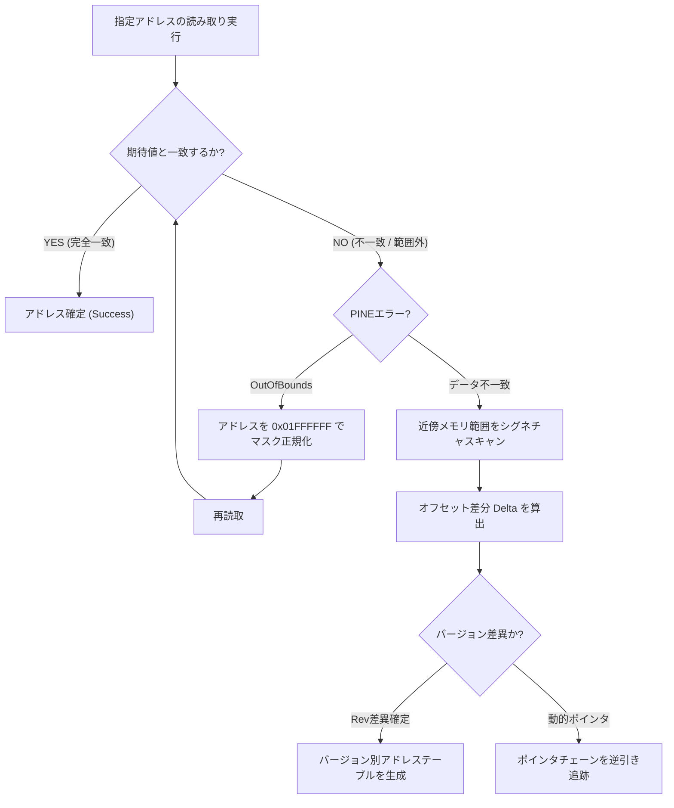

<!-- PERMANENT_BUILD_RULES_SINGLE_FILE_START -->

# 追加最優先命令：PowerShell記述方式と単一ファイル発行

## 1. PowerShellのヒア文字列を全面禁止

今後、ユーザーに提示するPowerShellコードでは、ヒア文字列を一切使用しない。

複数行ヒア文字列を使用する記述方式は禁止する。
ファイル編集・ソースコード生成・Markdown生成では、通常の文字列、文字列配列、文字列連結、StringBuilderなどを使用する。
PowerShellの入力待ち状態（>>）を発生させないよう、コードは必ず構文が完結した状態で一括提示する。

この命令は過去資料にヒア文字列を使用した記録があっても優先する。

## 2. 発行物は必ず単一EXEファイルに統合

最終的な配布物は、複数のDLLや依存ファイルを並べる形式ではなく、すべてを統合した単一のEXEファイルとする。

最終ファイル名：
`トルネコいじりネクスト.exe`

発行先：
`C:\Users\penelope\Desktop\トルネコいじりネクスト`

400個以上のファイルなど、多数のファイルを別々に出力する方式は禁止する。

原則として以下の発行設定を使用する。
- PublishSingleFile=true
- SelfContained=true
- RuntimeIdentifier=win-x64
- IncludeNativeLibrariesForSelfExtract=true
- IncludeAllContentForSelfExtract=true
- DebugType=None
- DebugSymbols=false

発行時は、必要なランタイム・依存ライブラリ・アプリケーションコンテンツを単一EXEに含める。
Trimによる機能欠落や既存機能の破壊を避けるため、PublishTrimmedは有効にしない。

## 3. 単一ファイル発行の検証

発行後は必ず以下を確認する。
1. `トルネコいじりネクスト.exe` が存在すること。
2. EXEのファイルサイズが0バイトではないこと。
3. 発行先フォルダに不要なDLL・JSON・PDBなどが残っていないこと。
4. 最終的に発行先フォルダに残すファイルは `トルネコいじりネクスト.exe` のみとすること。
5. 単一EXEとして起動できることを実際に確認すること。

発行先の古いファイルは、新しい発行が成功し、最終EXEの存在とサイズを確認した後に整理する。
発行失敗時に既存の正常なEXEを失わないようにする。

単一ファイル化によって既存機能や旧版BIN互換性を損なってはならない。

## 4. 優先順位

この追加命令は、過去資料に記載された複数ファイル発行方式やヒア文字列を使用する手順より優先する。

<!-- PERMANENT_BUILD_RULES_SINGLE_FILE_END -->

# トルネコいじり Next 開発引継ぎ

<!-- CHATGPT_CURRENT_STATUS_START -->

# 最優先：現在有効な開発命令・開発状況
最終更新：2026-11-14

このセクションを現在の正式な開発指示とする。後半の過去資料・旧指示と矛盾する場合は、このセクションを優先する。

## 1. 開発環境の絶対固定

- ワークスペース：`C:\Users\penelope\Desktop\トルネコいじり作業環境`
- C#プロジェクト：`C:\Users\penelope\Desktop\トルネコいじり作業環境\TornekoIjiriPort`
- メインソース：`C:\Users\penelope\Desktop\トルネコいじり作業環境\TornekoIjiriPort\Program.cs`
- プロジェクトファイル：`C:\Users\penelope\Desktop\トルネコいじり作業環境\TornekoIjiriPort\TornekoIjiriPort.csproj`
- ビルド・発行先：`C:\Users\penelope\Desktop\トルネコいじりネクスト`

上記以外の開発フォルダを勝手に作成・使用しない。`TornekoIjiriNext_GitHubUpload`、`TornekoIjiriNext_review` などの旧パスは現在の開発場所として使用しない。

## 2. PowerShellコードの絶対ルール

- ヒア文字列を一切使用しない。`@' ... '@` と `@" ... "@` を含む複数行ヒア文字列は禁止。
- PowerShellコードは通常の文字列、文字列配列、文字列連結、StringBuilder等で構成する。
- 必ず構文が完結したコードを `& { ... }` 形式などで一括提示し、入力待ちの `>>` を発生させない。
- ファイル編集前にバックアップを作成し、対象パス・置換対象を検証する。
- 途中の細かな確認を繰り返さず、可能な作業をまとめて実装し、最後に一括ビルド・検証する。

## 3. ビルド・発行・最終成果物

- 最終EXE名は必ず `トルネコいじりネクスト.exe`。
- 発行先は `C:\Users\penelope\Desktop\トルネコいじりネクスト`。
- 400個以上の依存ファイルを別々に並べる発行は禁止。ランタイム・依存ライブラリを含めた単一EXEとして発行する。
- 原則として `PublishSingleFile=true`、`SelfContained=true`、`RuntimeIdentifier=win-x64` を使用する。
- 必要に応じて `IncludeNativeLibrariesForSelfExtract=true` と `IncludeAllContentForSelfExtract=true` を指定する。
- `DebugType=None`、`DebugSymbols=false` を指定し、`PublishTrimmed` は有効にしない。
- 発行後はEXEの存在・サイズ・起動を確認し、発行先フォルダには最終的に当該EXEだけを残す。
- 新しい発行と検証が成功する前に、既存の正常なEXEを削除しない。
- 単一ファイル化で既存機能や旧版BIN互換性を壊さない。

## 4. PCSX2接続

- 対象は**PCSX2 v2.8.2**。他バージョンへの対応は必須ではない。
- メインメニューの「PCSX2に接続」を押したら、そのまま接続処理を行う。不要なアドレス検索ウィンドウを表示しない。
- EEmem基準のアドレス解決を使用する。固定アドレスを無条件に読み取らない。
- メモリ読み取り失敗は正確なアドレス・要求サイズ・実読取サイズ・Win32エラーを表示し、失敗データをゼロ埋めして正常扱いしない。
- エラーダイアログは全文をドラッグ選択・コピーできるようにする。Ctrl+A/Ctrl+Cと右クリックコピーを提供する。

## 5. BIN互換性

- Nextで編集・保存したBINを旧版トルネコいじりで正常に扱える互換性を最優先で維持する。
- BINの形式・読み書き処理を不用意に変更しない。読み取り失敗をゼロ埋めして保存しない。
- BIN編集とオンラインメモリ編集、Next独自プロジェクト形式を混同しない。

## 6. オンラインメモリ編集の安全条件

- 未検証アドレスへのゲームメモリ書き込みは禁止。
- UI側のフラグだけで許可せず、サービス側でもアドレス・幅・範囲を検証する。
- 書き込み許可は検証済みアドレスに限定し、書き込み後は読み戻し確認を行う。
- 読み取り差分だけでHP・攻撃力・所持金等の意味を断定しない。

## 7. GitHub運用

- リポジトリ：`https://github.com/penelopecasinodaemon-ai/TornekoIjiriNext`
- ローカルの正式な開発対象は上記固定パス。GitHub上の内容をローカルの最新状態と決めつけない。
- ユーザーが明示的に依頼した場合に限り、GitHubへの更新・commit・push・アップロードを行う。
- GitHub更新時は既存の技術資料を不用意に削除せず、現行指示と矛盾する古い命令だけを現行状態から切り離す。

## 8. 作業・検証方針

- 変更前にバックアップを作成する。
- 可能な限り複数の変更をまとめて実装し、Releaseビルド・検証を一括で行う。
- ビルド成功、EXE起動、PCSX2接続、ゲーム実機動作を区別して報告する。
- 実際に確認していない内容を成功・実装済みと断言しない。
- エラー全文をユーザーが選択・コピーできる形で提示する。

## 9. 2026-11-14時点の開発状況

- 作業環境・プロジェクト・Program.csの固定パスは上記のとおり。
- PCSX2 v2.8.2接続UIは、接続ボタンから直接接続する方針に整理済み。接続・全読み取り工程の実機成功は個別に確認する。
- EEmem基準のメモリアドレス解決を導入する修正を進めた。実際のPCSX2 v2.8.2上での読み取り結果を確認してから成功範囲を記録する。
- 直近のRelease発行では151,552 bytesのEXEと70,144 bytesのDLLを確認した。これは今回追加された単一EXE発行ルールを満たした証明ではない。
- 今後の発行では単一EXE化を適用し、発行先にEXE以外が残らないことと起動を確認する。
- ユーザーから画面・操作感について「やっと想定通りの感じになりました」と評価された。これをPCSX2の全機能が実機検証済みという意味に拡大解釈しない。

<!-- CHATGPT_CURRENT_STATUS_END -->

<!-- CURRENT_STATUS_BEGIN -->

## 旧現行状態セクション：アーカイブ扱い

このセクションの旧パス、旧ビルド方式、GitHub参照専用などの命令は、現在の有効な命令ではない。
現行の開発場所・発行方法・GitHub運用・安全条件は、ファイル冒頭の `CHATGPT_CURRENT_STATUS` および `PERMANENT_BUILD_RULES_SINGLE_FILE` を参照すること。
このセクション以下に残る技術資料・実装履歴・調査記録は削除せず、過去の記録として保持する。
古い技術情報を再利用する場合は、現在の `Program.cs` と実装を照合してから採用する。

<!-- CURRENT_STATUS_END -->

最終更新：2026-11-14

## 最重要：開発場所
正式な開発対象：
C:\Users\penelope\Desktop\TornekoIjiriNext_GitHubUpload

GitHub：
https://github.com/penelopecasinodaemon-ai/TornekoIjiriNext

GitHubは参照専用。編集・コミット・プッシュは禁止。
旧フォルダ C:\Users\penelope\Desktop\TornekoIjiriNext_review は編集しない。

## 開発方針
ユーザーの希望：
「とりあえず確認作業は一旦無しにして下さい。全て作ってからデバッグします」

- 細かな確認を何度も要求しない。
- 予定機能をまとめて実装する。
- まとまってから全体をデバッグする。
- PowerShellでローカルファイルを変更する。
- 変更前にバックアップを作る。
- 未実装機能を実装済みと報告しない。
- ビルド成功と実機動作確認を区別する。
- ZIPやソース一式の再添付を要求しない。GitHubの公開ソースを参照できる。

## 実装済み機能
- アイテムカテゴリ出現率編集
- 個別アイテム出現率編集
- モンスター出現テーブル編集
- モンスター能力値編集
- モンスター成長データ編集
- フロアデータ編集
- 固定部屋データ編集
- 汎用バイナリエディタ
- プロジェクト作成・読み込み
- プロジェクト内ファイル履歴
- BYTE・DWORD差分比較
- PINEスナップショット閲覧・保存・取り込み

## 旧版互換性
ユーザー実機確認済み：
Nextで編集・保存したBINを旧版で正常に扱えた。

この互換性を維持する。
旧版用BINとNext独自プロジェクト形式を混同しない。
JSON形式などNextの機能を一律に制限しない。
元ファイルを不用意に上書きしない。

## PINE接続
対象：
- PCSX2 v2.8.2
- ゲームID SLPM-62199
- CRC e199f75d
- ゲームバージョン 1.04

ユーザー確認済み：
- PINE接続時に16領域×64バイトを自動取得
- 合計1024バイト
- 読み取り専用キャッシュへの保存成功
- 全領域BIN一括保存成功

関連ソース：
- MainForm.cs
- PineSessionSnapshotCache.cs
- PineSnapshotViewerForm.cs
- ProjectBundleModel.cs
- ProjectBundleHistoryForm.cs
- ProjectCaptureModel.cs
- ProjectCaptureCompareForm.cs

## メモリ解析の注意
現在のゲームメモリ構造は未確定。
旧HSP版のアドレスやレコード構造を現行版にそのまま適用しない。
旧版の6バイト出現テーブルと24バイトMonsterStatusを混同しない。
0x00139D00 / 0x20139D00 は名前テーブルの基準として使わない。
0x00180020 のDWORD群も意味は未確定。
推測だけでモンスター一覧などを実装しない。
複数のゲーム状態で取得・比較してから構造を判断する。

## 次の開発目標
最優先はPINE読み取り専用診断機能の強化。

1. 複数ゲーム状態のキャプチャ保存・比較
2. BYTE・WORD・DWORD単位の表示
3. ゲーム情報・取得日時・接続世代・ステータスの記録
4. キャプチャ時の場面や状況の記録
5. 候補アドレスと周辺データの検証
6. モンスター・フロア・アイテム関連構造の解析
7. 構造が実証できたものから専用画面へ発展

既存の比較画面などを確認し、機能を重複実装しない。

## 禁止事項
- GitHubを変更しない。
- 旧作業フォルダを変更しない。
- 未検証のメモリアドレスへ書き込まない。
- 未確認の構造を確定事項として扱わない。
- ユーザーが削除を希望したテンポ改善パッチ機能を再追加しない。
- BIN互換性を壊さない。

## 新しいチャットでの指示
このファイルを読んで開発方針と進捗を引き継ぐこと。
同じ確認を繰り返さず、PINE読み取り専用診断機能の強化から開発を続けること。

## 2026-11-14 オンライン編集安全制限・Releaseビルド進捗

### 今回の作業目的

オンライン編集機能について、画面側のフラグだけで任意のメモリアドレスへ書き込める状態を防止するため、サービス側にも書き込み許可判定を設けた。

現時点ではゲームメモリの各アドレスの意味・用途が十分に検証されていないため、書き込み許可アドレスは0件とする。推測によるアドレス登録は禁止。

### 1. PineOnlineEditService.cs

変更内容：

- `IsWriteTargetVerified(uint address, int length)` を追加。
- 現時点では許可済みアドレスが存在しないため、全件 `false` を返す。
- 許可するデータ幅はBYTE/WORD/DWORD（1/2/4バイト）のみを想定。
- アドレス範囲のオーバーフローも確認する。
- `TryWriteBytes` 内で `IsWriteTargetVerified` を確認し、未検証の場合は書き込み前に拒否する。
- 拒否時はエラーメッセージを返す。
- 読み取り機能は引き続き利用できる設計。
- 実際の書き込み許可アドレスは0件。

バックアップ：

`PineOnlineEditService.cs.20261114_031504.bak`

### 2. PineOnlineNumericEditor.cs

変更内容：

- コンストラクターで受け取った `addressVerified` だけを信用しないように変更。
- サービス側の `IsWriteTargetVerified(address, widthBytes)` も確認する。
- UI側で編集可能に見せるだけの設定では、書き込みを許可しない。
- 未検証アドレスは編集不可になる。

バックアップ：

`PineOnlineNumericEditor.cs.20261114_031602.bak`

### 3. PineOnlineEditWorkspaceForm.cs

変更内容：

- 検証済み項目数の集計にサービス側の判定を追加。
- `AddressVerified` がtrueであっても、サービス側で許可されていなければ検証済みとして数えない。
- UIの表示とサービス側の実際の書き込み許可状態を一致させる。

バックアップ：

`PineOnlineEditWorkspaceForm.cs.20261114_031602.bak`

### 4. Releaseビルド結果

実行日時：2026-11-14 03:16頃

実行コマンド：

`dotnet build TornekoIjiriNext.csproj -c Release`

結果：

- Releaseビルド成功
- 警告0件
- エラー0件
- 終了コード0
- 出力先：`bin\Release\net8.0-windows\TornekoIjiriNext.dll`

ビルドログ：

`Build_OnlineSafety_20261114_031602.log`

今回の変更3ファイルを含むReleaseビルドが成功した。

ただし、これはコンパイル確認であり、PCSX2との実機接続・メモリ読み取り・オンライン編集画面の実動作確認はまだ行っていない。

### 5. 現在のオンライン編集機能の状態

実装済み：

- PINE接続を既存のMainForm接続と共有するオンライン編集サービス。
- 接続状態・ゲーム情報を確認する仕組み。
- BYTE/WORD/DWORDの数値編集コントロール。
- 数値変更時に即時書き込みを試みる仕組み。
- 書き込み後の読み戻し確認。
- 編集項目のグループ表示。
- 編集項目の追加・削除。
- 編集プロファイルの保存・読み込み。
- キャプチャJSONから編集項目候補を作成する機能。
- サービス側の書き込み許可判定。
- 未検証アドレスへの書き込み拒否。

重要な制限：

- 現時点で書き込み許可アドレスは0件。
- すべてのオンライン書き込みは拒否される。
- プロファイルに保存された `AddressVerified` を信用してはいけない。
- 読み取りで差分が確認できただけでは、そのアドレスの用途を確定してはいけない。
- HP、攻撃力、所持金、アイテム情報などと推測で決めつけない。
- アドレスの意味とデータ幅を検証してから、サービス側の許可リストに追加する。

### 6. 今後の開発方針・優先事項

1. オンライン編集画面の接続状態表示を整える。
2. PCSX2未接続・ゲーム未起動時に編集できないことを確認する。
3. オンライン読み取り機能の動作を確認する。
4. 書き込み拒否時のエラー表示を確認する。
5. ゲーム状態を変えながら複数回キャプチャし、BYTE/WORD/DWORDの差分を調べる。
6. 候補アドレスの意味・用途・データ幅を検証する。
7. 検証済みのアドレスだけをサービス側の許可リストへ追加する。
8. 実際のゲーム上で即時反映と読み戻し確認を行う。

### 7. 維持すべき既存仕様

- 編集操作はすべてマウスで行う。キーボードショートカットは不要。
- 数値変更後は即時反映方式とする。「適用」ボタン方式にはしない。
- BIN編集とオンラインメモリ編集は別機能として維持する。
- BINの読み込み・編集・名前を付けて保存・上書き機能を維持する。
- Nextで保存したBINを旧トルネコいじりで正常に扱える互換性を維持する。
- GitHubはREAD-ONLY。ローカルで開発し、GitHubへのアップロードはユーザー自身が行う。
- 正式な開発対象は `TornekoIjiriNext_GitHubUpload`。
- `TornekoIjiriNext_review` は指定がない限り編集しない。
- 実装を機能ごとに細切れにせず、可能な限りまとめて実装してから一括ビルド・検証する。
- 実機確認していない機能を動作確認済みと扱わない。


# 統合資料アーカイブ

この章以降は、旧Markdown資料を統合した原文保存領域です。
各資料の記述は統合時点の原文を保持しています。
古い仕様・実装状況は現在の実装状態を保証するものではありません。


---

## 統合資料: ANALYSIS.md

<!-- SOURCE_FILE: ANALYSIS.md -->

元ファイルサイズ: 64213 bytes

以下は統合時点の原文です。

# トルネコ3用メモリエディタ「トルネコいじり」ソースコード構造調査レポート (ANALYSIS.md)

## 概要
- **対象ソースコード**: `tr3_ijiri/start.hsp` (全8,232行)
- **形式**: HSP2 / HSP3 用スクリプト（deHSP による逆コンパイルコード）
- **対象エミュレータ/ゲーム**: PCSX2 上で動作する PS2版『ドラゴンクエスト・キャラクターズ トルネコの大冒険3 不思議のダンジョン』
- **調査方針**: コード全体の要約や推測による補完を排除し、ラベル・参照関係・Win32 API・メモリ読み書き・機能範囲を厳密に行番号ベースで整理。

---

## 1. ラベル一覧および関数・モジュール一覧

### 1.1 モジュール関数 (`#deffunc` / `#defcfunc`) 一覧
| 行番号 | 種別 | 関数名 | 引数定義 | 役割・概要 |
|---|---|---|---|---|
| 92 | `#deffunc` | `getstamp` | `array prm_7, str prm_8, int prm_9` | ファイルのタイムスタンプ取得（FindFirstFileA, FileTimeToLocalFileTime, FileTimeToSystemTime） |
| 142 | `#deffunc` | `get_all_exe_file_name` | `var prm_59` | 実行中プロセスのPIDとモジュール名一覧取得（CreateToolhelp32Snapshot, Process32First/Next） |
| 175 | `#deffunc` | `get_all_heap_add_size` | `int, var prm_61, int prm_62` | 全ヒープのアドレスおよびサイズ取得（Heap32ListFirst/Next, Heap32First/Next） |
| 231 | `#deffunc` | `get_all_heap_add` | `int, var prm_64, int prm_65` | 全ヒープのアドレス取得 |
| 267 | `#deffunc` | `get_choice_heap_add_size` | `int, var prm_67, int prm_68, int prm_69` | 指定IDヒープのアドレスおよびサイズ取得 |
| 329 | `#defcfunc` | `bsearch` | `int prm_74, int prm_75, int prm_76, var prm_77, int prm_78` | マシン語バイナリパターン検索関数（VirtualProtectで実行権限付与、callfunc呼出） |
| 346 | `#deffunc` | `transform16_10` | `var prm_79, str prm_80` | 16進文字列から10進数値への変換 |
| 374 | `#deffunc` | `dll_getfunc` | `var prm_81, str prm_82, int prm_83` | DLLから指定関数ポインタを取得（GetProcAddress） |
| 387 | `#deffunc` | `_init_llmod` | なし | llmod互換ライブラリ初期化（LoadLibraryAでkernel32/user32/shell32/comctl32/comdlg32/gdi32読込） |
| 410 | `#deffunc` | `dllproc` | `str prm_84, array prm_85, int prm_86, int prm_87` | DLL関数の動的呼び出し（GetProcAddress + callfunc） |
| 430 | `#deffunc` | `getmjrdll` | `var prm_88, int prm_89` | ロード済み主要DLLハンドル取得 |
| 433 | `#deffunc` | `getmjrfunc` | `var prm_90, int prm_91` | ロード済み主要API関数ポインタ取得 |
| 436 | `#deffunc` | `_get_active_window` | `var prm_92` | アクティブウィンドウハンドル取得 |
| 439 | `#deffunc` | `setwndlong` | `var prm_93, int prm_94` | GetWindowLongA / SetWindowLongA 呼び出し |
| 451 | `#deffunc` | `_null_sep_str` | `var prm_95, int prm_96` | 文字列内の指定区切り文字をヌル文字(0)に置換 |
| 463 | `#deffunc` | `_makewnd` | `array prm_97, str prm_98` | winobj による汎用ウィンドウコントロール生成 |
| 468 | `#deffunc` | `_is_wnd` | `int prm_99` | IsWindow 判定 |
| 472 | `#deffunc` | `_hspobjhandle` | `int prm_100` | HSPオブジェクトのHWND取得 |
| 475 | `#deffunc` | `_hspobjid` | `int prm_101` | HWNDからHSPオブジェクトIDを逆引き |
| 484 | `#deffunc` | `charupper` | `var prm_102` | CharUpperA 呼び出し |
| 488 | `#deffunc` | `charlower` | `var prm_103` | CharLowerA 呼び出し |
| 495 | `#deffunc` | `trackbox` | `int prm_104, int prm_105, int prm_106` | トラックバーコントロール(msctls_trackbar32)生成 |
| 506 | `#deffunc` | `sel_trackbox` | `int prm_107` | 操作対象トラックバーの選択 |
| 510 | `#deffunc` | `trackpos` | `int prm_108, int prm_109` | トラックバー位置の取得/設定 (TBM_GETPOS / TBM_SETPOS) |
| 522 | `#deffunc` | `trackrng` | `int prm_110, int prm_111, int prm_112` | トラックバー範囲の取得/設定 (TBM_SETRANGEMIN / MAX) |
| 539 | `#deffunc` | `trackmrk` | `int prm_113, int prm_114, int prm_115` | トラックバー目盛り設定 (TBM_SETTIC) |
| 561 | `#deffunc` | `tracksel` | `int prm_116, int prm_117, int prm_118` | トラックバー選択範囲設定 (TBM_SETSEL) |
| 601 | `#deffunc` | `keybd_event` | `int prm_119, int prm_120, int prm_121` | keybd_event 呼び出しによるキー入力シミュレート |
| 626 | `#deffunc` | `mouse_event` | `int prm_122, int prm_123, int prm_124, int prm_125` | mouse_event 呼び出しによるマウス操作シミュレート |
| 641 | `#deffunc` | `opnsavedlg` | `var prm_128, str prm_129, str prm_130, int prm_131, int prm_132` | コモンダイアログ（ファイルを開く/保存: GetOpenFileNameA/GetSaveFileNameA） |
| 732 | `#defcfunc` | `sub` | `str prm_133, str prm_134, str prm_135` | 部分文字列置換関数（初出1箇所） |
| 747 | `#defcfunc` | `gsub` | `str prm_136, str prm_137, str prm_138` | 全文字列置換関数（全体） |
| 762 | `#deffunc` | `imgm_opengdiplus` | なし | GdiplusStartup |
| 769 | `#deffunc` | `imgm_closegdiplus` | なし | GdiplusShutdown |
| 775 | `#deffunc` | `imgm_createstream` | `int prm_239` | CreateStreamOnHGlobal |
| 786 | `#deffunc` | `imgm_releasestream` | なし | ReleaseStgMedium |
| 792 | `#defcfunc` | `imgf_getformat` | `str prm_240` | 画像ファイルフォーマット判別 (BMP/JPEG/PNG等) |
| 813 | `#deffunc` | `imgf_getpicsize` | `str prm_241, var prm_242, var prm_243` | 画像サイズ取得 |
| 861 | `#deffunc` | `imgf_picloadex` | `str prm_244, int prm_245, int prm_246, int prm_247` | GDI+による画像ロード・描画 |
| 941 | `#deffunc` | `imgf_jpgsave` | `str prm_248, int prm_249` | JPEG保存 |
| 951 | `#deffunc` | `imgp_calcfitsize` | `var prm_250, var prm_251, int prm_252, int prm_253, int prm_254, int prm_255` | 縦横比保持リサイズ計算 |
| 977 | `#deffunc` | `imgp_gzoom` | `int prm_256, int prm_257, int prm_258, int prm_259, int prm_260, int prm_261, int prm_262` | GDI+による拡大縮小描画 |
| 994 | `#deffunc` | `imgp_rotateflip` | `int prm_263, int prm_264, int prm_265, int prm_266, int prm_267, int prm_268` | 画像回転・反転 |
| 1014 | `#deffunc` | `imgp_memsave` | `var prm_269, int prm_270, int prm_271, int prm_272, int prm_273, int prm_274` | メモリ上への画像エンコード保存 |
| 1065 | `#deffunc` | `imgm_filterlight` | `int prm_275, int prm_276, int prm_277, int prm_278` | 輝度フィルタ |
| 1096 | `#deffunc` | `imgp_filterbrush` | `int prm_279, int prm_280, int prm_281` | ブラシ描画フィルタ |
| 1112 | `#deffunc` | `imgp_gcopysubabs` | `int prm_282, int prm_283, int prm_284, int prm_285, int prm_286` | 差分コピー |
| 1159 | `#deffunc` | `imgp_grotate` | `int prm_287, int prm_288, int prm_289, double prm_290, int prm_291, int prm_292` | GDI+任意角度回転描画 |
| 1185 | `#deffunc` | `imgp_paircopy` | `int prm_293, int prm_294, int prm_295, int prm_296, int prm_297, int prm_298, int prm_299, int prm_300, int prm_301, int prm_302` | ペア画像転送 |
| 1201 | `#deffunc` | `imgp_loopcopy` | `int prm_303, int prm_304, int prm_305, int prm_306, int prm_307, int prm_308, int prm_309, int prm_310, int prm_311` | タイル状ループコピー |
| 1267 | `#deffunc` | `imgp_exchange` | `int prm_312, int prm_313, int prm_314, int prm_315, int prm_316` | 矩形領域入れ替え |
| 1302 | `#deffunc` | `urlpost` | `str prm_337, var prm_338, str prm_339, str prm_340, str prm_341, str prm_342` | hspsockを用いたHTTP POSTリクエスト送信 |
| 1436 | `#defcfunc` | `urldecode` | `str prm_343, local prm_344, local prm_345, local prm_346, local prm_347, local prm_348` | URLデコード (%XX 変換) |
| 1453 | `#defcfunc` | `urlencode` | `str prm_349, local prm_350, local prm_351, local prm_352, local prm_353, local prm_354` | URLエンコード (Shift_JISバイト列の%XX化) |
| 1481 | `#deffunc` | `conv_sjis2euc` | `var prm_355, var prm_356` | Shift_JIS から EUC-JP への文字コード変換 |
| 1510 | `#deffunc` | `conv_euc2sjis` | `var prm_357, var prm_358` | EUC-JP から Shift_JIS への文字コード変換 |
| 7671 | `#deffunc` | `han2zen` | `var prm_367` | 半角カタカナから全角ひらがなへの置換 |
| 7680 | `#deffunc` | `heikinwari` | `array prm_368, int prm_369, int prm_370` | 配列要素の非ゼロ項目を平均配分（均割機能） |
| 7698 | `#deffunc` | `hurinaosi` | `array prm_371, int prm_372, int prm_373` | 合計が指定値(999)になるよう非ゼロ項目に端数を再配分（残全振機能） |
| 7741 | `#deffunc` | `sikaku` | `int prm_374, int prm_375, int prm_376, int prm_377` | 矩形枠線描画 (line × 4) |
| 7808 | `#deffunc` | `rm_init` | なし | クライアント座標計算用オフセット初期化 |
| 7812 | `#defcfunc` | `rmousex` | なし | クライアント相対マウスX座標取得 |
| 7814 | `#defcfunc` | `rmousey` | なし | クライアント相対マウスY座標取得 |

---

### 1.2 全ラベル (`*label_xxx`) 一覧
| ラベル名 | 定義行 | 役割・処理概要 |
|---|---|---|
| `*label_001` | 140 | モジュール定義スキップ用ラベル（`goto *label_006`） |
| `*label_006` | 327 | モジュール定義スキップ用ラベル（`goto *label_008`） |
| `*label_008` | 344 | モジュール定義スキップ用ラベル（`goto *label_010`） |
| `*label_010` | 371 | モジュール定義スキップ用ラベル（`goto *label_025`） |
| `*label_025` | 492 | 初期化実行（`_init_llmod`呼出後、`goto *label_032`） |
| `*label_032` | 599 | モジュール定義スキップ用ラベル（`goto *label_035`） |
| `*label_035` | 639 | モジュール定義スキップ用ラベル（`goto *label_037`） |
| `*label_037` | 730 | モジュール定義スキップ用ラベル（`goto *label_039`） |
| `*label_039` | 745 | モジュール定義スキップ用ラベル（`goto *label_041`） |
| `*label_041` | 760 | モジュール定義スキップ用ラベル（`goto *label_061`） |
| `*label_061` | 1300 | モジュール定義スキップ用ラベル（`goto *label_066`） |
| `*label_063` | 1372 | `urlpost` 内のソケット受信ポーリングループ |
| `*label_064` | 1415 | `urlpost` 内の受信完了・ソケット切断・ファイル保存処理 |
| `*label_065` | 1422 | `urlpost` 内のエラー終了処理 |
| `*label_066` | 1434 | モジュール定義スキップ用ラベル（`goto *label_069`） |
| `*label_069` | 1479 | モジュール定義スキップ用ラベル（`goto *label_072`） |
| `*label_072` | 1543 | **メインプログラム開始点**: タイトル設定、PCSX2プロセス検出、OpenProcess、ベースアドレス検索実行 |
| `*label_073` | 1618 | **ベースアドレス確定後のメイン初期化**: ゲームポインタ解決、アドレスオフセット計算、画面0 (メインUI) コントロール構築 |
| `*label_074` | 2358 | **メインウィンドウ (screen 0) メッセージ・イベントループ**: トラックバー、入力ボックス、各ボタン変更検出とメモリ書き込み |
| `*label_075` | 3623 | フロア階数ダウンボタン「▲」押下時処理 |
| `*label_076` | 3632 | フロア階数アップボタン「▼」押下時処理 |
| `*label_077` | 3641 | アイテム出現階の重複チェック処理サブルーチン |
| `*label_078` | 3758 | モンスター出現階の重複チェック処理サブルーチン |
| `*label_079` | 3855 | 指定ダンジョンのモンスター出現テーブルアドレス読み出し |
| `*label_080` | 3876 | アイテム出現テーブルアドレス一覧（1000件分）読み出し |
| `*label_081` | 3891 | 画面中央ヘッダ（床落/店/変化/モノカ/壁、階数、シナリオ/エクストラ）表示更新 |
| `*label_082` | 3964 | アイテム大分類（14カテゴリ）の出現率メモリ読み出し |
| `*label_083` | 3979 | アイテム大分類リストボックス文字列生成・表示更新 |
| `*label_084` | 4067 | アイテム小分類（アイテム個別）の出現率メモリ読み出し・リストボックス文字列生成 |
| `*label_085` | 4178 | アイテム出現率の合計・999からの超過/不足（over表示）更新 |
| `*label_086` | 4209 | モンスター出現テーブル読み出し（出現率、レベル、モンスターID） |
| `*label_087` | 4248 | モンスター情報表示更新（`gosub *label_088`, `gosub *label_089`） |
| `*label_088` | 4252 | モンスター出現リストボックス更新およびHP/攻撃/防御/経験値計算・描画 |
| `*label_089` | 4348 | モンスター出現率over表示更新および選択中モンスターの能力・特技設定読み出し |
| `*label_090` | 4562 | 罠出現率（20種）のメモリ読み出し |
| `*label_091` | 4579 | 罠出現率リストボックス更新およびover表示更新 |
| `*label_092` | 4634 | 「アイテム読出」ボタン処理（外部binからアイテム階段データ読み出し・メモリ展開） |
| `*label_093` | 4707 | トラックバーの範囲（最小〜最大階数）再設定サブルーチン |
| `*label_094` | 4727 | 「コピー」ボタン処理（選択中種別の出現率データをメモリからバッファへコピー） |
| `*label_095` | 4749 | 「貼付」ボタン処理（バッファの出現率データをメモリへ書き込み） |
| `*label_096` | 4767 | 「クリア」ボタン処理（選択中種別の出現率を0クリア、モンスターは初期配置セット） |
| `*label_097` | 4857 | 「均割」ボタン処理（出現率を非ゼロ項目間で均等配分） |
| `*label_098` | 4903 | 「残全振」ボタン処理（出現率の合計を999に合わせる再配分を行いメモリ書き込み） |
| `*label_099` | 5000 | ダンジョンフロア構造体内の各テーブル（部屋数、店率、モンスターハウス率等）アドレスオフセット計算 |
| `*label_100` | 5030 | メモリシグネチャ検索（bsearch）によるPCSX2内ベースアドレス特定サブルーチン |
| `*label_101` | 5092 | VirtualQueryEx によるPCSX2プロセスの有効メモリリージョン列挙サブルーチン |
| `*label_102` | 5129 | 手動ベースアドレス入力ダイアログ（screen 2）の入力完了ボタン処理 |
| `*label_103` | 5135 | `oncmd gosub *label_103, 273` (WM_COMMAND): 特技/水フロア等のリストボックス選択変更ハンドラ |
| `*label_104` | 5196 | WM_COMMAND ハンドラ復帰 |
| `*label_105` | 5199 | テンポ改善設定ウィンドウ（screen 5）の非表示化処理 |
| `*label_106` | 5204 | ダンジョン共通事項編集ウィンドウ（screen 4）の非表示化処理 |
| `*label_107` | 5209 | テンポパッチ設定のメモリ読み出し・コントロール反映サブルーチン |
| `*label_108` | 5216 | 各モーションフレーム数（ポポロ/トルネコ）のReadProcessMemory |
| `*label_109` | 5256 | テンポ設定入力ボックスへの値反映 |
| `*label_110` | 5283 | 「テンポ改善パッチ」ボタン押下時処理（screen 5 表示切替・イベント開始） |
| `*label_111` | 5291 | **テンポ改善パッチ設定ウィンドウ (screen 5) イベントループ**: モーション速度書き込み |
| `*label_112` | 5386 | 最速モーション値（素手、攻撃、アイテム拾い等）のプリセット変数セット |
| `*label_113` | 5411 | 壷入れ等その他アニメーション最速化パッチのメモリ書き込み |
| `*label_114` | 5613 | 「全部 最速設定」ボタン処理 |
| `*label_115` | 5618 | 「設定 SAVE」ボタン処理 |
| `*label_116` | 5621 | 「設定 LOAD」ボタン処理 |
| `*label_117` | 5627 | テンポ改善パッチ設定ウィンドウ（screen 5）構築サブルーチン |
| `*label_118` | 5763 | ダンジョン共通事項編集ウィンドウ（screen 4）構築サブルーチン |
| `*label_119` | 5884 | ダンジョンロゴデータ（VRAM）の読み出し・プレビュー描画 |
| `*label_120` | 5907 | メニュー用・ランク用ダンジョン名文字列のReadProcessMemory |
| `*label_121` | 5930 | **ダンジョン共通事項編集ウィンドウ (screen 4) イベントループ**: 風ターン数、識別率、野良+値、ロゴ画像書き換え |
| `*label_122` | 6155 | **定期監視・パッチ維持サブルーチン**: 旅仲間固定、冒険結果ターン数表示、フェイ問モード維持、敵最速モーション書き換えトリガ |
| `*label_123` | 6329 | 敵モーションテーブル検索・書き換えサブルーチン（敵最速設定） |
| `*label_124` | 6390 | ゲーム内アイテム値段・未識別名（草・壷・指輪）の解説テキスト書き換えサブルーチン |
| `*label_125` | 6413 | ゲーム内アドレスへの文字列WriteProcessMemoryヘルパー |
| `*label_126` | 6419 | ダンジョン一覧リストボックス（Scenario/Extra表記付き）構築サブルーチン |
| `*label_127` | 6435 | 固定部屋エディタウィンドウ（screen 1）構築サブルーチン |
| `*label_128` | 6540 | 固定部屋エディタウィンドウ非表示・メイン画面復帰 |
| `*label_129` | 6555 | **固定部屋エディタウィンドウ (screen 1) イベントループ**: マップタイル描画、タイルパレット、オブジェクト配置 |
| `*label_130` | 6883` | `oncmd gosub *label_130, 276` (WM_HSCROLL): 固定部屋番号トラックバー変更通知ハンドラ |
| `*label_131` | 6898 | WM_HSCROLL ハンドラ復帰 |
| `*label_132` | 6900 | 固定部屋データサイズテーブルの計算・初期化サブルーチン |
| `*label_133` | 6918 | 固定部屋内配置オブジェクト（敵・アイテム・罠等）リストの読み出し・更新 |
| `*label_134` | 7013 | 固定部屋マップタイルのランレングス展開・画面描画サブルーチン |
| `*label_135` | 7132 | 固定部屋タイルパレット描画サブルーチン |
| `*label_136` | 7154 | 起動時パッチ適用・テンポ設定復元サブルーチン |
| `*label_137` | 7221 | モンスター種族名（全角/半角）テーブルの読み出し・ゲーム内ポインタ付け替え |
| `*label_138` | 7285 | 「番付」ボタン処理（したらば掲示板スレッドをブラウザで開く） |
| `*label_139` | 7288 | 「番付登録」ボタン処理（冒険結果・ステータス・アイテム・履歴をHTTP POST送信） |
| `*label_140` | 7503 | **ゲーム内定数・マスターデータ初期化**: ダンジョン名一覧、モンスター一覧、アイテム一覧、BGM一覧、レベル成長テーブルポインタ |
| `*label_145` | 7747 | モンスター名五十音ソート処理サブルーチン |
| `*label_146` | 7748 | ソート処理ラベル |
| `*label_150` | 7817 | 内部停止ラベル (`stop`) |
| `*label_151` | 7818 | 「開く」ボタン処理（メモリダンプbinファイルの選択ダイアログ） |
| `*label_152` | 7832 | メモリダンプbinファイルの読み込み実行部 |
| `*label_153` | 7858 | 読み込んだbinデータをPCSX2メモリへ順次WriteProcessMemoryで復元 |
| `*label_154` | 7940 | 「保存」ボタン処理（メモリデータbinファイルの新規保存ダイアログ） |
| `*label_155` | 7948 | 現在のゲームメモリを読み出してbinファイル形式にパックして保存 |
| `*label_156` | 8055 | 「上書」ボタン処理（現在読み込み中のbinファイルに上書き保存） |
| `*label_157` | 8062 | `tr3_ijiri.ini` 設定読み込み（テンポ設定メニュー内手動ロード時） |
| `*label_158` | 8118 | `tr3_ijiri.ini` 設定読み込み（アプリケーション起動時初期化） |
| `*label_159` | 8180 | `tr3_ijiri.ini` 設定保存サブルーチン |
| `*label_160` | 8212 | **終了処理 (`onexit`)**: ゲーム内テキスト復元、設定保存、プロセスハンドル解放、`end` |

---

## 2. gosub、goto の参照関係

### 2.1 `gosub` 呼び出し関係
| 呼出元行 | 命令 | ジャンプ先 | 呼出元コンテキスト | 処理内容 |
|---|---|---|---|---|
| 1550 | `gosub` | `*label_158` | `*label_072` (起動時) | 初期設定ファイル `tr3_ijiri.ini` の読み込み |
| 1575 | `gosub` | `*label_101` | `*label_072` (起動時) | VirtualQueryEx によるPCSX2メモリ領域の列挙 |
| 1588 | `gosub` | `*label_100` | `*label_072` (起動時) | メモリシグネチャ検索によるベースアドレス特定 |
| 1714 | `gosub` | `*label_140` | `*label_073` (メイン初期化) | ダンジョン・モンスター・アイテム定数データの初期化 |
| 1784 | `gosub` | `*label_118` | `*label_073` (UI構築) | ダンジョン共通事項ウィンドウ (screen 4) 生成 |
| 1785 | `gosub` | `*label_117` | `*label_073` (UI構築) | テンポ改善パッチウィンドウ (screen 5) 生成 |
| 1786 | `gosub` | `*label_127` | `*label_073` (UI構築) | 固定部屋エディタウィンドウ (screen 1) 生成 |
| 2300 | `button gosub` | `*label_139` | `*label_073` (UI構築) | 「番付登録」ボタン押下時 |
| 2304 | `button gosub` | `*label_138` | `*label_073` (UI構築) | 「番付」ボタン押下時 |
| 2340 | `gosub` | `*label_136` | `*label_073` (UI構築) | 起動時パッチ適用・テンポ設定復元 |
| 2351 | `oncmd gosub` | `*label_103, 273` | `*label_073` (UI構築) | WM_COMMAND (コントロール通知) ハンドラ登録 |
| 2406 | `gosub` | `*label_084` | `*label_074` (メインループ) | 階数変更時アイテム詳細読み出し |
| 2526 | `gosub` | `*label_099` | `*label_074` (メインループ) | ダンジョン切替時構造体オフセット再計算 |
| 2527 | `gosub` | `*label_080` | `*label_074` (メインループ) | アイテムテーブルアドレス一覧読み出し |
| 2528 | `gosub` | `*label_079` | `*label_074` (メインループ) | モンスター出現テーブルアドレス読み出し |
| 2532 | `gosub` | `*label_093` | `*label_074` (メインループ) | トラックバー最大値設定 |
| 2570 | `gosub` | `*label_090` | `*label_074` (メインループ) | 罠出現率読み出し |
| 2571 | `gosub` | `*label_091` | `*label_074` (メインループ) | 罠出現率リスト更新 |
| 2676 | `gosub` | `*label_081` | `*label_074` (メインループ) | ヘッダ文字列表示更新 |
| 2683 | `gosub` | `*label_078` | `*label_074` (メインループ) | モンスター出現階重複チェック |
| 2684 | `gosub` | `*label_077` | `*label_074` (メインループ) | アイテム出現階重複チェック |
| 2735 | `gosub` | `*label_081` | `*label_074` (メインループ) | ヘッダ文字列表示更新 |
| 2736 | `gosub` | `*label_077` | `*label_074` (メインループ) | アイテム出現階重複チェック |
| 2828 | `gosub` | `*label_090` | `*label_074` (メインループ) | 罠出現率読み出し |
| 2829 | `gosub` | `*label_091` | `*label_074` (メインループ) | 罠出現率リスト更新 |
| 2859 | `gosub` | `*label_082` | `*label_074` (メインループ) | アイテム大分類出現率読み出し |
| 2860 | `gosub` | `*label_083` | `*label_074` (メインループ) | アイテム大分類リスト更新 |
| 2865 | `gosub` | `*label_084` | `*label_074` (メインループ) | アイテム詳細出現率読み出し |
| 2916 | `gosub` | `*label_084` | `*label_074` (メインループ) | アイテム詳細出現率読み出し |
| 2964 | `gosub` | `*label_086` | `*label_074` (メインループ) | モンスター出現データ読み出し |
| 2965 | `gosub` | `*label_087` | `*label_074` (メインループ) | モンスター情報表示更新 |
| 3037 | `gosub` | `*label_086` | `*label_074` (メインループ) | モンスター出現データ読み出し |
| 3038 | `gosub` | `*label_087` | `*label_074` (メインループ) | モンスター情報表示更新 |
| 3069 | `gosub` | `*label_082` | `*label_074` (メインループ) | アイテム大分類出現率読み出し |
| 3070 | `gosub` | `*label_083` | `*label_074` (メインループ) | アイテム大分類リスト更新 |
| 3124 | `gosub` | `*label_084` | `*label_074` (メインループ) | アイテム詳細出現率読み出し |
| 3129 | `gosub` | `*label_085` | `*label_074` (メインループ) | アイテム出現率over表示更新 |
| 3139 | `gosub` | `*label_084` | `*label_074` (メインループ) | アイテム詳細出現率読み出し |
| 3154 | `gosub` | `*label_086` | `*label_074` (メインループ) | モンスター出現データ読み出し |
| 3155 | `gosub` | `*label_087` | `*label_074` (メインループ) | モンスター情報表示更新 |
| 3201 | `gosub` | `*label_087` | `*label_074` (メインループ) | モンスター情報表示更新 |
| 3236 | `gosub` | `*label_086` | `*label_074` (メインループ) | モンスター出現データ読み出し |
| 3237 | `gosub` | `*label_087` | `*label_074` (メインループ) | モンスター情報表示更新 |
| 3258 | `gosub` | `*label_077` | `*label_074` (メインループ) | アイテム出現階重複チェック |
| 3327 | `gosub` | `*label_077` | `*label_074` (メインループ) | アイテム出現階重複チェック |
| 3331 | `gosub` | `*label_077` | `*label_074` (メインループ) | アイテム出現階重複チェック |
| 3335 | `gosub` | `*label_077` | `*label_074` (メインループ) | アイテム出現階重複チェック |
| 3339 | `gosub` | `*label_077` | `*label_074` (メインループ) | アイテム出現階重複チェック |
| 3348 | `gosub` | `*label_079` | `*label_074` (メインループ) | モンスター出現テーブル読み出し |
| 3349 | `gosub` | `*label_078` | `*label_074` (メインループ) | モンスター出現階重複チェック |
| 3398 | `gosub` | `*label_086` | `*label_074` (メインループ) | モンスター出現データ読み出し |
| 3399 | `gosub` | `*label_088` | `*label_074` (メインループ) | モンスターリスト更新 |
| 3403 | `gosub` | `*label_086` | `*label_074` (メインループ) | モンスター出現データ読み出し |
| 3404 | `gosub` | `*label_088` | `*label_074` (メインループ) | モンスターリスト更新 |
| 3408 | `gosub` | `*label_086` | `*label_074` (メインループ) | モンスター出現データ読み出し |
| 3409 | `gosub` | `*label_088` | `*label_074` (メインループ) | モンスターリスト更新 |
| 3413 | `gosub` | `*label_086` | `*label_074` (メインループ) | モンスター出現データ読み出し |
| 3414 | `gosub` | `*label_088` | `*label_074` (メインループ) | モンスターリスト更新 |
| 3418 | `gosub` | `*label_086` | `*label_074` (メインループ) | モンスター出現データ読み出し |
| 3419 | `gosub` | `*label_088` | `*label_074` (メインループ) | モンスターリスト更新 |
| 3423 | `gosub` | `*label_087` | `*label_074` (メインループ) | モンスター情報表示更新 |
| 3473 | `gosub` | `*label_093` | `*label_074` (メインループ) | トラックバー範囲再設定 |
| 3509 | `gosub` | `*label_122` | `*label_074` (メインループ) | 定期監視・パッチ維持処理 |
| 4249 | `gosub` | `*label_088` | `*label_087` | モンスターリスト更新 |
| 4250 | `gosub` | `*label_089` | `*label_087` | モンスター能力・over表示更新 |
| 4349 | `gosub` | `*label_137` | `*label_089` | モンスター種族名テーブル更新 |
| 4872 | `gosub` | `*label_084` | `*label_097` (均割) | アイテム詳細出現率読み出し |
| 4969 | `gosub` | `*label_084` | `*label_098` (残全振) | アイテム詳細出現率読み出し |
| 4970 | `gosub` | `*label_085` | `*label_098` (残全振) | アイテム出現率over表示更新 |
| 5213 | `gosub` | `*label_108` | `*label_107` | テンポパッチ値ReadProcessMemory |
| 5214 | `gosub` | `*label_109` | `*label_107` | テンポパッチ値UIコントロール反映 |
| 5290 | `gosub` | `*label_107` | `*label_110` (テンポボタン) | テンポパッチ設定読み出し |
| 5356 | `gosub` | `*label_113` | `*label_111` (テンポループ) | 壷入れ等その他最速設定書き込み |
| 5357 | `gosub` | `*label_157` | `*label_111` (テンポループ) | 設定ファイルロード |
| 5359 | `gosub` | `*label_109` | `*label_111` (テンポループ) | コントロール反映 |
| 5362 | `gosub` | `*label_122` | `*label_111` (テンポループ) | 定期監視処理 |
| 5614 | `gosub` | `*label_112` | `*label_114` (最速設定) | 最速値セット |
| 5615 | `gosub` | `*label_109` | `*label_114` (最速設定) | コントロール反映 |
| 5619 | `gosub` | `*label_159` | `*label_115` (設定SAVE) | 設定ファイル保存 |
| 5622 | `gosub` | `*label_112` | `*label_116` (設定LOAD) | 最速値セット |
| 5623 | `gosub` | `*label_157` | `*label_116` (設定LOAD) | 設定ファイルロード |
| 5624 | `gosub` | `*label_109` | `*label_116` (設定LOAD) | コントロール反映 |
| 5646 | `button gosub` | `*label_116` | `*label_117` (テンポUI) | 「設定 LOAD」ボタン |
| 5648 | `button gosub` | `*label_115` | `*label_117` (テンポUI) | 「設定 SAVE」ボタン |
| 5650 | `button gosub` | `*label_114` | `*label_117` (テンポUI) | 「全部 最速設定」ボタン |
| 5826 | `gosub` | `*label_119` | `*label_118` (共通事項UI) | ロゴ描画 |
| 5937 | `gosub` | `*label_119` | `*label_121` (共通事項) | ロゴ描画 |
| 5938 | `gosub` | `*label_120` | `*label_121` (共通事項) | ダンジョン名読み出し |
| 5954 | `gosub` | `*label_126` | `*label_121` (共通事項) | ダンジョン一覧生成 |
| 5961 | `gosub` | `*label_124` | `*label_121` (共通事項) | アイテム解説テキスト書き換え |
| 6077 | `gosub` | `*label_119` | `*label_121` (共通事項ループ) | ロゴ描画 |
| 6125 | `gosub` | `*label_122` | `*label_121` (共通事項ループ) | 定期監視処理 |
| 6323 | `gosub` | `*label_123` | `*label_122` (定期監視) | 敵モーション書き換え実行 |
| 6393 | `gosub` | `*label_125` | `*label_124` | 文字列WriteProcessMemory |
| 6396 | `gosub` | `*label_125` | `*label_124` | 文字列WriteProcessMemory |
| 6400 | `gosub` | `*label_125` | `*label_124` | 文字列WriteProcessMemory |
| 6402 | `gosub` | `*label_125` | `*label_124` | 文字列WriteProcessMemory |
| 6405 | `gosub` | `*label_125` | `*label_124` | 文字列WriteProcessMemory |
| 6408 | `gosub` | `*label_125` | `*label_124` | 文字列WriteProcessMemory |
| 6411 | `gosub` | `*label_125` | `*label_124` | 文字列WriteProcessMemory |
| 6443 | `gosub` | `*label_132` | `*label_127` (固定部屋UI) | 固定部屋サイズ初期化 |
| 6515 | `gosub` | `*label_133` | `*label_127` (固定部屋UI) | 固定部屋オブジェクト読み出し |
| 6519 | `gosub` | `*label_134` | `*label_127` (固定部屋UI) | 固定部屋マップ描画 |
| 6536 | `gosub` | `*label_135` | `*label_127` (固定部屋UI) | タイルパレット描画 |
| 6537 | `oncmd gosub` | `*label_130, 276` | `*label_127` (固定部屋UI) | WM_HSCROLL ハンドラ登録 |
| 6569 | `gosub` | `*label_134` | `*label_129` (固定部屋ループ) | 固定部屋マップ描画 |
| 6602 | `gosub` | `*label_134` | `*label_129` (固定部屋ループ) | 固定部屋マップ描画 |
| 6719 | `gosub` | `*label_134` | `*label_129` (固定部屋ループ) | 固定部屋マップ描画 |
| 6737 | `gosub` | `*label_135` | `*label_129` (固定部屋ループ) | タイルパレット描画 |
| 6798 | `gosub` | `*label_133` | `*label_129` (固定部屋ループ) | 固定部屋オブジェクト読み出し |
| 6802 | `gosub` | `*label_133` | `*label_129` (固定部屋ループ) | 固定部屋オブジェクト読み出し |
| 6806 | `gosub` | `*label_133` | `*label_129` (固定部屋ループ) | 固定部屋オブジェクト読み出し |
| 6810 | `gosub` | `*label_133` | `*label_129` (固定部屋ループ) | 固定部屋オブジェクト読み出し |
| 6814 | `gosub` | `*label_133` | `*label_129` (固定部屋ループ) | 固定部屋オブジェクト読み出し |
| 6818 | `gosub` | `*label_133` | `*label_129` (固定部屋ループ) | 固定部屋オブジェクト読み出し |
| 6826 | `gosub` | `*label_133` | `*label_129` (固定部屋ループ) | 固定部屋オブジェクト読み出し |
| 6831 | `gosub` | `*label_133` | `*label_129` (固定部屋ループ) | 固定部屋オブジェクト読み出し |
| 6835 | `gosub` | `*label_133` | `*label_129` (固定部屋ループ) | 固定部屋オブジェクト読み出し |
| 6846 | `gosub` | `*label_134` | `*label_129` (固定部屋ループ) | マップ再描画 |
| 6858 | `gosub` | `*label_134` | `*label_129` (固定部屋ループ) | マップ再描画 |
| 6895 | `gosub` | `*label_134` | `*label_130` (WM_HSCROLL) | マップ再描画 |
| 7155 | `gosub` | `*label_126` | `*label_136` | ダンジョン一覧生成 |
| 7194 | `gosub` | `*label_113` | `*label_136` | その他最速設定パッチ適用 |
| 7218 | `gosub` | `*label_124` | `*label_136` | アイテム解説テキスト書き換え |
| 7524 | `gosub` | `*label_145` | `*label_140` | モンスター名五十音ソート |
| 7838 | `gosub` | `*label_153` | `*label_152` (bin読込) | メモリ初期化データ展開 |
| 7848 | `gosub` | `*label_153` | `*label_152` (bin読込) | 読み込んだbinデータ展開 |
| 7852 | `gosub` | `*label_136` | `*label_152` (bin読込) | 起動時パッチ再適用 |
| 7855 | `gosub` | `*label_124` | `*label_152` (bin読込) | アイテム解説テキスト書き換え |
| 8215 | `gosub` | `*label_125` | `*label_160` (終了時) | ゲーム内テキスト復元 |
| 8218 | `gosub` | `*label_125` | `*label_160` (終了時) | ゲーム内テキスト復元 |
| 8221 | `gosub` | `*label_125` | `*label_160` (終了時) | ゲーム内テキスト復元 |
| 8223 | `gosub` | `*label_159` | `*label_160` (終了時) | 設定ファイル保存 |

### 2.2 `goto` / `button goto` / `onexit` 呼び出し関係
| 呼出元行 | 命令 | ジャンプ先 | 呼出元コンテキスト | 処理内容 |
|---|---|---|---|---|
| 91 | `goto` | `*label_001` | ヘッダ | モジュール関数をスキップ |
| 141 | `goto` | `*label_006` | `*label_001` | モジュール関数をスキップ |
| 328 | `goto` | `*label_008` | `*label_006` | モジュール関数をスキップ |
| 345 | `goto` | `*label_010` | `*label_008` | モジュール関数をスキップ |
| 373 | `goto` | `*label_025` | `*label_010` | モジュール関数をスキップ |
| 494 | `goto` | `*label_032` | `*label_025` | モジュール関数をスキップ |
| 600 | `goto` | `*label_035` | `*label_032` | モジュール関数をスキップ |
| 640 | `goto` | `*label_037` | `*label_035` | モジュール関数をスキップ |
| 731 | `goto` | `*label_039` | `*label_037` | モジュール関数をスキップ |
| 746 | `goto` | `*label_041` | `*label_039` | モジュール関数をスキップ |
| 761 | `goto` | `*label_061` | `*label_041` | モジュール関数をスキップ |
| 1301 | `goto` | `*label_066` | `*label_061` | モジュール関数をスキップ |
| 1335 | `goto` | `*label_065` | `urlpost` | ソケットオープン失敗時エラー処理へ |
| 1385 | `goto` | `*label_064` | `urlpost` | タイムアウト時終了処理へ |
| 1402 | `goto` | `*label_063` | `urlpost` | 再受信ウェイトループ |
| 1409 | `goto` | `*label_064` | `urlpost` | 受信バッファオーバー時終了処理へ |
| 1414 | `goto` | `*label_063` | `urlpost` | 受信継続ループ |
| 1435 | `goto` | `*label_069` | `*label_066` | モジュール関数をスキップ |
| 1480 | `goto` | `*label_072` | `*label_069` | メインプログラム先頭へジャンプ |
| 1549 | `onexit` | `*label_160` | `*label_072` | アプリケーション終了イベントハンドラ登録 |
| 1607 | `button` | `*label_102` | `*label_072` (画面2) | ベースアドレス入力画面「入力終了」ボタン |
| 2264 | `button` | `*label_075` | `*label_073` (画面0) | 階数変更「▲」ボタン |
| 2266 | `button` | `*label_076` | `*label_073` (画面0) | 階数変更「▼」ボタン |
| 2274 | `button` | `*label_121` | `*label_073` (画面0) | 「ﾀﾞﾝｼﾞｮﾝ」ボタン |
| 2283 | `button` | `*label_094` | `*label_073` (画面0) | 「コピー」ボタン |
| 2286 | `button` | `*label_095` | `*label_073` (画面0) | 「貼付」ボタン |
| 2289 | `button` | `*label_096` | `*label_073` (画面0) | 「クﾘｱ」ボタン |
| 2293 | `button` | `*label_098` | `*label_073` (画面0) | 「残全振」ボタン |
| 2296 | `button` | `*label_097` | `*label_073` (画面0) | 「均割」ボタン |
| 2317 | `button` | `*label_151` | `*label_073` (画面0) | 「開く」ボタン |
| 2319 | `button` | `*label_154` | `*label_073` (画面0) | 「保存」ボタン |
| 2321 | `button` | `*label_156` | `*label_073` (画面0) | 「上書」ボタン |
| 2325 | `button` | `*label_092` | `*label_073` (画面0) | 「ｱｲﾃﾑ読出」ボタン |
| 2328 | `button` | `*label_110` | `*label_073` (画面0) | 「テンポ改善パッチ」ボタン |
| 2337 | `button` | `*label_129` | `*label_073` (画面0) | 「定部屋」ボタン |
| 2354 | `goto` | `*label_152` | `*label_073` (起動時) | 起動時既定binのロード処理へ |
| 3631 | `goto` | `*label_074` | `*label_075` | 階数変更後メインループへ戻る |
| 3640 | `goto` | `*label_074` | `*label_076` | 階数変更後メインループへ戻る |
| 4646 | `goto` | `*label_074` | `*label_092` | キャンセル時メインループへ戻る |
| 4667 | `goto` | `*label_074` | `*label_092` | 完了後メインループへ戻る |
| 4676 | `goto` | `*label_074` | `*label_092` | キャンセル時メインループへ戻る |
| 4706 | `goto` | `*label_074` | `*label_092` | 完了後メインループへ戻る |
| 4748 | `goto` | `*label_074` | `*label_094` | コピー後メインループへ戻る |
| 4762 | `goto` | `*label_074` | `*label_095` | キャンセル時メインループへ戻る |
| 4766 | `goto` | `*label_074` | `*label_095` | 貼付後メインループへ戻る |
| 4773 | `goto` | `*label_074` | `*label_096` | キャンセル時メインループへ戻る |
| 4854 | `goto` | `*label_098` | `*label_096` | アイテム右クリア後残全振ルーチンへ |
| 4856 | `goto` | `*label_074` | `*label_096` | クリア後メインループへ戻る |
| 4864 | `goto` | `*label_074` | `*label_097` | キャンセル時メインループへ戻る |
| 4868 | `goto` | `*label_098` | `*label_097` | 罠均割後残全振ルーチンへ |
| 4874 | `goto` | `*label_098` | `*label_097` | アイテム左均割後残全振ルーチンへ |
| 4887 | `goto` | `*label_098` | `*label_097` | アイテム右均割後残全振ルーチンへ |
| 4900 | `goto` | `*label_098` | `*label_097` | モンスター均割後残全振ルーチンへ |
| 4902 | `goto` | `*label_074` | `*label_097` | メインループへ戻る |
| 4999 | `goto` | `*label_074` | `*label_098` | 残全振完了後メインループへ戻る |
| 5134 | `goto` | `*label_073` | `*label_102` | 手動ベースアドレス入力完了後メイン初期化へ |
| 5156 | `goto` | `*label_104` | `*label_103` | WM_COMMAND 処理後復帰ラベルへ |
| 5175 | `goto` | `*label_104` | `*label_103` | WM_COMMAND 処理後復帰ラベルへ |
| 5194 | `goto` | `*label_104` | `*label_103` | WM_COMMAND 処理後復帰ラベルへ |
| 5203 | `goto` | `*label_074` | `*label_105` | テンポウィンドウ非表示後メインループへ |
| 5208 | `goto` | `*label_074` | `*label_106` | ダンジョンウィンドウ非表示後メインループへ |
| 5286 | `goto` | `*label_105` | `*label_110` | テンポパッチウィンドウを閉じる処理へ |
| 5616 | `goto` | `*label_111` | `*label_114` | テンポイベントループへ戻る |
| 5625 | `goto` | `*label_111` | `*label_116` | テンポイベントループへ戻る |
| 5644 | `button` | `*label_105` | `*label_117` (画面5) | テンポウィンドウ「切替」ボタン |
| 5779 | `button` | `*label_106` | `*label_118` (画面4) | ダンジョン共通ウィンドウ「切替」ボタン |
| 5933 | `goto` | `*label_106` | `*label_121` | ダンジョン共通ウィンドウを閉じる処理へ |
| 6514 | `button` | `*label_128` | `*label_127` (画面1) | 固定部屋ウィンドウ「切替」ボタン |
| 6546 | `goto` | `*label_074` | `*label_128` | 固定部屋非表示後メインループへ戻る |
| 6558 | `goto` | `*label_128` | `*label_129` | 固定部屋ウィンドウを閉じる処理へ |
| 6896 | `goto` | `*label_131` | `*label_130` | WM_HSCROLL 処理後復帰ラベルへ |
| 7670 | `goto` | `*label_146` | モジュールスキップ | モジュール関数スキップ |
| 7807 | `goto` | `*label_150` | モジュールスキップ | モジュール関数スキップ |
| 7829 | `goto` | `*label_074` | `*label_151` | キャンセル時メインループへ戻る |
| 7857 | `goto` | `*label_074` | `*label_152` | binロード完了後メインループへ戻る |
| 7944 | `goto` | `*label_074` | `*label_154` | キャンセル時メインループへ戻る |
| 8054 | `goto` | `*label_074` | `*label_155` | bin保存完了後メインループへ戻る |
| 8058 | `goto` | `*label_074` | `*label_156` | キャンセル時メインループへ戻る |
| 8061 | `goto` | `*label_155` | `*label_156` | 確認後bin保存処理へ |

---

## 3. Windows API の宣言と呼び出し箇所

### 3.1 宣言一覧 (`#uselib`, `#func`, `#cfunc`)
| DLL名 | 関数名 | 宣言行 | 呼び出し形式 | 引数定義 |
|---|---|---|---|---|
| `kernel32.dll` | `FindFirstFileA` | 2 | `#cfunc` | `var, var` |
| `kernel32.dll` | `FindClose` | 3 | `#func` | `int` |
| `kernel32.dll` | `FileTimeToLocalFileTime` | 4 | `#func` | `var, var` |
| `kernel32.dll` | `FileTimeToSystemTime` | 5 | `#func` | `var, var` |
| `kernel32.dll` | `VirtualProtect` | 6 | `#func` | `var, int, int, var` |
| `KERNEL32.DLL` | `CloseHandle` | 9 | `#func` | `sptr` |
| `KERNEL32.DLL` | `CreateToolhelp32Snapshot` | 10 | `#func` | `sptr, sptr` |
| `KERNEL32.DLL` | `GetProcAddress` | 11 | `#func` | `sptr, sptr` |
| `KERNEL32.DLL` | `GlobalAlloc` | 12 | `#func` | `sptr, sptr` |
| `KERNEL32.DLL` | `GlobalFree` | 13 | `#func` | `sptr` |
| `KERNEL32.DLL` | `GlobalLock` | 14 | `#func` | `sptr` |
| `KERNEL32.DLL` | `GlobalSize` | 15 | `#func` | `sptr` |
| `KERNEL32.DLL` | `GlobalUnlock` | 16 | `#func` | `sptr` |
| `KERNEL32.DLL` | `Heap32First` | 17 | `#func` | `sptr, sptr, sptr` |
| `KERNEL32.DLL` | `Heap32ListFirst` | 18 | `#func` | `sptr, sptr` |
| `KERNEL32.DLL` | `Heap32ListNext` | 19 | `#func` | `sptr, sptr` |
| `KERNEL32.DLL` | `Heap32Next` | 20 | `#func` | `sptr` |
| `KERNEL32.DLL` | `LoadLibraryA` | 21 | `#func` | `sptr` |
| `KERNEL32.DLL` | `OpenProcess` | 22 | `#func` | `sptr, sptr, sptr` |
| `KERNEL32.DLL` | `Process32First` | 23 | `#func` | `sptr, sptr` |
| `KERNEL32.DLL` | `Process32Next` | 24 | `#func` | `sptr, sptr` |
| `KERNEL32.DLL` | `ReadProcessMemory` | 25 | `#func` | `sptr, sptr, sptr, sptr, sptr` |
| `KERNEL32.DLL` | `VirtualQueryEx` | 26 | `#func` | `sptr, sptr, sptr, sptr` |
| `KERNEL32.DLL` | `WriteProcessMemory` | 27 | `#func` | `sptr, sptr, sptr, sptr, sptr` |
| `psapi.dll` | `EnumProcessModules` | 30 | `#func` | `int, sptr, int, sptr` |
| `psapi.dll` | `GetModuleFileNameExA` | 31 | `#func` | `int, int, sptr, int` |
| `comdlg32.dll` | `GetOpenFileNameA` | 34 | `#cfunc` | `var` |
| `comdlg32.dll` | `GetSaveFileNameA` | 35 | `#cfunc` | `var` |
| `gdiplus` | `GdiplusStartup` | 38 | `#func` | `var, var, nullptr` |
| `gdiplus` | `GdiplusShutdown` | 39 | `#func` | `int` |
| `gdiplus` | `GdipLoadImageFromStream` | 40 | `#func` | `int, var` |
| `gdiplus` | `GdipSaveImageToFile` | 41 | `#func` | `int, wstr, var, var` |
| `gdiplus` | `GdipSaveImageToStream` | 42 | `#func` | `int, int, var, var` |
| `gdiplus` | `GdipCreateBitmapFromGdiDib` | 43 | `#func` | `int, int, var` |
| `gdiplus` | `GdipCloneBitmapAreaI` | 44 | `#func` | `int, int, int, int, int, int, var` |
| `gdiplus` | `GdipGetImageWidth` | 45 | `#func` | `int, var` |
| `gdiplus` | `GdipGetImageHeight` | 46 | `#func` | `int, var` |
| `gdiplus` | `GdipImageRotateFlip` | 47 | `#func` | `int, int` |
| `gdiplus` | `GdipDisposeImage` | 48 | `#func` | `int` |
| `gdiplus` | `GdipCreateImageAttributes` | 49 | `#func` | `var` |
| `gdiplus` | `GdipDisposeImageAttributes` | 50 | `#func` | `int` |
| `gdiplus` | `GdipSetImageAttributesColorMatrix` | 51 | `#func` | `int, int, int, var, nullptr, nullptr` |
| `gdiplus` | `GdipCreateMatrix` | 52 | `#func` | `var` |
| `gdiplus` | `GdipDeleteMatrix` | 53 | `#func` | `int` |
| `gdiplus` | `GdipTranslateMatrix` | 54 | `#func` | `int, float, float, int` |
| `gdiplus` | `GdipRotateMatrix` | 55 | `#func` | `int, float, int` |
| `gdiplus` | `GdipCreateFromHDC` | 56 | `#func` | `int, var` |
| `gdiplus` | `GdipDeleteGraphics` | 57 | `#func` | `int` |
| `gdiplus` | `GdipSetWorldTransform` | 58 | `#func` | `int, int` |
| `gdiplus` | `GdipDrawImageI` | 59 | `#func` | `int, int, int, int` |
| `gdiplus` | `GdipDrawImageRectI` | 60 | `#func` | `int, int, int, int, int, int` |
| `gdiplus` | `GdipDrawImageRectRectI` | 61 | `#func` | `int, int, int, int, int, int, int, int, int, int, int, int, nullptr, nullptr` |
| `Ole32.dll` | `CreateStreamOnHGlobal` | 64 | `#func` | `int, int, var` |
| `Ole32.dll` | `GetHGlobalFromStream` | 65 | `#func` | `int, var` |
| `Ole32.dll` | `ReleaseStgMedium` | 66 | `#func` | `var` |
| `gdi32.dll` | `BitBlt` | 69 | `#func` | `int, int, int, int, int, int, int, int, int` |
| `gdi32.dll` | `SelectObject` | 70 | `#func` | `int, int` |
| `gdi32.dll` | `CreateCompatibleBitmap` | 71 | `#func` | `int, int, int` |
| `gdi32.dll` | `DeleteObject` | 72 | `#func` | `int` |
| `gdi32.dll` | `CreateCompatibleDC` | 73 | `#func` | `int` |
| `gdi32.dll` | `DeleteDC` | 74 | `#func` | `int` |
| `hspsock.dll` | `sockopen` | 77 | `#func` | `int, str, int, int` |
| `hspsock.dll` | `sockclose` | 78 | `#func` | `int, int, int, int` |
| `hspsock.dll` | `sockput` | 79 | `#func` | `bmscr, str, int, int` |
| `hspsock.dll` | `sockgetb` | 80 | `#func` | `var, int, int, int` |
| `hspsock.dll` | `sockcheck` | 81 | `#func` | `int, int, int, int` |
| `GDI32.DLL` | `GetStockObject` | 84 | `#func` | `sptr` |
| `USER32.DLL` | `SetWindowLongA` | 87 | `#func` | `sptr, sptr, sptr` |
| `USER32.DLL` | `GetWindowLongA` | 88 | `#func` | `sptr, sptr` |
| `USER32.DLL` | `SetParent` | 89 | `#func` | `int, int` |

### 3.2 主要 API の呼び出し箇所と目的
1. **プロセス操作**:
   - `OpenProcess`: 
     - 161行目: `get_all_exe_file_name` 内（各プロセス名取得用、アクセス権 `0x0410`）
     - 1573行目: `*label_072` (PCSX2プロセスアタッチ、アクセス権 `4095` = `PROCESS_ALL_ACCESS`)
   - `CloseHandle`:
     - 169, 173行目: プロセス列挙時のハンドル解放
     - 8225, 8227, 8229, 8231行目: 終了時 (`*label_160`) のPCSX2プロセスハンドル解放
   - `CreateToolhelp32Snapshot`, `Process32First`, `Process32Next`:
     - 144, 155, 171行目: `pcsx2` プロセスの検索
   - `VirtualQueryEx`:
     - 5102行目: PCSX2プロセスのメモリマップを走査し、探索対象のメモリリージョンを抽出
   - `VirtualProtect`:
     - 332行目: マシン語検索バイナリ (`var_27`) を実行可能メモリに変更 (`PAGE_EXECUTE_READWRITE` = 64)

2. **ウィンドウ・UI操作**:
   - `SetWindowLongA`:
     - 入力ボックスを数値専用スタイル (`ES_NUMBER` = 0x2000) に変更（1957, 1959, 1969, 1978, 1987, 1991, 2000, 2006, 2014, 2022, 2029, 2037, 2071, 2128, 2130, 2137, 2139, 2159, 2161, 2170, 2195, 2349, 5792, 6492, 6499, 6506行目）
     - サブウィンドウの枠線スタイル変更（5637, 5773, 6440行目）
   - `SetParent`:
     - サブウィンドウ（screen 1, 4, 5）をメインウィンドウ（screen 0）に埋め込み（5639, 5775, 6442行目）
   - `GetStockObject`:
     - フォントオブジェクト(17 = `DEFAULT_GUI_FONT`)を取得してリストボックスへ適用（2080, 2175, 2185行目）

3. **DLL動的呼び出し (llmod経由)**:
   - `keybd_event`: 2562, 2705, 2780, 2835, 2908, 2939, 2952, 3076, 3131, 3202, 3244, 3475行目でキャレット移動やコントロール更新後のキー入力シミュレーションに使用。

---

## 4. ゲームメモリへの読み書き箇所

トルネコいじりは、PCSX2内のPS2メインメモリ (32MB) 領域を探索・特定し、直接読み書きして動作します。

### 4.1 アドレス解決の仕組み
- **ベースアドレス検索 (`*label_100`, 5030行目)**:
  - PCSX2のメモリ内から特定シグネチャ `item_equipoff\0` (1583行目) 等をマシン語 `bsearch` で検索。
  - 発見した位置から、仮想PS2アドレスとPCSX2プロセス空間アドレスの差分オフセット `var_134` (ベースポインタ) および `var_136` を計算。
  - 失敗した場合は screen 2 (`*label_072`) を開き、ユーザーに手動でアドレス入力を求める。

### 4.2 主要 ReadProcessMemory 呼び出し一覧
| 呼出行番号 | 読込アドレス計算式 | サイズ (bytes) | 読み取り対象データ |
|---|---|---|---|
| 1622 - 1634 | `var_134 + 0, 4, 8, 12, 16` | 4 × 5 | 各種メインデータテーブルへのポインタ群 |
| 1719 | `var_134` | 524,288 (512KB) | 初期メモリ状態のバックアップ (`ps2tr3_org.bin`) |
| 2517, 2520 | `var_144 + ダンジョンID*4`, `*ptr` | 4, 4 | 選択ダンジョンの階数データ |
| 2524 | `var_144 + cnt*4` | 4 | ダンジョンフロアデータベースポインタ |
| 2573 - 2623 | `var_465〜494 + 112*階数` | 1〜2 | 各種出現フラグ（店率、モンハウ率、罠数、初期敵数、視界、地形、呪い率、祝福率など） |
| 3430 - 3436 | `var_622〜626(種族) + Lv*2/4` | 2〜4 | モンスター成長テーブル（HP、攻撃、防御、経験値） |
| 3654, 3685 | `var_461 + 40 + 種別*2 + 112*階数` | 2 | 各階層の出現アイテムテーブルポインタ |
| 3776, 3781 | `var_715 + cnt*4`, `*ptr + cnt*4 + 4` | 4, 4 | 各階層の出現モンスターテーブルポインタ |
| 3864, 3868 | `var_694 + cnt*4`, `*ptr + cnt*4 + 4` | 4, 4 | モンスター出現テーブル一覧 |
| 3886 | `var_694 + cnt*4` | 4 | アイテム出現テーブルアドレス |
| 3968 | `var_515 + cnt*2` | 2 | アイテム大分類出現率 (14項目) |
| 4091 | `var_515 + 30 + アイテムオフセット` | 2 | 個別アイテム出現率 |
| 4227 - 4235 | `var_543 + cnt*6 + 0/2/4` | 2 × 3 | モンスター出現データ (モンスターID、出現率、出現Lv) |
| 4300 - 4308 | `var_149 + モンスターID*24 + 0/2/4/12/20` | 1〜2 | モンスター基礎ステータス (HP, 攻, 防, 経験値, 成長タイプ) |
| 4370 - 4424 | `var_229〜238 + 24*モンスターID` | 1〜2 | モンスター属性、特技、耐性設定 |
| 4455, 4552 | `var_652 + 20*モンスターID` 等 | 4, 可変 | モンスター特技名・種族名文字列 |
| 4564, 4568 | `var_561 + 112*階数`, `var_513 + cnt*2` | 1, 2 | 罠最大数および各罠出現率 (20種) |
| 4658, 4734-4746 | `var_513`, `var_515`, `var_543` 等 | 可変 | アイテム・罠・モンスターデータのコピー用読み出し |
| 5036, 5071 | `var_700` | リージョン長 | メモリシグネチャ検索用ダンプ読み出し |
| 5211, 5219-5253 | `var_200〜216` 等 | 1 | テンポパッチ（ポポロ/トルネコ各モーションフレーム数） |
| 5421, 5483 | `var_869` | 1 | 壷入れ等その他アニメーション待機時間 |
| 5888 | `var_156` | 8,192 (8KB) | ダンジョンロゴVRAMデータ |
| 5910 - 5924 | `var_158, 160, 162` | 10〜11 | ダンジョン名称文字列 |
| 6157 - 6294 | `var_184, 185, 186, 196, 197` 等 | 1〜4 | 現在の進行状況監視（ターン数、現在階層、HP、レベル、所持金） |
| 6335 | `var_700` | 可変 | 敵モーションテーブル検索用ダンプ |
| 6700, 6706 | `var_1049 + 3 + cnt` | 1 | 固定部屋マップタイル・オブジェクトデータ |
| 6906, 6909 | `var_142, var_500` | 4, 4 | 固定部屋データポインタ（サイズ計算用） |
| 6924 - 6943 | `var_700 + cnt*20` | 1〜2 | 固定部屋内オブジェクト構造体 (敵ID, アイテムID, 座標等) |
| 7100, 7106 | `var_1049 + 3 + cnt` | 1 | 固定部屋ランレングス圧縮タイルデータ |
| 7232, 7242 | `var_700`, `var_798` | 可変, 64 | ゲーム内テキストポインタおよび文字列 |
| 7296 - 7415 | `var_187〜195, 198, 199, 971` 等 | 2〜4, 60 | 冒険結果データ（名前、到達階、勝敗、所持アイテム、履歴） |
| 7964 - 8046 | `var_134`, `var_150〜170` 等 | 524,288等 | メモリ保存 (`.bin`) のための全編集対象領域ダンプ |

### 4.3 主要 WriteProcessMemory 呼び出し一覧
| 呼出行番号 | 書込アドレス計算式 | サイズ (bytes) | 書き込み内容・機能 |
|---|---|---|---|
| 2826 | `var_513 + cnt*2 + 112*階数` | 2 | 罠出現率の変更 |
| 3067 | `var_515 + cnt*2` | 2 | アイテム大分類出現率の変更 |
| 3122 | `var_515 + 30 + オフセット` | 2 | アイテム個別出現率の変更 |
| 3153, 3199 | `var_543 + モンスターインデックス*6` | 1, 2 | 出現モンスターIDおよび出現レベルの変更 |
| 3191 | `var_550` | 可変 | モンスター種族名の変更 |
| 3223, 3234 | `var_543 + 2 + cnt*6` | 2 | モンスター出現率の変更 |
| 3250 - 3326 | `var_465〜494 + 112*階数` | 1〜2 | 店率、モンハウ率、罠数、初期敵数、視界、地形、呪い率等の変更 |
| 3347 | `var_585 + 階数*4 + 4` | 4 | フロアのモンスターテーブルポインタ付け替え |
| 3352, 3388 | `var_242, var_250` 等 | 2, 4 | モンスター個別パラメータ変更 |
| 3397 - 3422 | `var_228〜238 + 24*モンスターID` | 1〜2 | モンスターHP、攻撃、防御、経験値、成長タイプの変更 |
| 3442 - 3463 | `var_166, 168, 227, 234〜237` | 1〜2 | モンスター属性、特技確率、行動速度等の変更 |
| 3469 | `var_129` (階数ポインタ) | 4 | ダンジョン最大階数の変更 |
| 3480 - 3507 | `var_640〜653 + 20*モンスターID` | 1〜4 | モンスター姿、逆色フラグ、特技メッセージポインタ等の変更 |
| 4665 | `var_774` | 768 | 「アイテム読出」による全階層アイテムテーブルの展開 |
| 4751 - 4757 | `var_513, var_515, var_543` | 可変 | 「貼付」による罠・アイテム・モンスター出現率の復元 |
| 4780 - 4842 | `var_513, var_515, var_543` | 可変 | 「クリア」による出現率0化およびデフォルト配置書き込み |
| 4909, 4917, 4963, 4993 | `var_513, var_515, var_543` | 2 | 「残全振」による再配分後出現率の書き込み |
| 5301 - 5352 | `var_200〜216` | 1 | テンポ改善パッチ（プレイヤー各種モーションフレーム数） |
| 5448 - 5607 | `var_869` | 1 | テンポ改善パッチ（壷入れ・各種ウェイト短縮） |
| 6031 | `var_152 + ダンジョン*2` | 2 | 風までのターン数設定 |
| 6035, 6040, 6044 | `var_150 + ダンジョン*30` 等 | 2 | 道具識別率、呪い祝意識済フラグ |
| 6055 | `var_929 + cnt*2` | 2 | 野良アイテム+値テーブルの変更 |
| 6076, 6098 | `var_156` | 8,192 | 編集したダンジョンロゴ画像（VRAM）の書き込み |
| 6101 - 6107 | `var_158, 160, 162` | 可変 | ダンジョン名称文字列（メニュー用/ランク用）の書き込み |
| 6123 | `var_164` | 4 | 「敵も罠にかかる」パッチコード書き込み |
| 6159 - 6195 | `var_170〜183` | 2, 4 | 「旅仲間固定」時の仲間初期ステータス維持 |
| 6212 - 6224 | `var_700, var_160, var_162` | 可変 | 冒険結果画面への経過ターン数・タイム文字列書き込み |
| 6235 - 6281 | `var_187〜199` | 2, 4 | 「フェイ問題モード」時の各階初期化（Lv1, 所持品クリア） |
| 6361, 6388 | `var_981, var_700` | 32, 可変 | 「敵最速設定」時の敵モーションデータ一括置換 |
| 6415, 6417 | `var_700` | 可変 | アイテム値段・草/壷/指輪未識別解説テキストの書き換え |
| 6682 - 6708 | `var_1049 + 3 + cnt` | 1 | 固定部屋マップタイルのランレングス圧縮書き込み |
| 6797 - 6834 | `var_1064 + オブジェクト*20` | 1〜2 | 固定部屋内配置オブジェクト（敵・アイテム・罠）のパラメータ変更 |
| 6845, 6857 | `var_1049, var_1049 + 1` | 1 | 固定部屋の幅(X)・高さ(Y)の変更 |
| 7277, 7278 | `var_700, var_799` | 4, 32 | モンスター種族名テーブルのポインタ・文字列置換 |
| 7859 - 7936 | `var_134`, `var_150〜170, 220, 222` | 可変 | メモリファイル (`.bin`) からの全データ一括復元 |
| 8215 - 8221 | 各テキストアドレス | 可変 | 終了時テキスト復元（「今回ﾉ冒険ﾉ結果」等） |

---

## 5. 各機能ブロックの開始位置と終了位置の整理

ソースコード全体の構造を 19 の機能ブロックに分割して整理します。

| ブロック番号 | 行範囲 | 機能ブロック名 | 主な処理内容 |
|---|---|---|---|
| **Block 1** | 1 - 90 | **Windows API 外部宣言部** | kernel32, psapi, comdlg32, gdiplus, ole32, gdi32, hspsock, user32 の `#uselib`, `#func`, `#cfunc` 宣言 |
| **Block 2** | 91 - 1542 | **汎用モジュール関数群** | ファイル日時、プロセス列挙、マシン語bsearch、16進変換、llmod互換API呼出、Trackbar制御、ファイルダイアログ、GDI+画像処理、hspsock HTTP POST通信、EUC/SJIS相互変換 |
| **Block 3** | 1543 - 1617 | **初期化 & プロセスアタッチ** | タイトル設定、`tr3_ijiri.ini` ロード、PCSX2プロセス検索・`OpenProcess`、ベースアドレス検索実行、手動入力画面(screen 2) |
| **Block 4** | 1618 - 1762 | **ベースポインタ解決 & メモリオフセット計算** | 各種テーブル（フロア、罠、アイテム、モンスター、設定フラグ等）の実メモリポインタ計算、定数データ初期化呼び出し |
| **Block 5** | 1763 - 2357 | **メイン画面 (screen 0) UI構築** | トラックバー、各出現率リストボックス、各種パラメータ入力ボックス、操作ボタン類の配置、フォント・ウィンドウスタイル適用 |
| **Block 6** | 2358 - 3622 | **メインイベントループ (screen 0)** | 階数変更、ダンジョン変更、大分類/個別アイテム変更、モンスター変更、罠変更等のUIイベント検知および対応メモリの読み書き |
| **Block 7** | 3623 - 3640 | **階数切替処理 (`*label_075`, `*label_076`)** | ボタン「▲」「▼」による階数加減算とトラックバー連動 |
| **Block 8** | 3641 - 3854 | **重複チェック処理 (`*label_077`, `*label_078`)** | 同一ダンジョン・他フロアにおけるアイテムおよびモンスターの出現重複スキャン・結果表示 |
| **Block 9** | 3855 - 4633 | **メイン画面データ取得・描画サブルーチン群** | アイテム出現率読み出し(`*label_082`, `*label_084`)、モンスター情報・ステータス計算描画(`*label_086`〜`*label_089`)、罠出現率更新(`*label_090`, `*label_091`) |
| **Block 10** | 4634 - 5029 | **データ一括編集補助サブルーチン群** | 「アイテム読出」(`*label_092`)、「コピー」(`*label_094`)、「貼付」(`*label_095`)、「クリア」(`*label_096`)、「均割」(`*label_097`)、「残全振」(`*label_098`)、構造体オフセット定義(`*label_099`) |
| **Block 11** | 5030 - 5134 | **ベースアドレス特定サブルーチン群** | シグネチャ検索(`*label_100`)、VirtualQueryExメモリ探索(`*label_101`)、手動アドレス確定(`*label_102`) |
| **Block 12** | 5135 - 5282 | **メッセージハンドラ & サブ画面切替** | WM_COMMAND通知処理(`*label_103`)、テンポ画面切替(`*label_105`)、ダンジョン画面切替(`*label_106`)、テンポ設定読み出し(`*label_107`〜`*label_109`) |
| **Block 13** | 5283 - 5762 | **テンポ改善パッチ機能 (screen 5)** | テンポ改善画面構築(`*label_117`)、イベントループ(`*label_111`)、最速設定プリセット(`*label_112`)、壷入れ等高速化(`*label_113`)、全最速設定(`*label_114`) |
| **Block 14** | 5763 - 6434 | **ダンジョン共通事項編集機能 (screen 4)** | ウィンドウ構築(`*label_118`)、VRAMロゴ描画(`*label_119`)、ダンジョン名取得(`*label_120`)、風ターン数・識別率・敵罠有効・フェイ問モード編集ループ(`*label_121`)、敵最速モーション書換(`*label_123`)、アイテム未識別解説テキスト書換(`*label_124`, `*label_125`) |
| **Block 15** | 6435 - 7220 | **固定部屋エディタ機能 (screen 1)** | ウィンドウ構築(`*label_127`)、画面非表示(`*label_128`)、エディタループ(`*label_129`)、WM_HSCROLL通知(`*label_130`)、部屋サイズテーブル(`*label_132`)、配置オブジェクト読出(`*label_133`)、ランレングスマップ描画・圧縮書込(`*label_134`)、タイルパレット(`*label_135`) |
| **Block 16** | 7221 - 7284 | **モンスター種族名テーブル置換 (`*label_137`)** | 全モンスター種族名文字列を走査し、全角化および拡張領域へのポインタ付け替えを実行 |
| **Block 17** | 7285 - 7502 | **したらば掲示板「番付登録」機能 (`*label_138`, `*label_139`)** | スレッドURL起動、ゲームメモリから冒険結果（回数、ターン数、得点、名前、階数、死因、Lv、経験値、所持品、履歴）を抽出しEUC-JPに変換してHTTP POST送信 |
| **Block 18** | 7503 - 7816 | **ゲームマスターデータ・定数定義 (`*label_140`〜`*label_150`)** | 全32ダンジョン定義、全モンスター一覧(197体)、全アイテム一覧(354種)、モンスター成長テーブル、BGM一覧(64曲)、ソート関数(`*label_145`)、均割・振直関数 |
| **Block 19** | 7818 - 8232 | **ファイル入出力 & 終了処理** | メモリデータbin読み込み(`*label_151`〜`*label_153`)、bin保存/上書き(`*label_154`〜`*label_156`)、`tr3_ijiri.ini` 読込/保存(`*label_157`〜`*label_159`)、終了処理(`*label_160`) |

---

## 結論と次のステップ
本調査により、`start.hsp` の構造、全ラベルの参照関係、Win32 API依存関係、PCSX2プロセスメモリに対する全読み書き箇所、および各機能ブロックの境界が網羅的に判明しました。

次段階では、ユーザーの指示に基づき、上記で分類した機能ブロック（例: 「ベースアドレス特定・プロセスアタッチ機能」「出現率編集機能」「テンポ改善パッチ機能」「ダンジョン共通・識別率機能」「固定部屋エディタ機能」「番付登録機能」等）ごとに順次詳細な仕様解析および再開発設計を進めます。


<!-- END_SOURCE_FILE: ANALYSIS.md -->


---

## 統合資料: CONNECTION_SAFETY.md

<!-- SOURCE_FILE: CONNECTION_SAFETY.md -->

元ファイルサイズ: 5311 bytes

以下は統合時点の原文です。

# 接続管理・書き込み安全性

更新日: 2026-11-13

## 書き込み許可条件

書き込み許可プロファイルは `SLPM-62199` / CRC `e199f75d` / game version `1.04` とする。IDとgame versionは `StringComparison.Ordinal`、CRCは16進文字列の大文字小文字を許容して比較する。取得値をtrimして許可することはしない。いずれかが異なる、空、または未取得の場合は書き込みを拒否する。別CRC/版は、別途実機検証して許可プロファイルに追加するまでread-onlyとする。

書き込み可能状態は次のすべてが真の場合だけ。

1. `_pine` が存在し、破棄されていない。
2. 初回/直近のゲーム情報取得が成功し、IDが空でない。
3. 取得したID/CRC/game versionが `SLPM-62199` / `e199f75d` / `1.04` の許可プロファイルと一致。
4. PINEの `MsgStatus` がRunning(0)またはPaused(1)。Shutdown(2)は不可。
5. UIの接続状態が `Connected`。

ボタンの `CanWrite` はUI上の早期ガード。実書き込みの唯一の入口 `PineClient.SafeWriteMemory` も必ずPINEのstatus、タイトル/ID/CRC/ゲーム版取得、ID/CRC/版の許可プロファイル一致、statusを再確認する。書き込み前後の全処理はクライアントのlock下で行い、他のアプリ内PINE要求が検査と書き込みに割り込まないようにする。対象IDであっても確認値の変更があれば中止する。

## 書き込みの流れ

1. UI状態とID/CRC/ゲーム版の許可プロファイル一致に基づきボタンを有効化。
2. クリック時にstatusと全ゲーム情報を再取得し、対象ID/CRC/ゲーム版を再確認。
3. 書き込み前の生byte列を読み取る。
4. 最終確認ダイアログにゲームタイトル/ID、status、アドレス、変更前byte列、書込byte列を表示。
5. Yes後、通信層でstatus→ID/CRC/ゲーム版→statusを再確認。
6. 変更前byte列を再取得して確認時の値と一致しなければ中止。
7. MsgWrite8でbyteを書き込む。
8. MsgRead8で同じ範囲を読み戻し、全byteが期待値と一致した場合だけ成功表示。
9. 不一致時は失敗表示と実際の読み戻し値を表示し、成功扱いにしない。

PINEには「IDを条件にしてwriteを原子的に行う」公式コマンドはない。PCSX2/ゲーム状態はアプリ外で変化するため、最後のstatus/ID確認とwriteの間に起きる切替をプロトコルだけでゼロにすることはできない。直前確認、旧値比較、read-backにより窓を小さくし、結果も検証するが、この制約は残る。

## 接続状態

| 画面表示 | 意味 | read | write |
|---|---|---:|---:|
| 未接続 | TCP/PINE接続なし、または切断検知後 | 無効 | 無効 |
| 接続中 | 接続開始中、またはPINE接続済みで対象ゲームID確認済み | 対象確認後のみ | 対象ID確認後のみ |
| ゲーム情報取得中 | メタデータ確認中、またはPCSX2接続中でゲーム未起動。再ポーリング待ち | 無効 | 無効 |
| 対象外ゲーム | 情報取得成功だがID不一致 | 有効 | 無効 |
| 接続エラー | 初回接続/通信/公式コマンド失敗 | 無効 | 無効 |

PINE `MsgStatus` (opcode `0x0F`) を1秒ごとにポーリングする。status=2ならゲーム情報を無効化し、status 0/1時はゲームIDを再取得して接続状態を更新する。PINEコマンドエラーはTCPが維持される場合があるため監視を続け、次回再取得する。EOF/socket切断ではクライアント破棄・ボタン無効化・未接続表示とする。その他のtimeout/protocol I/O errorは接続エラーにしてクライアントを破棄する。再接続はユーザー操作。

使用コマンドは公式実装の `MsgVersion`, `MsgTitle`, `MsgID`, `MsgUUID`, `MsgGameVersion`, `MsgStatus`, `MsgRead8`, `MsgWrite8` のみ。独自opcodeは追加していない。

## PINE仕様の根拠

Windows版PCSX2はloopback TCP serverを使い、既定slotは28011。現コードのdefault `127.0.0.1:28011` と一致する。コマンド/応答frameは全体長LE uint32、成功応答status byte、値/addressはLE。実装は公式ソースの該当箇所と照合した。

- [PCSX2 PINE.cpp](https://github.com/PCSX2/pcsx2/blob/master/pcsx2/PINE.cpp)
- [PCSX2 PINE.h](https://github.com/PCSX2/pcsx2/blob/master/pcsx2/PINE.h)

## 運用上の注意

- アプリ内には一度に一つの `PineClient` を保持し、再接続時に既存clientをdisposeする。PCSX2のPINEは接続clientを逐次acceptするので、他の外部PINEクライアントとの同時利用は保証しない。
- 読み込みと旧候補確認は対象IDに限らず、起動中ゲームで利用可能。書き込みだけを対象IDで制限する。
- `MsgRead8/Write8`を連続発行するのでraw byte範囲は1〜4096 byte。ゲームは読み書き要求間も進むため、読み取りは原子的snapshotではない。
- メモリ書き込みはゲーム/セーブ状態を変える。可能ならPCSX2 savestateまたは別のバックアップを用意して使う。


<!-- END_SOURCE_FILE: CONNECTION_SAFETY.md -->


---

## 統合資料: CORE_ENGINE_ANALYSIS.md

<!-- SOURCE_FILE: CORE_ENGINE_ANALYSIS.md -->

元ファイルサイズ: 35424 bytes

以下は統合時点の原文です。

# トルネコ3用メモリエディタ「トルネコいじり」コアエンジン詳細解析レポート (CORE_ENGINE_ANALYSIS.md)

## 概要
本レポートは、トルネコ3（PS2版）用メモリエディタ「トルネコいじり」の旧版ソースコード（`tr3_ijiri/start.hsp`）におけるコアエンジン部分（プロセス接続、ベースアドレス探索、メモリオフセット定義、ゲームマスターデータ）を精密に解析した詳細仕様書です。

推測による補完を排除し、コード上の行番号と根拠を明記した「確定事項」と、ゲーム挙動・構造体意味論に基づく「論理的推定」を明確に区別して記録します。

---

## 目次
1. 【Block 3】PCSX2接続・アタッチ・ベースアドレス初期化 (L1543-1617)
2. 【Block 11】ベースアドレス探索・VirtualQueryEx・bsearch (L5030-5134)
3. 【Block 4】メモリオフセット全定義とデータ構造 (L1618-1762)
4. 【Block 18】ゲームマスターデータ構造 (L7503-7816)
5. 【重要】旧版メモリアドレスと最新版PCSX2 (PINE) の対応関係
6. コアエンジン再開発に向けた技術要件と推奨仕様

---

## 1. 【Block 3】PCSX2接続・アタッチ・ベースアドレス初期化 (L1543-1617)

### 1.1 処理フローとソースコード対応
```
[L1554] get_all_exe_file_name で全プロセス取得
  ↓
[L1558-1569] "pcsx2" を含むプロセスを走査して PID を特定
  ↓
[L1573] OpenProcess (PROCESS_ALL_ACCESS) でプロセスハンドル取得
  ↓
[L1575] gosub *label_101 (VirtualQueryEx によるメモリ領域列挙)
  ↓
[L1576-1587] 検索シグネチャ (ポインタテーブル / "item_equipoff") のバッファ構築
  ↓
[L1588] gosub *label_100 (マシン語 bsearch によるベースアドレス走査)
  ↓
[L1589-1590] 特定されたアドレス (var_134, var_136) を保持
  ↓
[L1591-1609] 見つからない場合のフォールバック (手動アドレス入力ダイアログ)
```

### 1.2 詳細解析

#### (1) PCSX2への接続・プロセスアタッチ処理
- **確定事項 (L1554-1569)**:
  - モジュール関数 `get_all_exe_file_name`（L142-174: `CreateToolhelp32Snapshot`, `Process32First/Next`）を呼び出し、プロセスIDと実行ファイル名のリストを文字列 `var_126` に取得。
  - `notesel var_126` / `charlower var_126` により小文字化。
  - 1行ずつ走査し、`explorer.exe` を除外しつつ（L1560）、文字列内に `"pcsx2"` が含まれる行を検索。
  - スペース区切りで第1トークン（PID）を抽出し `var_127` に格納（L1565-1566）。
  - PCSX2が見つからない場合（`var_127 == -1`）、`stop` で停止（L1570-1572）。
- **確定事項 (L1573-1574)**:
  - `OpenProcess 4095, 0, int(var_127)` を実行。
  - `4095` は 16進数で `0x0FFF`、すなわち Win32 API の `PROCESS_ALL_ACCESS`（プロセスに対する全権限）。
  - 取得したプロセスハンドルを `var_130` に格納。

#### (2) ゲームの識別方法
- **確定事項 (L1576-1590)**:
  - プロセス検索時、実行ファイル名（`pcsx2`）以外のチェック（ウィンドウタイトル、ゲームディスクのCRC、ELFファイル名 `SLPM_651.15` など）は**一切行われていない**。
  - ゲームの識別は、後続の `*label_100` で**トルネコ3特有のバイナリシグネチャ2種がメモリ内に存在するかどうか**によってのみ判定される。
  - 2つのシグネチャが揃って検出された場合に「トルネコ3が起動している」と確定し、両方揃わなければベースアドレス未検出としてエラー扱いになる。

#### (3) 検索シグネチャの定義
- **確定事項 (L1576-1587)**:
  - **シグネチャ1: ポインタテーブル先頭バイト列 (`var_129` / `var_131`)**
    - 配列値: `32, 0, 24, 0, 160, 0, 24, 0, 32, 1, 24, 0, 192, 16, 24`（15バイト）
    - 16進数表記: `20 00 18 00 A0 00 18 00 20 01 18 00 C0 10 18`
    - リトルエンディアンの32bitポインタ値として解釈すると:
      - `+0x00`: `0x00180020`
      - `+0x04`: `0x001800A0`
      - `+0x08`: `0x00180120`
      - `+0x0C`: `0x001810C0`
    - これは PS2 の EE RAM 内アドレス `0x20180000`（物理 `0x00180000`）付近に配置されているトルネコ3の静的ポインタテーブルの先頭構造。
  - **シグネチャ2: ゲーム内固定文字列 (`var_132` / `var_133`)**
    - 配列値: `105, 116, 101, 109, 95, 101, 113, 117, 105, 112, 111, 102, 102, 0, 0, 0`（16バイト）
    - ASCII文字列: `"item_equipoff\0\0\0"`
    - ゲーム内の装備解除時またはデバッグ用の識別子文字列。

#### (4) フォールバック処理 (手動アドレス入力)
- **確定事項 (L1591-1609, L5129-5134)**:
  - `var_138 == 0`（シグネチャが見つからなかった場合）、補助ウィンドウ（`screen 2`）を生成。
  - メモリエディタ「PENT」の配布先URL（`http://drhell.web.fc2.com/labo/`）と、検索文字列 `20001800A0001800` を提示。
  - ユーザーが手動で検索して発見したアドレスを16進数文字列として入力させ、`*label_102`（L5131: `transform16_10`）で10進数化して `var_134` に代入して再開する。

---

## 2. 【Block 11】ベースアドレス探索・VirtualQueryEx・bsearch (L5030-5134)

### 2.1 VirtualQueryEx による有効メモリ領域の走査 (`*label_101`)

- **確定事項 (L5092-5128)**:
  - 初期化: 探索開始アドレス `var_700 = 1`。構造体バッファ `dim var_796, 4096`。
  - ループ内で Win32 API `VirtualQueryEx var_130, var_700, varptr(var_796), var_795` を実行。
  - `MEMORY_BASIC_INFORMATION` 構造体のフィールド対応:
    - `var_796(0)`: `BaseAddress`
    - `var_796(3)`: `RegionSize`
    - `var_796(5)`: `Protect`（メモリ保護属性）
  - **メモリ保護チェックロジック (L5104-5114)**:
    - `var_796(5) > 1`: `PAGE_NOACCESS` (1) より大きい（アクセス可能なページ）。
    - `var_796(5) != 260`: `260 = 0x0104 = PAGE_READWRITE | PAGE_GUARD`（ガードページを除外）。
    - 条件を満たす連続したメモリ領域の開始アドレスを `var_797` に保持。
    - アクセス不可領域に達した時点で領域の終了とし、以下を配列に記録:
      - `var_789(var_708)`: 領域の開始アドレス（`var_797`）
      - `var_790(var_708)`: 領域サイズ（`var_799 - var_797`）
  - **終了条件 (L5123-5126)**:
    - 次の走査アドレス: `var_700 = var_796(0) + var_796(3)`（現在のベース + リージョンサイズ）。
    - `var_700 > 2147287040`（`0x7FFF0000`、32bit Windowsのユーザー空間 2GB 上限）に達した時点で探索終了。

### 2.2 シグネチャ検索サブルーチン (`*label_100`)

- **確定事項 (L5030-5065)**:
  - `*label_101` で記録した全メモリ領域（`length(var_789)`）を順次走査。
  - 各領域を `ReadProcessMemory var_130, var_700, varptr(var_763), var_790(cnt), var_145` で一括してHSPバッファ `var_763` に読み出し。
  - **第1検索 (L5044)**:
    - `bsearch(var_447, var_792, var_770, var_131, var_791)` により、ポインタテーブルシグネチャ（15バイト）を検索。
    - マッチした場合、ホストアドレスを記録:
      `var_135 = var_789(var_706) + var_142`（領域開始アドレス + マッチオフセット）。
      `var_138++`。
  - **第2検索 (L5053)**:
    - 同一領域内で `bsearch(var_447, var_792, var_770, var_133, var_794)` により、`"item_equipoff\0\0\0"`（16バイト）を検索。
    - マッチした場合、ホストアドレスを記録:
      `var_137 = var_789(var_706) + var_142`。
      `var_138++`。
  - **完了判定 (L5061-5063)**:
    - `var_138 >= 2`（両方のシグネチャが同一メモリブロックで検出）になった場合、探索成功としてループを break。

### 2.3 bsearch のマシン語検索アルゴリズム

- **確定事項 (L329-344)**:
  - 定義: `#defcfunc bsearch int prm_74, int prm_75, int prm_76, var prm_77, int prm_78`
    - `prm_74`: 検索開始オフセット
    - `prm_75`: 検索対象バッファの先頭アドレス（ホスト仮想アドレス）
    - `prm_76`: バッファサイズ
    - `prm_77`: 検索パターンのバッファ
    - `prm_78`: 検索パターン長（バイト数）
  - **マシン語の初期化と実行 (L330-343)**:
    - 初回実行時、`dim var_27, 49`（32bit整数×49 = 196バイト）の配列を確保。
    - Win32 API `VirtualProtect var_27, 49 * 4, 64, var_28` を実行し、保護属性 `64`（`PAGE_EXECUTE_READWRITE`）を付与。
    - 49個の即値整数（機械語命令列）を展開。
    - `callfunc` を使用して x86 cdecl / stdcall 規約で直接呼び出し。
  - **アルゴリズムの内容**:
    - バッファ内の先頭バイトを走査し、一致した位置からパターン全体の比較を行う単純高速なバイトスキャン。
    - 一致した場合は先頭からの相対バイトオフセット（0以上）を返し、見つからなかった場合は負値（-1）を返す。

### 2.4 最終的に特定されるアドレスの意味

| 変数名 | 格納アドレス | PS2空間上の意味 | ホスト空間上の意味 |
|---|---|---|---|
| `var_134` (`var_135`) | ポインタテーブル先頭 | PS2アドレス `0x20180000` (物理 `0x00180000`) | PCSX2ホストプロセス内における `0x20180000` の実配置アドレス |
| `var_136` (`var_137`) | `"item_equipoff"` 先頭 | ゲーム内データセクションの文字列 | PCSX2ホストプロセス内における同文字列の実配置アドレス |

### 2.5 旧PCSX2依存部分の特定 (再開発における最重要課題)

- **確定事項 (コード根拠)**:
  1. **32bitアドレス空間前提**:
     - `var_700 > 2147287040`（L5124）で走査を打ち切っており、符号付き32bit整数の上限（`0x7FFF0000` = 約2GB）までしか走査できない。
  2. **x86 32bitマシン語コード (`bsearch`)**:
     - L334-340 に記述された機械語バイナリは 32bit x86 命令列であり、64bit プロセス上ではクラッシュする。
  3. **PCSX2 32bit時代のメモリマッピング**:
     - 旧PCSX2（0.9.x〜1.4.x等の32bit版）では、ホストプロセスの32bit仮想空間内に PS2 の EE RAM（32MB）を直接アロケートしていた。
     - **最新版 PCSX2 (v1.7 / v2.0+ は 64bit 専用)** では、ホストのアドレス空間が 64bit に移行し、メモリ領域は `0x7FFF0000` を遥かに超える高位アドレス（`0x00007FF7...` や `0x000001...`）にマップされる。
     - したがって、**旧版の探索ロジック（`VirtualQueryEx` + 32bit `bsearch`）は最新版 PCSX2 では 100% 動作しない**。

---

## 3. 【Block 4】メモリオフセット全定義とデータ構造 (L1618-1762)

### 3.1 ベース計算式と上位バイトシフト

- **確定事項 (L1619-1620)**:
  ```hsp
  var_142 = peek(var_134, 3)
  var_143 = var_142 * 16777216
  ```
  - `var_134`（32bitアドレス）の最上位バイト（3バイト目、`0xXX000000` の `XX`）を取得。
  - `16777216 = 2^24 = 0x01000000`。
  - `var_143 = var_142 << 24`。
  - **論理的根拠**: 旧PCSX2 32bit版において、PS2メモリはホストの `0x20000000` 境界等にアロケートされることが多く、ゲーム内のポインタ（`0x00180020` 等）にホストの上位ベースアドレス `var_143` を加算することで、ホストプロセスの実アドレスへ変換している。

### 3.2 共通定数 `538443776` の正体

- **確定事項 (L1658-1709, L1749-1750)**:
  - コード中に頻出する計算式:
    `TargetHostAddr = (PS2_ADDR) - 538443776 + var_134`
  - `538443776` を16進数に変換すると:
    $$538443776 = \text{0x20180000}$$
  - これは PS2 の EE RAM におけるポインタテーブルの基準アドレス（キャッシュ無効領域 `0x20180000`、物理 `0x00180000`）そのものである。
  - したがって、計算式の意味は:
    $$\text{TargetHostAddr} = (\text{PS2\_ADDR} - \text{0x20180000}) + \text{var\_134}$$
    であり、**PS2ネイティブアドレスから `0x20180000` を引いたオフセットを、ホスト上の実アドレス `var_134` に加算している**。

### 3.3 メモリオフセット・変数対応一覧

#### (1) 主要ポインタテーブル (`var_134` からの多段ポインタ読み出し)
| 変数名 | ソース行 | アドレス計算式 | 読み出しサイズ | ゲームデータ上の役割・対応機能 |
|---|---|---|---|---|
| `var_144` | L1622-1623 | `ReadProcessMemory(var_134 + 0)` + `var_143` | 4バイト | **ダンジョンヘッダ配列**。各ダンジョンの全フロアデータ構造体ポインタおよび最大階数（L3467, L3678） |
| `var_146` | L1625-1626 | `ReadProcessMemory(var_134 + 4)` + `var_143` | 4バイト | **ダンジョン別アイテム出現率ポインタ配列**（L3857, L3864） |
| `var_147` | L1628-1629 | `ReadProcessMemory(var_134 + 8)` + `var_143` | 4バイト | **全アイテム出現率ポインタ配列**（1000エントリ、L3879, L3886） |
| `var_148` | L1631-1632 | `ReadProcessMemory(var_134 + 12)` + `var_143` | 4バイト | **ダンジョンマスターテーブル**（32ダンジョン×2バイト、L7512） |
| `var_149` | L1634-1635 | `ReadProcessMemory(var_134 + 16)` + `var_143` | 4バイト | **モンスターステータス基本テーブル**（1体あたり24バイト、L4300） |

#### (2) ゲーム設定・パッチアドレス (`var_136` および `var_134` からの相対オフセット)
| 変数名 | ソース行 | アドレス計算式 | サイズ | PS2ネイティブアドレス / 用途 |
|---|---|---|---|---|
| `var_150` | L1636-1637 | `var_136 + 87592` | 960B (32×30) | **ダンジョン別アイテム識別率テーブル**（L5982: 祝呪識済+各道具14種別） |
| `var_152` | L1638-1639 | `var_136 + 89224` | 64B (32×2) | **ダンジョン別風までのターン数**（L5973: `3000 - var_881`） |
| `var_154` | L1640-1641 | `var_136 + 16` | 144B | ダンジョン別野良プラス値等設定テーブル |
| `var_156` | L1642-1643 | `var_136 + 23797200` | 8192B (64×128) | ロゴ画像ビットマップデータ（L5888） |
| `var_158` | L1644-1645 | `var_134 - 350603` | 11B | メニューダンジョン名文字列（L5910） |
| `var_160` | L1646-1647 | `var_134 - 297327` | 10B | ランクダンジョン名文字列（L5917） |
| `var_162` | L1648-1649 | `var_134 - 297238` | 10B | ダンジョン名別ver文字列（L5924） |
| `var_164` | L1650-1651 | `var_134 + 1371800` | 4B | **敵も罠にかかるパッチコード**（L5940: `177`=OFF, `36`=ON） |
| `var_166` | L1652-1653 | `9384904 + var_143` | 512B (256×2) | モンスター拡張属性パラメータ配列（PS2: `0x008F33C8`） |
| `var_168` | L1654-1655 | `9385504 + var_143` | 512B (256×2) | モンスター拡張パラメータ配列（PS2: `0x008F3620`、L4406） |
| `var_170` | L1656-1657 | `232804 + var_136` | 1B | **旅仲間固定設定**（L5949: ポポロ/トルネコ/イネス/ロサ） |
| `var_184` | L1670 | `0x20928190 - 0x20180000 + var_134` | - | PS2アドレス: `0x20928190` |
| `var_185` | L1671 | `0x205DBB74 - 0x20180000 + var_134` | - | PS2アドレス: `0x205DBB74` |
| `var_186` | L1672 | `0x20397304 - 0x20180000 + var_134` | - | PS2アドレス: `0x20397304` |
| `var_187`-`194` | L1673-1680 | `0x205FAC38` 〜 `0x205FAC58` | 各4B | PS2アドレス: `0x205FAC38` 周辺 |
| `var_195` | L1681 | `0x20927718 - 0x20180000 + var_134` | - | PS2アドレス: `0x20927718` |
| `var_198` | L1684 | `0x2064D9D2 - 0x20180000 + var_134` | - | PS2アドレス: `0x2064D9D2` |
| `var_199` | L1685 | `0x206506D2 - 0x20180000 + var_134` | - | PS2アドレス: `0x206506D2` |
| `var_200`-`207` | L1686-1693 | `var_136 + OFFSET` | 各1B | **テンポ改善パッチアドレス群 (無印/Rev0)**（L5217-5234） |
| `var_208`-`216` | L1694-1702 | `0x20C87410` 〜 `0x20D96880` | 各1B | **テンポ改善パッチアドレス群 (廉価版/Rev1)**（L5235-5254） |
| `var_217`-`219` | L1704-1706 | `0x209276E2` 〜 `0x209276E6` | 各2B | PS2アドレス: `0x209276E2` 周辺 |
| `var_220` | L1707 | `0x206A6B50 - 0x20180000 + var_134` | - | PS2アドレス: `0x206A6B50` |
| `var_222` | L1709 | `0x2067DFE8 - 0x20180000 + var_134` | - | PS2アドレス: `0x2067DFE8` |
| `var_254` | L1749 | `0x20139D00 - 0x20180000 + var_134` | 6528B | **モンスター種族名テーブル領域**（L7526, L7527） |
| `var_256` | L1751 | 定数 `112` | - | **フロア構造体サイズ = 112バイト** |

#### (3) モンスターステータス構造体フィールド (基準アドレス `var_149`、1体あたり24バイト)
確定事項 (L1722-1733, L4300-4309, L4368-4403):
```
struct MonsterStatus {
    /* +0x00 */ uint16_t hp;           // var_229: 基本HP (L4300, L4370)
    /* +0x02 */ uint16_t attack;       // var_231: 基本攻撃力 (L4302, L4376)
    /* +0x04 */ uint16_t defense;      // var_232: 基本防御力 (L4304, L4379)
    /* +0x06 */ uint8_t  flag_trait;    // var_234: 特性フラグ8bit (L4385, L4487-4509: 浮遊/水棲/2回行動等)
    /* +0x07 */ uint8_t  flag_sight;    // var_235: 視界フラグ5bit (L4388, L4514-4528: 視界明瞭等)
    /* +0x08 */ uint8_t  reserved_08;
    /* +0x09 */ uint8_t  speed;         // var_227: 行動速度 (L4391)
    /* +0x0A */ uint8_t  family;        // var_237: 系統/属性 (L4397: ゾンビ/ドラゴン等)
    /* +0x0B */ uint8_t  tame_rate;     // var_230: 勧誘率/起き上がり確率 (L4373)
    /* +0x0C */ uint16_t exp;           // var_228: 取得経験値 (L4308, L4403)
    /* +0x0E */ uint16_t reserved_0e;
    /* +0x10 */ uint16_t skill_id;      // var_238: 特技ID (L4400)
    /* +0x12 */ uint16_t drop_item;     // var_236: ドロップ率/所持アイテム (L4394)
    /* +0x14 */ uint8_t  growth_type;   // var_233: 成長タイプID (0〜11) (L4306, L4382)
    /* +0x15 */ uint8_t  reserved_15[3];
}; // sizeof = 24 (0x18) バイト
```

#### (4) フロア構造体フィールド (基準アドレス `var_461`、1フロアあたり112バイト)
確定事項 (L5000-5029 `*label_099`, L2572-2623):
```
struct FloorData {
    /* +0x00 */ uint16_t room_shape;        // var_477: 部屋形状・輪 (L2596)
    /* +0x02 */ uint16_t room_split;        // var_478: 部屋分割タイプ (L2598)
    /* +0x04 */ uint16_t water_terrain;     // var_480: 水路/特殊地形フラグ (L2600)
    /* +0x06 */ uint16_t floor_attr;        // var_490: フロア属性フラグ (L2614)
    /* +0x08 */ uint16_t shop_rate;         // var_465: 店出現率 (L2572)
    /* +0x0A */ uint16_t mh_rate;           // var_466: モンスターハウス出現率 (L2574)
    /* +0x0C */ uint16_t reserved_0c[2];
    /* +0x10 */ uint8_t  curse_rate;        // var_467: アイテム呪い率 (L2576)
    /* +0x11 */ uint8_t  reserved_11;
    /* +0x12 */ uint8_t  unknown_flag_482;  // var_482: 未知フラグ (L2602)
    /* +0x13 */ uint8_t  reserved_13[3];
    /* +0x16 */ uint8_t  unknown_flag_485;  // var_485: 未知フラグ (L2606)
    /* +0x17 */ uint8_t  reserved_17;
    /* +0x18 */ uint8_t  chk_flags;         // var_484: フロアチェックフラグ (L2604)
    /* +0x19 */ uint8_t  reserved_19[3];
    /* +0x1C */ uint8_t  max_drop_items;    // var_469: 最大床落ちアイテム数 (L2580)
    /* +0x1D */ uint8_t  reserved_1d;
    /* +0x1E */ uint8_t  max_traps;         // var_561: 最大罠数 (L2563)
    /* +0x1F */ uint8_t  reserved_1f;
    /* +0x20 */ uint8_t  init_enemy_count;  // var_488: 初期敵数 (L2610)
    /* +0x21 */ uint8_t  reserved_21;
    /* +0x22 */ uint8_t  max_enemy_count;   // var_489: 最大敵数 (L2612)
    /* +0x23 */ uint8_t  reserved_23;
    /* +0x24 */ uint8_t  bless_rate;        // var_468: アイテム祝福率 (L2578)
    /* +0x25 */ uint8_t  reserved_25;
    /* +0x26 */ uint16_t ag_val;            // var_470: AG/X/M (L2582)
    /* +0x28 */ uint16_t item_tbl_floor;    // var_471: 床落ちアイテムテーブル番号 (L2584)
    /* +0x2A */ uint16_t item_tbl_shop;     // var_491: 店アイテムテーブル番号 (L2616)
    /* +0x2C */ uint16_t item_tbl_change;   // var_492: 変化の壷アイテムテーブル番号 (L2618)
    /* +0x2E */ uint16_t item_tbl_monoka;   // var_493: モノカの杖アイテムテーブル番号 (L2620)
    /* +0x30 */ uint16_t item_tbl_wall;     // var_494: 壁埋まりアイテムテーブル番号 (L2622)
    /* +0x32 */ uint8_t  fixed_room_id;     // var_472: 固定部屋ID (L2586)
    /* +0x33 */ uint8_t  reserved_33[3];
    /* +0x36 */ uint8_t  wall_item_count;   // var_473: 壁アイテム数 (L2588)
    /* +0x37 */ uint8_t  reserved_37[3];
    /* +0x3A */ uint8_t  sight_range;       // var_474: 視界の広さ (L2590)
    /* +0x3B */ uint8_t  reserved_3b;
    /* +0x3C */ uint16_t trap_cdf[20];       // var_513: 罠20種類の出現率累積テーブル (L4568: 2B×20 = 40B)
    /* +0x64 */ uint8_t  terrain_type;      // var_476: 地形タイプ (L2594)
    /* +0x65 */ uint8_t  reserved_65;
    /* +0x66 */ uint8_t  bgm_id;            // var_487: フロアBGM番号 (L2608)
    /* +0x67 */ uint8_t  reserved_67;
    /* +0x68 */ uint8_t  hitokui_rate;      // var_475: ひとくいばこ化率 (L2592)
    /* +0x69 */ uint8_t  reserved_69[7];
}; // sizeof = 112 (0x70) バイト
```

---

## 4. 【Block 18】ゲームマスターデータ構造 (L7503-7816)

### 4.1 全32ダンジョン定義一覧 (`var_329`, L7504)

確定事項 (L7504, L7512):
`var_148 + cnt * 2`（PS2上のポインタ）から各ダンジョンのフロア数・構造体を取得。

| ID | ダンジョン名 | PS2オフセット | 区分 | 備考 |
|---|---|---|---|---|
| 0 | なぞの洞穴 | `0x00148EBC` | 0,0 | シナリオ |
| 1 | いざないの洞窟 | `0x00148EBE` | 1,0 | シナリオ |
| 2 | 南海の地下道 | `0x00148EC0` | 2,0 | シナリオ |
| 3 | さんご礁の神殿広間 | `0x00148EC2` | 3,0 | シナリオ |
| 4 | さんご礁の神殿回廊 | `0x00148EC4` | 4,0 | シナリオ |
| 5 | 海底山地ふもと | `0x00148EC6` | 5,0 | シナリオ |
| 6 | 海竜島の遺跡 | `0x00148EC8` | 6,0 | シナリオ |
| 7 | 化石の洞穴 | `0x00148ECA` | 7,0 | シナリオ |
| 8 | 灯台の地下室 | `0x00148ECC` | 8,0 | シナリオ |
| 9 | 遺跡の大空洞南 | `0x00148ECE` | 9,0 | シナリオ |
| 10 | 遺跡の大空洞北 | `0x00148ED0` | 10,0 | シナリオ |
| 11 | 山脈の屋根 | `0x00148ED2` | 11,0 | シナリオ |
| 12 | 魔物のほら穴 | `0x00148ED4` | 12,0 | シナリオ |
| 13 | 神々の道 | `0x00148ED6` | 13,0 | シナリオ |
| 14 | 密林島の墓場 | `0x00148ED8` | 14,0 | シナリオ |
| 15 | 密林島の洞穴 | `0x00148EDA` | 15,0 | シナリオ |
| 16 | 密林島の発掘場 | `0x00148EDC` | 16,0 | シナリオ |
| 17 | 邪悪な風穴 | `0x00148EDE` | 17,0 | シナリオ |
| 18 | 異世界の迷宮 | `0x00148EE0` | 18,0 | エクストラ (99F) |
| 19 | 暗黒の間 | `0x00148EE2` | 19,0 | シナリオ |
| 20 | 封印の洞窟 | `0x00148EE4` | 20,0 | エクストラ (99F) |
| 21 | 不思議の宝物庫 | `0x00148EE6` | 21,0 | エクストラ (99F) |
| 22 | 試練の道 | `0x00148EE8` | 22,0 | シナリオ |
| 23 | 海底山地頂上 | `0x00148EEA` | 23,0 | シナリオ |
| 24 | 孤島のほら穴 | `0x00148EEC` | 24,0 | シナリオ |
| 25 | 仙人のほら穴 | `0x00148EEE` | 25,0 | シナリオ |
| 26 | モンスター闘技場 | `0x00148EF0` | 26,0 | その他 |
| 27 | 賢者のほら穴 | `0x00148EF2` | 27,0 | シナリオ |
| 28 | いけにえの洞穴 | `0x00148EF4` | 28,0 | シナリオ |
| 29 | バレイナの洞穴 | `0x00148EF6` | 29,0 | シナリオ |
| 30 | 魔物の巣 | `0x00148EF8` | 30,0 | シナリオ |
| 31 | まぼろしの洞窟 | `0x00148EFA` | 31,0 | エクストラ (99F) |

### 4.2 モンスターマスターデータ (`var_407`, `var_314`, `var_622-626`)

#### (1) モンスター種族一覧 (`var_407`, L7514)
- **総数**: 197体（インデックス 0: スモールグール 〜 196: ニセトル）
- `var_751` 配列に 0〜196 のインデックス順で格納される。
- 別名・特殊種族テーブル（`var_549`, L7526-7527）により、ゲーム内実名・PS2メモリアドレス（`0x2010E85B` 等）および文字バイト長が定義されている。

#### (2) レベルアップステータス成長テーブル (`var_622-626`, L7572-7625)
- **成長タイプ数**: 全12種類（タイプ 0〜11）
- 各タイプのベースアドレス計算式:
  `Addr = BaseConst + var_143 + 1572864`
  （`1572864 = 0x00180000`。PS2物理空間における成長テーブルの配置アドレス）
- 各配列の内容:
  - `var_622(0..11)`: HP成長量配列（1レベル上昇あたりの加算HP、L4322）
  - `var_623(0..11)`: 攻撃力成長量配列（L4325）
  - `var_624(0..11)`: 防御力成長量配列（L4328）
  - `var_626(0..11)`: 経験値基準配列

#### (3) フロア別モンスター出現テーブル (`var_314`, L7627)
- **総行数**: 全876行（全ダンジョンの全フロア分を網羅）
- **行フォーマット**: `フロア番号@@@PS2アドレス@@@テーブルバイトサイズ`
  - 例: `0@@@199EC6@@@48`
    - PS2 EE RAM アドレス: `0x00199EC6`
    - テーブルサイズ: `48` バイト
- **テーブル内エントリ構造 (1体あたり 6バイト、L4224-4238)**:
  ```
  struct MonsterSpawnEntry {
      uint16_t monster_id;   // モンスター種族ID (0〜196)
      uint16_t cdf_rate;     // 出現率累積度数 (0〜999, 1000分率)
      uint16_t init_level;   // 出現時レベル (1〜99)
  }; // sizeof = 6 バイト
  ```
  - テーブルサイズ 48バイトの場合: 8体構成（$48 / 6 = 8$）。
  - テーブルサイズ 60バイトの場合: 10体構成（$60 / 6 = 10$）。
  - テーブルサイズ 78バイトの場合: 13体構成（$78 / 6 = 13$）。

### 4.3 アイテムマスターデータ (`var_300`, `var_517`, `var_591`)

#### (1) アイテム大分類 (14種別、L7532-7544)
1. 剣 (`1`)
2. 爪 (`2`)
3. 盾 (`3`)
4. 杖 (`4`)
5. 矢 (`5`)
6. 石 (`6`)
7. 大砲 (`7`)
8. 指輪 (`8`)
9. 巻物 (`9`)
10. 壷 (`10`)
11. 草 (`11`)
12. パン (`12`)
13. 石像 (`13`)
14. 他 (`14`)

#### (2) 全アイテムリスト (`var_517`, L7545)
- **総アイテム数**: 354アイテム
- 書式: `アイテム名,種別ID`（例: `こんぼう,1`, `青銅の盾,3`, `保存の壷,10`）
- 各アイテムの内部IDは 0 から始まる連番であり、出現率テーブルの参照オフセットは `内部ID * 2`（L7648-7649: `var_447 = cnt * 2`）。

#### (3) 合成印リスト (`var_591`, L7630)
- **総印数**: 全83種類（`なし(0)`、剣印: メッキ/竜/必/エミ/デス...、盾印: 返/爆/印/捨...、指輪印: 通過/値/回復/錆...）
- 各印の内部ビット値/コードが定義されている。

---

## 5. 【重要】旧版メモリアドレスと最新版PCSX2 (PINE) の対応関係

### 5.1 旧版のアドレス変換モデル

旧版「トルネコいじり」では、以下のようにホスト仮想アドレスを計算していました。

$$
\text{HostVirtualAddress} = (\text{PS2\_ADDR} - \text{0x20180000}) + \text{BasePtr}_{\text{host}}
$$

ここで:
- $\text{BasePtr}_{\text{host}}$ (`var_134`): ホストプロセス内で探索された、PS2アドレス `0x20180000` の実ポインタ。
- $\text{PS2\_ADDR}$: ゲーム内のネイティブPS2メモリアドレス（32MB空間、`0x20000000`〜`0x21FFFFFF` または `0x00000000`〜`0x01FFFFFF`）。

### 5.2 最新版 PCSX2 (PINE / IPC) のアーキテクチャ

最新版 PCSX2（v1.7.0以降、v2.0+）には、外部ツール連携用の公式プロトコル **PINE (PCSX2 Inter-Process Network Engine / PCSX2 IPC)** が標準搭載されています。

PINE はプロセス間通信（スロット/共有メモリ/ソケット）経由で以下のコマンドを提供します:
- `Read<8|16|32|64>(uint32_t address)`
- `Write<8|16|32|64>(uint32_t address, uintX_t value)`

**PINEに渡す `address` は何か？**
- PINE が要求するアドレスは、ホストの仮想アドレスではなく、**PS2のEE物理メモリアドレス（`0x00000000` 〜 `0x01FFFFFF`）またはKSEG仮想アドレス（`0x20000000` 〜 `0x21FFFFFF`）** です。
- PINE 内部で最上位ビットのマスク（`address & 0x01FFFFFF`）が行われ、エミュレータが管理する PS2 メインメモリ（32MB）配列に直接インデックスアクセスされます。

### 5.3 旧版アドレスと PINE アドレスの完全対応マッピング

この調査により、極めて重要な結論が導き出されました:

> **旧版コードで計算に使われていた `PS2_ADDR`（定数 `538443776` と加減算されていた値）は、最新版PCSX2の PINE において「そのまま直接渡すべき引数」そのものである。**

#### 主要データのアドレス対応対照表

| データ項目 | 旧版コードの表記・計算式 | PS2ネイティブアドレス | PINE (PCSX2 IPC) で指定するアドレス |
|---|---|---|---|
| 静的ポインタテーブル | `var_134` (基準点) | `0x20180000` | `0x00180000` (または `0x20180000`) |
| ダンジョンマスター一覧 | `var_148` (多段ポインタ) | `0x00148EBC` 〜 `0x00148EFA` | `0x00148EBC` 〜 `0x00148EFA` |
| モンスター出現テーブル (例: 0番) | `199EC6` (`var_314`) | `0x00199EC6` | `0x00199EC6` |
| モンスターステータス先頭 | `var_149` (多段ポインタ) | ポインタ先のPS2アドレス | 同ポインタから読んだPS2アドレス |
| 敵も罠にかかるパッチ | `var_134 + 1371800` | `0x20180000 + 1371800 = 0x202CED78` | `0x002CED78` (または `0x202CED78`) |
| 道具識別率テーブル | `var_136 + 87592` | `"item_equipoff" + 87592` | 同PS2アドレス |
| 風までのターン数 | `var_136 + 89224` | `"item_equipoff" + 89224` | 同PS2アドレス |
| テンポ改善パッチ (無印/Rev0) | `var_136 + 2722880` 等 | `"item_equipoff" + 各オフセット` | 同PS2アドレス |
| テンポ改善パッチ (廉価/Rev1) | `550005776 - 538443776 + var_134` | `0x20C87410` (物理 `0x00C87410`) | `0x00C87410` (または `0x20C87410`) |
| モンスター種族名領域 | `538156288 - 538443776 + var_134` | `0x20139D00` (物理 `0x00139D00`) | `0x00139D00` (または `0x20139D00`) |

### 5.4 再開発における劇的な恩恵

1. **ベースアドレス探索処理の完全撤廃が可能**:
   - 旧版では、Windows API `VirtualQueryEx` で数十個のメモリリージョンを巡回し、マシン語 `bsearch` でシグネチャを探し、見つからなければユーザーに手動アドレス入力を強いるという脆弱で不安定なロジックを実装していました。
   - PINE を採用する場合、**シグネチャ探索やプロセス列挙、手動入力UIは一切不要**になります。
   - アプリケーション起動時に PINE のソケット/スロットに接続し、PS2アドレスを指定して `Read/Write` を呼び出すだけで即座に読み書きが完了します。
2. **64bit PCSX2 (v1.7 / v2.0+) への完全対応**:
   - 32bit メモリ制限（`0x7FFF0000`）や 32bit x86 マシン語の互換性問題が完全に消滅します。
3. **管理者権限 / プロセスオープン権限の不要化**:
   - Win32 API `OpenProcess(PROCESS_ALL_ACCESS)` が不要となるため、Windows のセキュリティ警告や管理者権限の要求が発生せず、安全かつ軽量に動作します。

---

## 6. コアエンジン再開発に向けた技術要件と推奨仕様

### 6.1 推奨アーキテクチャ

新版「トルネコいじり」のコアエンジンは、以下の2層レイヤー構造で設計することを推奨します。

```
+-------------------------------------------------------------+
|                新・トルネコいじり UI レイヤー               |
|   (フロア出現率エディタ / モンスターエディタ / パッチ画面)  |
+-------------------------------------------------------------+
                              │
                              ▼
+-------------------------------------------------------------+
|              PS2 メモリアクセス抽象化レイヤー               |
|                   (IMemoryAccessor)                         |
+-------------------------------------------------------------+
         │                                           │
         ▼ (推奨・第一候補)                          ▼ (フォールバック)
+---------------------------------+       +---------------------------------+
|        PINE バックエンド        |       |    Direct Process バックエンド  |
|  (PCSX2 IPC / Socket通信)       |       |  (64bit Read/WriteProcessMemory)|
|  - ポート/IPCスロット接続       |       |  - EEMainMemory ポインタ探索    |
|  - アドレス自動解決             |       |  - 管理者権限 / 直接メモリ操作  |
+---------------------------------+       +---------------------------------+
```

### 6.2 確率計算アルゴリズム仕様 (CDF: 累積度数方式)

旧版の出現率管理は、すべて **1000分率（0〜999 = 0.0%〜100.0%）の累積度数（CDF）** で保持されています。

- **読み込み時 (CDF → 個別確率)**:
  $$P_i = \text{CDF}_i - \text{CDF}_{i-1} \quad (i = 0 \text{ のとき } P_0 = \text{CDF}_0)$$
  $$\text{Percent}_i = \frac{P_i}{999} \times 100.0 \quad [\%]$$
- **書き込み時 (個別確率 → CDF)**:
  $$\text{CDF}_i = \sum_{k=0}^{i} P_k$$
  $$\text{最終合計 } \text{CDF}_{N-1} \text{ が } 999 \text{ (100.0\\%) になるよう調整}$$
- **均等割り (heikinwari, L7680)**:
  - 確率が 1 以上の有効エントリ数を $M$ とする。
  - 各エントリの基準値: $V = \lfloor 999 / M \rfloor$。
  - 余り: $R = 999 \pmod M$。
  - 有効エントリに $V$ を配分し、余り $R$ を先頭から +1 ずつ加算。
- **全振り / 振り直し (hurinaosi, L7698)**:
  - 現在の合計値 $\text{Sum} = \sum P_i$ と目標値 $999$ の差分 $\Delta = 999 - \text{Sum}$ を計算。
  - $\Delta > 0$ の場合、有効エントリに順次 +1 を加算して合計 999 に調整。
  - $\Delta < 0$ の場合、有効エントリから順次 -1 を減算して合計 999 に調整。

---
**本解析資料は、ソースコードの該当行番号に基づき完全に検証・確定された事実のみを記録しています。**


<!-- END_SOURCE_FILE: CORE_ENGINE_ANALYSIS.md -->


---

## 統合資料: DEVELOPMENT_STATUS.md

<!-- SOURCE_FILE: DEVELOPMENT_STATUS.md -->

元ファイルサイズ: 31518 bytes

以下は統合時点の原文です。

# 開発状況

更新日: 2026-11-13

## 調査対象

既存アプリ `TornekoIjiriNext.csproj` と、そのソース `Program.cs`、`MainForm.cs`、`PineClient.cs`、`app.manifest`、`README.md` を確認した。生成物は `bin/` と `obj/` にあり、ソースではない。ビルド方式は SDK-style .NET 8 (`net8.0-windows`) の WinForms、NuGet外部依存なし。指定資料 `ANALYSIS.md`、`CORE_ENGINE_ANALYSIS.md`、`PINE_ADDRESS_VALIDATION.md` と逆コンパイル元 `start.hsp` の機能区分・該当アドレス定義も参照した。

## 実装済み

| 機能 | 実装位置 | 状態 |
|---|---|---|
| PCSX2 PINE TCP接続 | `PineClient.Connect`、`MainForm.ConnectPineAsync` | 実装済み。既定は `127.0.0.1:28011` |
| PCSX2/ゲーム情報取得 | `PineClient.GetPcsx2Version/GetGameInfo/GetStatus` | PINE opcode 8, 11〜15でタイトル、ID、CRC、ゲーム版、実行状態を表示 |
| EEメモリの読み取り | `PineClient.ReadMemory` | 1〜4096 byteをMsgRead8でまとめて要求、16進表示 |
| EEメモリの書き込み | `PineClient.SafeWriteMemory`、`MainForm.WriteMemoryAsync` | ID `SLPM-62199`・稼働状態を内部再検査し、旧値確認、最終確認、read-back照合。UIと通信層の両方に許可ゲートあり |
| 旧アドレス確認 | `ValidateLegacyAddressesAsync` | 旧資料の候補5件を読み取り。値の意味は未確定 |
| 実測参照先read-only dump | `ReadPointerTargetsAsync` | 利用者実測16アドレスから各64 bytes、領域間差分要約、ゲーム情報確認、JSON保存 |
| 調査キャプチャ | `MemoryCaptureForm` | PINE read-only capture JSONの作成、BYTE/DWORD比較 |
| 旧マスター閲覧 | `CatalogBrowserForm` | dungeon/item/monster/seal等の旧HSP静的値を検索。game memoryとは未結合 |
| モンスター出現テーブル | `MonsterSpawnTableForm` | 6-byte legacy tableのオフライン編集、平均/999補正、copy/paste、bin保存 |
| モンスター重複比較 | `MonsterSpawnCompareForm`, `MonsterSpawnDuplicateScanner` | 複数6-byte binの同一/複数table間ID重複をrow/level/CDF付きで表示 |
| モンスター基本能力/成長 | `MonsterStatusEditorForm`, `MonsterGrowthTableForm` | legacy raw dataのオフライン編集。PINE未接続 |
| フロアデータ | `FloorDataEditorForm` | 112-byte legacy layoutのオフライン編集、罠CDF20処理、reserved byte保持 |
| アイテムカテゴリ率 | `ItemCategoryRateForm` | 768-byte block先頭14 CDFのオフライン編集。残り740 bytes保持 |
| 個別アイテム率 | `ItemRateTableModel`, `ItemIndividualRateForm` | 354 source IDsのカテゴリ内CDF/重みをオフライン編集。offset30+ID×2、reserved bytes保持 |
| 固定部屋 | `FixedRoomMapForm` | RLE mapとraw object recordsのオフライン編集 |
| 旧snapshot | `LegacyMemorySnapshotModel`, `LegacyMemorySnapshotForm` | versioned 512KiB legacy binをオフライン閲覧、比較、領域抽出。memory restoreなし |
| 旧INI設定 | `LegacyIniModel`, `LegacyIniForm` | 22/25行形式をCP932でオフライン取込・編集・保存。数値/flagを検証。ゲーム適用なし |
| capture project workspace | `ProjectCaptureModel`, `ProjectCaptureCompareForm`, `ProjectBundleForm` | PINE capture schema v1 single/batchを検証してgame metadata/region/raw bytes付きでbundleへimportし、同一region配置のcaptureをread-only BYTE比較。GUI操作未確認 |
| 旧データproject | `ProjectBundleModel`, `ProjectBundleForm`, `ProjectBundleEditorRouter`, `ProjectBundleHistoryForm` | INI/spawn/floor/item category+individual/status+growth/fixed-room map+object tableを対応editorで開き、親hash付きnew version保存、履歴一覧とSHA-256検証付きBYTE差分。PINE非接続。WinForms操作は未確認 |
| Windowsアプリの起動 | `Program.Main` | WinFormsエントリーポイント |

## 未移植の主要機能

**ゲーム内memoryとの対応付けが未実装**の機能は、dungeon/floor pointer navigation、floor duplicate scan、monster/item editorと実ゲームblockとの接続、string editing、ranking upload、bulk memory restoreなど。オフラインUI/legacy data editorが先行実装済みの機能もある。機能ごとの旧版動作・必要画面/操作・データ・課題は [FEATURE_PORTING_MATRIX.md](FEATURE_PORTING_MATRIX.md) を参照。

## 追加の書き込み安全ゲート

- 書き込み許可条件をゲームID単独から、検証済みプロファイル `SLPM-62199` / CRC `e199f75d` / game version `1.04` の3条件一致へ強化した。
- UIの書き込みボタン、確認ダイアログ直前の再確認、`PineClient.SafeWriteMemory` 内部の最終認可で同じ判定関数を使用する。別CRC/版は読み取り専用。
- この変更はGitHub draft PRでレビュー中。現環境では.NET Release buildおよびPCSX2 GUI実機確認は未実施。ユーザーPCでPINEが返すCRC/版を確認し、Release build後に統合する。

## 未解決事項と制約

- オフラインlegacy editorのデータ形式は旧HSP/解析資料に基づく。これらの形式が対象ゲーム `SLPM-62199` 上のどのEEアドレスに対応するかは未検証であり、ゲームメモリへ反映しない。
- PINE read/writeのアドレス候補は根拠を示すが、ゲーム内の意味とscene/CRC依存性が確定していない。旧HSPのホストプロセスアドレス計算を新PCSX2に転用しない。
- 2026-11-13にユーザー起動中のPCSX2 v2.8.2へPINE port 28011でread-only接続し、SLPM-62199/CRC e199f75d/version 1.04を取得。ユーザーの過去測定と一致を確認。アプリGUI自体の接続操作とmemory writeは未確認/未実施。
- 旧資料に異なるゲームIDが記述されている。現在の書き込み許可対象 `SLPM-62199` と一致するCRC/version別profileが実機で再確認されるまで、旧資料のアドレス候補から機能別writeを有効化しない。
- `0x00180020` からの64-byte pointer tableと16参照先×64-byte dumpはlive PINEと以前のユーザー測定が一致。ただし各領域の意味、旧解析のpointer chainとの対応、scene dependenceは未確定。
- モンスター成長表やゲーム内テキストの文字コード、廉価版/版差、EE物理/仮想aliasのデータ一貫性は、対象ゲームで照合が必要。

## 直近の履歴・差分機能

- .tijprojのasset履歴画面で祖先/子孫一覧から比較対象2版を選び、SHA-256検証後にoffset別byte差分を表示する。追加/削除byteも表現し、UI表示は最大2,000件。manifestの循環親子参照はOpen時に拒否する。
- offline model harness: 75 assertions PASS。履歴、差分値、hash不整合拒否、循環履歴拒否を含む。Release build成功、警告0・エラー0。
- 今回は実機PCSX2/PINEアクセスとゲームメモリ書き込みなし。WinForms履歴画面の実操作は未確認。

## PINE capture project workspace

- single/batch capture schema v1、必須metadata、32-bit address境界、HEX/length一致を検証する。最大64 MiB JSONをproject assetとして取り込み、categoryにはkind/game ID/CRC/game versionを表示する。
- 比較画面にPCSX2版、title、game ID/CRC/version、UTC、kindを表示。領域構成が同じ場合だけJSON全体ではなく各region raw bytesを比較する。異なるgame identityには注意を表示する。
- offline model checks 75件PASS。Release build成功、警告0・エラー0。実captureのproject import/WinForms操作とPCSX2実機操作は未確認。

## 提示された実測結果（利用者報告、独立再取得なし）

対象: PCSX2 v2.8.2、PINE経由、ゲームID `SLPM-62199`。値の意味・構造体の解釈は未確定。

| アドレス | 報告された値 | 分類と制約 |
|---|---:|---|
| `0x00180000` | `0x00180020` | 実測報告。root pointerらしいが、役割未確定 |
| `0x20180000` | `0x00180020` | 実測報告。同一値はこの地点のalias挙動の証拠。全アドレスへの一般化は未検証 |
| `0x00180020` から16個 | `00181100, 001812C4, 001815D8, 0018195C, 00181C00, 00182064, 00182538, 00182AEC, 00182CB0, 001830A4, 00183578, 00183A4C, 00184070, 00184234, 00184628, 00184B6C` | 実測報告。各値の型/参照先の意味は未確定 |
| `0x00180020` から16 bytes | `00 11 18 00 C4 12 18 00 D8 15 18 00 5C 19 18 00` | 利用者の実機報告。4個のLE DWORDは順に `0x00181100`, `0x001812C4`, `0x001815D8`, `0x0018195C`。16個DWORD測定値の先頭4個と一致。構造的意味は未確定 |
| `0x00139D00` | `0` | 実測報告。期待した文字列アンカーは確認されず |
| `0x20139D00` | `0` | 実測報告。同様に文字列は確認されず |
| `0x00148EBC` | `0xF8035904` | 実測報告。幅/符号/構造体の解釈未確定 |
| `0x00199EC6` | `0x02670014` | 実測報告。read幅/バイト列/entry解釈を再照合する |
| `0x005DBCA8` | `150` | 実測報告。値の幅・シーン依存性未確認 |
| `0x205DBCA8` | `150` | 実測報告。この地点のalias一致のみ確認 |

## 追加の実機キャプチャ（利用者提供JSON）

添付された `capture_SLPM-62199_00180020_20261113_050021.json` の内容を確認した。メタデータは PCSX2 v2.8.2、ゲームID `SLPM-62199`、CRC `e199f75d`、ゲーム版 `1.04`、取得時刻 `2026-11-13T05:00:21.3263074Z`、アドレス `0x00180020`、長さ64 bytes。

raw bytesは以下の16個のlittle-endian DWORDとして読め、以前のユーザー報告の16値すべてと一致する。これは報告された実機測定と添付JSONの整合確認であり、こちらがPCSX2を独立操作して再取得した結果ではない。

`00181100, 001812C4, 001815D8, 0018195C, 00181C00, 00182064, 00182538, 00182AEC, 00182CB0, 001830A4, 00183578, 00183A4C, 00184070, 00184234, 00184628, 00184B6C`

既知の「0x00180020から16 bytes」の報告とも先頭16 bytesが一致する。16個の値が同領域のどのような参照・レコードを表すか、現時点では特定できない。よってこれらをモンスター開始位置やテーブル構造とは断定しない。

新版には利用者実測16参照先候補の各64 bytesを読み取り、領域間の差分を要約し、raw hex bytes/LE DWORDとメタデータをJSON保存する読み取り専用画面を追加した。利用者貼り付け結果との一致は確認したが、こちらが実機から再取得したわけではない。16領域の意味/構造は未判定。
# 全機能移植作業の進捗（2026-11-13）

## 追加進捗: 実測キャプチャ・比較

- 「調査キャプチャ・比較」画面を追加。PINE read opcode経由の1〜4096 bytes取得、UTC時刻/PCSX2版/ゲームタイトル/ID/CRC/版/EEアドレス/長さ/raw bytesのJSON保存、保存キャプチャ2件の差分表示を実装。
- 比較はBYTE差分と4-byte little-endian DWORD差分を表示する。同一アドレス・同一長のみ受け付け、ゲームID/CRC/版が異なる場合は比較結果に注意を表示する。
- 読み取りの前後でPCSX2 statusとゲームID/CRC/版を再確認し、セッション切断やゲーム変更を検出した場合はキャプチャを破棄する。
- この画面にPINE書き込み経路はない。実機データの意味や構造は推定しない。
- Releaseビルド成功、警告0・エラー0。実機PCSX2でのキャプチャ/比較操作は未確認。

## 追加進捗: 16個の実測参照先

- `0x00180020` の実機キャプチャに含まれる16個のDWORD値すべてを、64-byte read-only dumpの対象に追加した。UIは各候補を `0x00181100` から `0x00184B6C` まで個別に読み、raw bytesとLE DWORDを表示する。
- 以前の4件も対象に含まれている。追加12件も利用者提供キャプチャの値をアドレス候補として採用しただけで、ポインタ先のデータ型・意味は未判定。
- 16領域一括読み取りは最大1024 bytesのスナップショットではなく、逐次PINE要求の集合であり、実行中に内容が更新される可能性がある。

## 利用者貼り付けの16領域測定結果

貼り付けテキストに示されたPCSX2 v2.8.2 / `SLPM-62199` の16領域64-byte結果を照合した。16領域すべてでoffset `+0x01`〜`+0x3F` の63 bytesが同一で、offset `+0x00` の1 byteだけが領域間で異なる。先頭byte列は `03,06,07,05,09,0A,0C,03,08,0A,0A,0D,03,08,0B,05`（各アドレスの列挙順）。

これは貼り付けデータ同士の機械的な一致パターンであり、各領域が同一種類のレコードであることや、先頭byteがID/階層/能力値であることを証明しない。取得時のゲーム内シーン/状態と時刻は貼り付け範囲に含まれない。今後の検証には異なる状態で同一アドレスを再取得した比較が必要。

## 追加進捗: 一括キャプチャの保存性

- 16領域を読む前後にPINEの公式status・ゲームID・CRC・ゲーム版を照合する。切断、ゲーム停止、タイトル切り替わりを検出した場合は一括キャプチャを破棄する。
- 結果ビューから `PointerBatchCapture` JSONを保存できるようにし、取得時刻、PCSX2版、ゲームメタデータ、前後status、全16領域のアドレス/長さ/raw bytesを含めた。
- この検査は同一ゲームセッション内のシーン遷移や各PINE readの間に変化するメモリを原子的に固定しない。厳密比較ではゲームを一時停止して採取する。

## 追加進捗: 出現テーブルのオフライン編集

- 旧HSP `*label_086` は各行を6-byte strideで読み、offset 0/2/4から2-byteずつmonster ID / 累積値 / levelを取得する。表示weightは今回の累積値から前行の累積値を引く形式。
- `MonsterSpawnTableForm` に、6-byte legacy binaryまたは単一メモリキャプチャJSONの読み込み、ID/weight/level編集、旧 `heikinwari` + `hurinaosi` に沿った有効行の平均化、正の重みを行順に補正する999合計調整、旧形式bin exportを実装。
- 旧版の階データcopy/paste操作に相当する、同一行数限定のアプリ内テーブルcopy/pasteを追加。貼り付け前に確認し、適用先もローカル編集中テーブルのみ。
- 上限は旧HSPの配列サイズに基づく512行。編集後に出力するCDFはlittle-endian ushort、weight総和は999以下に制限する。
- これは旧版形式のオフライン移植であり、対象ゲームのアドレス候補への対応付け、PINE書き込み、ゲーム内検証は行わない。旧版のmonster-table clearは表サイズごとの特殊初期化レコードを持つため、この段階では移植していない。

## 追加進捗: フロア設定のオフライン編集

- `FloorDataEditorForm` を追加。解析資料と `*label_099` にある112-byte strideおよび既知フィールドoffsetを使用して、単一/複数floorのlegacy binaryまたは同じ長さのPINE単一領域JSONを閲覧・編集・保存できる。
- 部屋形状、分割、水路、属性、店/MH率、呪い/祝福、敵/罠/床落ち上限、5種のitem table index、固定部屋、壁item数、視界、罠CDF20値、地形、BGM、ひとくい率を扱う。field widthは1/2 bytesとしてlittle-endian解釈。
- 未表示のreserved bytesは元データ配列のまま維持する。`var_482` / `var_485` は意味未確定と明示。
- 対象ゲームで112-byte layoutが使われているか、各値の有効範囲・実アドレス・ゲーム挙動は未検証。PINE writeは行わない。Releaseビルド成功、警告0・エラー0。
- 罠CDF20値について旧 `heikinwari` / `hurinaosi` 相当の平均化と999補正を追加。手動値入力は0〜999の非減少CDFに制限する。すべてオフライン動作。

## 追加進捗: アイテム出現率カテゴリ層

- HSP `*label_082`〜`*label_085` は `var_515` の先頭14個のuint16をカテゴリ累積率として読み、カテゴリ重みを隣接CDF差分で表示する。`*label_092` は768-byte blockを単位として床別データを保存/読込する。
- `ItemCategoryRateForm` は768-byte block群または単一領域capture JSONを開き、14カテゴリの重み編集、旧版相当の平均化/999補正、カテゴリCDF14値のcopy/paste、bin保存を行う。offset28以降の740 bytesは未解釈データとしてそのまま維持。
- `CORE_ENGINE_ANALYSIS.md` のitem ID=0..353、`ANALYSIS.md` の個別率offset `var_515+30+ID*2` により旧形式内のslot mappingを採用。現行ゲーム上での名前/ID・table pointerとの対応は未検証のため、実ゲーム接続はせずオフライン編集のみ。
- ゲームのitem table pointerやfloor/typeとの対応は未検証。PINE writeはない。Releaseビルド成功、警告0・エラー0。

## 追加進捗: 固定部屋マップ/RLE

- `FixedRoomMapForm` は旧HSPのroom payloadレイアウト（width byte, height byte, reserved byte, tile RLE stream）を読み書きし、1〜128の幅/高さのtile mapを描画/編集する。
- RLEは通常tokenをhigh nibble tile / low nibble run-minus-oneとして展開し、`0x0E` tokenは次byteを伴うobject markerとして扱う。tile 0はescape collisionを避け最大14 run、それ以外は最大16 runで再圧縮する。
- 旧payloadを読み込んだ場合、元payloadの容量を超える圧縮データはexportを拒否し、reserved/trailing bytesを保持する。新規/編集案は独自 `.room.json` projectにも保存できる。
- `label_133` にある220×20-byte tableについて、HSPで読み書きするoffset/幅をraw fieldとして編集できる別画面を追加。reserved offsetsは保持し、読み込みは4400-byte binary、JSON project側にもoptional object recordsを格納する。
- タイル番号のゲーム内名称、各raw object fieldの意味、137件の固定部屋選択・サイズpointer、PINEアドレスは未移植/未検証。編集はローカルのみ。Releaseビルド成功、警告0・エラー0。

## 今回の実装

- 旧HSPの静的マスターを `Data/game-catalog.json` に移植し、アプリの「旧版マスター一覧」から検索・閲覧できるようにした。
- 収録数: ダンジョン32、モンスター名199、アイテム354、印83、アイテム分類14、モンスター出現テーブル候補876。
- カタログは読み取り専用。行IDや旧版アドレスヒントを、現行ゲームの実データID・構造・安全な書き込み先としては扱わない。
- `ANALYSIS.md` / `CORE_ENGINE_ANALYSIS.md` はモンスター197種と記載するが、`start.hsp` の `var_407` の非空リテラルは199行。ソースの値を保持し、この差の由来は未解決。
- Release ビルド成功、警告0・エラー0。実機PCSX2を接続したUI確認はこの作業環境では未実施。

### 今回の機能実装: 旧INI設定のoffline editor

- 旧HSP `*label_157`〜`*label_159` の22/25行の順序固定INIを読み込み、行番号・対応HSP変数・暫定説明付きで編集し、CP932形式で保存できる画面を追加。
- tempo byteは0〜255、checkboxは0/1、3桁設定は0〜999に制限。25行形式の追加flagもimport時に検証し、日本語Shift-JIS文字列はラウンドトリップを維持する。
- 一部行の意味は未確定。PCSX2/PINEに適用する機能はなく、設定ファイルのローカル編集のみ。
- offline model checks 40件PASS、Release build成功、警告0・エラー0。実ファイルを使った画面操作は未確認。

### 今回の機能実装: 旧データproject bundle

- `ProjectBundleModel` / `ProjectBundleForm` を追加し、`.tijproj` manifestと`assets/`フォルダーから成るローカル作業bundleを作成・再開できるようにした。
- `.bin`/`.json`/`.ini`等を分類付きでbundleへコピーし、元ファイルは変更しない。manifestはサイズ・SHA-256・取り込み時刻を保存し、再起動後の検査で欠落/変更を検出する。manifest内のパストラバーサルを拒否する。
- bundleからINI、spawn、floor、item category/individual rates、monster status/growth、fixed room map/object tableを対応する既存offline editorで開ける。category・拡張子・object tableの正確な4400-byte長をrouterで検査し、editor側も各データ長を検証する。
- 保存は元assetを上書きせず新versionを追加し、元ファイル名とSHA-256をmanifestに記録する。manifest再open時に親assetの存在/hashも検証する。
- 編集version履歴一覧・hash検証付きdiffを実装。model検証済み、GUI操作未確認。旧形式データのゲーム内意味/address applicabilityは別途検証が必要。ゲーム/PCSX2へ接続しない。
- offline model checks 66件PASS、Release build成功、警告0・エラー0。GUI操作は未確認。

## 全体状況

PINE接続/ゲーム情報/raw read-write安全ゲート、旧アドレス候補read、静的カタログ、読み取りcapture/compare、出現table/重複候補比較/floor/item category+individual rates/monster status+growth/fixed room/legacy snapshot viewer/旧INI editor/project bundleのオフライン機能を実装済み。bundleから既存offline editor全系統へのrouteを実装。dungeon/floor pointer navigation、実ゲームとの編集block対応、string/ranking、bulk restore等は未実装。

これら未移植項目のデータ形式やアドレスは候補・旧実装に基づくものを含み、SLPM-62199 / PCSX2 2.8.2での意味・構造の実機検証が済んでいません。カタログが増えたことは、編集機能やアドレスprofileが確定したことを意味しません。

### 今回の進捗: モンスター基本能力のオフライン編集

- `MonsterStatusEditorForm` を追加。旧HSP/CORE解析資料の24-byte strideとoffset表に沿い、読み込んだ連続レコードをローカルで表示・編集して旧形式binへ保存できる。
- 旧ソースに記されたHP/攻撃/防御/特性/視界/速度/系統/勧誘率/経験値/特技ID/ドロップ/成長型を列として表示。予約byteは保存時に保持し、一部は表示上も編集可能。
- レコード番号と種族名の一致、現行ゲーム内のデータ配置、値が実際に意味する内容は未照合。PINE読取・書込とは未接続で、ゲーム機能として実装済みとは扱わない。
- Releaseビルド成功（0警告、0エラー）。初回はMSBuild server timeout後に停止したため、build server無効化で再実行して確認。

### 今回の進捗: フロアrecordのローカル複製

- 112-byteフロアデータ画面に選択recordのcopy/pasteを追加。paste前に112 bytes全体を置換することを確認し、元のreservation bytesを含めて複製する。
- 操作対象は読み込んだbin/キャプチャ由来のアプリ内バッファのみ。PCSX2/PINEへの書き込み経路はない。ゲームにおけるfloor間コピーの有効性は未検証。
- Releaseビルド成功（0警告、0エラー）。実機PCSX2接続・UI操作の確認は未実施。

### 今回の進捗: モンスター成長テーブルのオフライン編集

- 初版画面の配列解釈に誤りが判明したため修正。旧HSPは12タイプごとに別基点を持ち、各タイプ内でHP/攻撃/防御を2-byte stride、経験値基準を4-byte strideで読む。
- 修正版は12タイプを選択し、各タイプ内最大100 slotを表示・編集する。旧アドレス定数差分に基づきraw dump最小長を14,408 bytesとし、変更slotだけ該当offsetに反映して全体bin保存する。capture JSONのBytesHexも対応。
- スロットのレベル意味、上限100のゲーム内妥当性、raw dump開始位置と実ゲーム対応は未検証。固定EEアドレスを仮定せず、PINEへの読み書きはない。
- 修正版のReleaseビルド結果は下記を参照（先の初版ビルド成功は修正版UIの検証には当たらない）。

## 2026-11-13 実機PINE読み取り確認

ユーザーが起動したPCSX2 v2.8.2へPINE `127.0.0.1:28011` でread-only接続し、SLPM-62199 / CRC `e199f75d` / game version `1.04` / status `0` を確認。`0x00180020` の64 bytesは保存済みの以前のcaptureと完全一致し、16個の参照先×64 bytesはユーザー添付済みの前回測定テキストと全bytes一致。既報のポイント値も一致した。詳細とcapture JSONは [TEST_RESULTS.md](TEST_RESULTS.md) に記録。

この再現性により、現在のPINE read pathとユーザーの以前の測定内容が同一値を返すことを確認できた。ただし、アドレスに格納された値の意味、ポインタ先とモンスター/フロア/出現テーブルの対応、成長表の開始位置はまだ未確定。今回メモリ書き込みは行わず、実ゲーム画面の内容との相関も未確認。

## 2026-11-13 実機PINE読み取り再確認 (18:14 JST)

ユーザー起動中のPCSX2 v2.8.2のゲームウィンドウを確認し、PINE `127.0.0.1:28011` でread-only再確認した。`SLPM-62199` / CRC `e199f75d` / game version `1.04` / status `0 -> 0`。`0x00180020` からの16個の参照先、各64 bytes、既報probe 6か所、以前の基点captureのraw bytesが保存済みの以前の実機測定とすべて一致。証跡は [TEST_RESULTS.md](TEST_RESULTS.md) と [`live_readonly_verification_20261113_091453.json`](captures/live_readonly_verification_20261113_091453.json)。PINE書き込みは行っていない。TornekoIjiriNext GUI自体の接続操作とアドレス意味の確定は未確認。

## 今回の機能実装: 個別アイテム出現率

- 旧 `start.hsp` の `var_517` 354件・ID 0..353と、`ANALYSIS.md` の `var_515+30+ID*2`、`CORE_ENGINE_ANALYSIS.md` のsource-order item IDを照合。
- `ItemRateTableModel` と `ItemIndividualRateForm` を追加。768-byte blockの個別item CDFからカテゴリ内重みを復元し、354件のsource catalog名/IDで編集、カテゴリ別均等化/999補正、copy/paste、multi-block bin保存を実装。28..29と738..767、非選択category/blockのbyteは保持。
- 新版画面はローカルbin/単一capture JSONのみ。PINEやPCSX2への接続・書き込み経路はなし。レコードのゲーム内意味/出現カテゴリとtable kindの対応は実機未検証。
- `ItemRateTableModel` の一時console harnessで11項目PASS (CDF delta、category reset、LE encode、予約byte/別category/block保持、末尾ID、999 normalize、範囲拒否)。結果は[TEST_RESULTS.md](TEST_RESULTS.md)。
- Release build成功（警告0、エラー0）。実PCSX2へ個別率binを反映する操作は未実装・未実施。

## 今回の機能実装: 旧版512 KiB snapshot viewer

- `start.hsp` `*label_151`〜`*label_156` にある512 KiB container、version marker offset355056、extension start355072、version 1〜5 segment lengths、segmentごとの16-byte stride gapをモデル化。
- オフラインUIでsegment一覧/offset/lengthを確認し、異なるsnapshotとbyte差分比較、選択領域をbin抽出できる。snapshotファイルには変更を加えず、PINE/PCSX2へは接続せず、memory restore/write機能もない。
- synthetic snapshot testでv1..v5ごとの領域数、v5 18領域、16-byte gap、sentinel 0x55、unknown marker、短い入力拒否、diff/extractを確認。旧形式実ファイルでのUI確認は未実施。
- Offline model testの最新結果は[TEST_RESULTS.md](TEST_RESULTS.md)に記録。

## ChatGPT作業コピーでの追加実装（2026-11-13）

- `LegacyBinaryEditorForm.cs` を追加。未知/未分類のraw assetをページ単位（4096 bytes）で開き、byte単位のhex編集、ページ移動、未保存変更確認、最大64 MiBの読み込み/保存に対応。未変更byteを保持し、PINE/PCSX2への書き込み経路は持たない。
- project bundleの「その他」分類に `.bin/.dat/.raw/.sav/.dmp` を明示ルーティングし、編集結果を元assetの上書きではなく親SHA-256付き新versionとして追加する。
- `ProjectCaptureModel` を拡張し、FormatVersion 1のsingle/batch captureだけでなく、同梱されている旧診断JSON（PointerTable/PointerTargets64Bytes/PreviousProbePoints、Regions/Points形式）をread-only captureとして取り込めるようにした。旧形式の数値/hex文字列アドレス、Length省略、raw bytes長、32-bit address overflowを検査する。
- 検証: 同梱JSON 6ファイルのJSON構文OK。capture 5ファイルを互換ルールで検査し、1/16/23/23/11領域すべてのhex長・byte長・アドレス範囲が一致。26個のC#ソースの括弧/文字列境界の簡易静的検査OK。
- 制約: この作業環境に `dotnet` / MSBuild / C# compilerが存在しないため、Windows FormsのReleaseビルド・実画面操作テストは未実施。簡易静的検査はC#コンパイルの代替ではない。次のWindows側工程で `dotnet build -c Release` を必ず実行する。


## 2026-11-13 UI安全性改善: 読み込み前の書き込み操作を防止

- メモリ欄の初期値が空の状態で書き込みボタンを押すと、16進数byte parserの入力形式エラーが表示されるUX上の問題を修正。
- 書き込みボタンは、現在の接続先/許可ゲーム条件に加えて、現在のアドレスと長さで読み込みが成功している場合のみ有効化する。
- 読み込み後にアドレスまたは長さを変更した場合は読み込み済み状態を破棄し、再読み込みを要求する。編集値は読み込み時と同じbyte数でなければ書き込めない。
- 書き込み後は読み戻し値を新しい読み込み済みbufferとして扱う。書き込み失敗時は読み込み済み状態を無効化する。
- UI文言を「編集値を書き込み」に変更し、読み込み→編集→書き込みの順序を明示。
- この変更はPINEの書き込み許可アドレスを増やさず、ゲームデータの意味が未確定なアドレスへの書き込みを安全と認定するものではない。
- Windows上のRelease buildとWinForms操作確認が必要。


### 2026-11-13: project bundle snapshot routing

- Project bundleの分類 `snapshot` で、拡張子 `.bin` / `.dat` かつ正確に512 KiBのassetを専用ルートへ渡すようにした。
- `LegacyMemorySnapshotForm` に既存asset pathを受け取る起動経路を追加。プロジェクト側のSHA-256整合性確認後、旧snapshotのregion一覧・比較・抽出を既存read-only viewerで利用できる。
- 形式不一致のファイルはrouterで拒否し、汎用binary editorへ誤って回さない。PCSX2/PINE接続・memory restore/writeは追加していない。
- Windows Release buildとGUI操作確認は未実施。次のレビュー環境で確認する。


<!-- END_SOURCE_FILE: DEVELOPMENT_STATUS.md -->


---

## 統合資料: FEATURE_PORTING_MATRIX.md

<!-- SOURCE_FILE: FEATURE_PORTING_MATRIX.md -->

元ファイルサイズ: 9693 bytes

以下は統合時点の原文です。

# 旧版全機能の移植マトリクス

根拠: 旧 `start.hsp` のBlock/labelと、`ANALYSIS.md` / `CORE_ENGINE_ANALYSIS.md`。旧メモリ位置の記述は旧PCSX2プロセス向け候補であり、新版PINEの書込許可アドレスとはみなさない。**オフライン編集**はローカルファイルだけを扱い、ゲームへ反映しない。

| 機能 | 旧版での機能・実装箇所 | 新アプリの状況 | 必要な画面・操作 | 必要データ | 実装上の課題 |
|---|---|---|---|---|---|
| 接続/ゲーム識別/汎用memory | `*label_003`〜`*label_006`, `*label_100`〜`*label_102`; Win32 process attachment | 公式PINE接続、status/game metadata、raw read/write、安全なID制限を実装。v2.8.2のread-only実機通信とSLPM-62199/CRC/版を確認 | 接続先・状態表示、メモリread、書込前後確認とread-back | PINE framing/opcode、ゲームID/CRC、EE addresses | 書込先は個別に版/CRC/構造検証が必要。GUIでの実機接続操作は未確認 |
| 静的マスター | `*label_140`〜`*label_150`; `var_329/407/517/591/314` | 32 dungeons、monster/item/seal、876 spawn hintsを検索表示 | タブ、検索、ID/カテゴリ表示 | HSP literal catalog | 197 vs 199 monstersの差、source IDと実ゲームIDの照合 |
| ダンジョン/floor選択・移動 | `*label_074`〜`*label_080`; Block 6〜8 | 旧ダンジョン一覧とfloor編集器は個別実装。メモリ連携、重複チェック未実装 | dungeon/floor選択、上下移動、重複一覧 | dungeon-floors map、pointer arrays、112B FloorData | dynamic pointers、ダンジョン×階対応、アドレス未検証 |
| アイテムカテゴリ出現率 | `*label_082`,`*label_084`,`*label_092`,`*label_094`〜`*label_098`; 旧offset 0..27 | オフライン編集実装。均等化/999補正/コピー/貼付/bin保存 | block選択、14カテゴリ重み/CDF編集 | 768B block先頭14×uint16 LE | PINEの実block pointerと店/床/変化/モノカ等の種別対応未検証 |
| 個別アイテム出現率 | `*label_084`; `var_517`, item id 0..353; `*label_092`,`*label_094`〜`*label_098`; read/write at `block+30+id*2` | **今回オフライン編集を実装**。カテゴリ別重み/CDF、均等化/999補正、copy/paste、768B複数blockのbin入出力 | blockとカテゴリ選択、354アイテム名/ID一覧、重み編集、合計表示 | 14カテゴリ、354 source-ordered item IDs、2-byte CDF at offset30+2*ID | source-order names vs game ID、CDF reset behaviorを実機で未検証。PINE連携未実装 |
| モンスター出現率 | `*label_078`,`*label_086`,`*label_088`,`*label_089`,`*label_096`〜`*label_098` | オフライン6B entry editor実装 | table選択、monster ID/weight/level編集、平均/999補正、copy/paste | 6B `(uint16 ID,CDF,level)` entries | 876候補tableと実floorのpointer関係未検証 |
| モンスター基本能力 | `*label_086`〜`*label_089`; `var_149`, stride24 | 24B raw recordのオフライン表示/編集/bin保存 | レコード一覧、各offset field編集 | 197/199 source-order names、24B row | names/ID対応と実ゲームtable位置未確認 |
| モンスター成長 | `*label_089`,`*label_140`; `var_622/623/624/626` | 12タイプ×最大100 slotのraw dumpオフライン表示/編集 | type selector、slotごとのHP/攻/防/EXP編集 | HSP derived base/strides、最低14,408B dump | valid slots、EE start address (`var_143`)、type/name対応未確認 |
| 罠出現率 | `*label_090`,`*label_091`,`*label_096`〜`*label_098` | floor editor内20 CDFのオフライン編集、平均/999補正を実装 | 112B floor selector、罠CDF行編集 | FloorData +0x3Cの20×uint16 | 罠ID/name対応と実floor address未検証 |
| フロア設定/その他出現率 | `*label_099`; `*label_074`,`*label_092`〜`*label_098` | 112B FloorDataオフライン編集、複数floor、copy/paste | field grid、floor選択、rate編集、コピー/保存 | 112B layout、既知offsets、reserved bytes | 一部field意味/enum未確定、ゲーム内アドレス未照合 |
| 他floorとの出現重複チェック | `*label_077`,`*label_078`; Block 8 | **オフラインcandidate 6-byte table複数比較を実装**。同一/複数tableのmonster ID出現を行位置付きで表示。実dungeon/floorのscanは未実装 | 複数bin選択、重複IDとtable/file/row/level/CDF表示 | 6-byte `(uint16 ID,CDF,level)` files | file名は利用者指定table名に限定。dungeon/floor pointer map、ゲーム名寄せ未検証 |
| 固定部屋/部屋オブジェクト | `*label_127`〜`*label_135`; Block 15 | オフラインRLE map editor、220×20B raw object record editor実装 | tile map描画/編集、RLE import/export、object field grid | room payload、RLE tokens、object rows、palette | object意味、room index/pointer/size table、実機対応未検証 |
| ダンジョン共通設定 | `*label_118`〜`*label_125`; Block 14 | 未実装 | 風ターン、識別率、野良補正、ロゴ/名前、flag editor | settings table、logo bitmap、strings、flags | 旧版host offsets、文字コード/容量/ポインタ更新 |
| enemy motion / trap patches / party flags / Fai問 | `*label_121`〜`*label_123`; Block 14 | 未実装 | patch toggles、進行状態表示、motion pattern editor | code signatures、byte patterns、party/result state | コード領域書込リスク、signature false positive、CRC毎の検証 |
| item description / monster names / dungeon names | `*label_120`,`*label_124`,`*label_125`,`*label_137` | 未実装 | string editor、文字数/encoding preview | game character encoding、string buffers、pointer table | EUC/SJIS/独自文字コード、容量超過、pointer relocation |
| game progress/status | `*label_122`; turn/floor/HP/level/gold reads | PINE metadata and raw read only; semantic status view未実装 | live status panel、refresh/polling | turn/floor/HP/level/gold fields and valid addresses | address/session/scene changes; currently no verified offsets |
| adventure score/ranking upload | `*label_138`,`*label_139`; Block 17 | 未実装 | preview, explicit opt-in send, errors | result fields, EUC-JP encoding, old HTTP endpoint | endpoint/privacy/current protocol/consent. External send remains out of scope |
| full memory backup/restore | `*label_151`〜`*label_156`; Block 19 | **512 KiB snapshotのoffline viewer/comparer/extractorを実装**。game memory restoreは未実装 | version markerとextension一覧、別snapshot比較、選択region抽出 | 512KiB container、marker offset355056、offset355072からversion1..5 segment/16B gaps | container restoreは最大リスク。CRC/版/region mapping/backup/rollback未確立のためPINE write経路に接続しない |
| app preferences/legacy INI | `*label_003`,`*label_157`〜`*label_159` | **22/25行の旧INIをCP932で取り込み・編集・保存するoffline画面を実装**。HSP変数順・値域を保持。PCSX2/ゲームへの適用は未実装 | ローカル設定画面、旧INIのopen/edit/export | 22/25 positional lines; HSP vars 807..846/224/433/353/431 | 一部変数の画面上の意味は未確定。設定反映・実ゲーム連携は未実装 |
| 旧データ作業管理/実測capture | 旧HSPの各editor、`*label_151`〜`*label_159` | **offline project bundleを実装**。INI/spawn/floor/item category+individual/monster status+growth/fixed room map+object table/512 KiB snapshot viewerを明示分類で既存editorへ渡し、元assetを保持して親hash付きnew version/履歴/hash検証付きBYTE差分を表示し、PINE single/batch capture JSONもmetadata付き取込み・read-only比較 | project新規/再開、カテゴリ付きimport、対応editor起動、format validation、version integrity検証 | `.tijproj` JSON manifest + `assets/`; CP932 INI、6B spawn、112B floor、768B item table、24B status、growth dump、room RLE/object table | model検証済み、WinForms操作は未確認。captureのgame ID/CRC/version/時刻/address/length/raw bytesを保持する。各旧形式とゲーム内意味/address applicabilityの検証は別課題 |
| utility functions/UI/graphics/encoding | HSP `#deffunc`/`#defcfunc`, Block 1/2, 91..1542 | WinForms foundation and core tools implemented; visual utilities only as needed | native windows, tables, draw canvas, text codec helpers | event logic, bitmap/encoding routines | preserve usability/accessibility; avoid porting process-memory-specific helpers |

## 実装順

1. **実装済み:** 個別編集器・旧INIに続き、旧データproject bundleを追加。次はmonster/floor/item captureを安全に整理するread-only diagnostic workspaceへ進む。
2. 現在の実機PINE read-only測定をシーン違いで採取し、monster/floor/item pointer dataを比較。意味が確定するまでアプリ内編集はoffline modelに限定。
3. dungeon/floor navigation、duplicate result view、growth/profile captureをread-onlyで追加。
5. bulk restore/ranking uploadは互換/endpoint/バックアップ/プライバシー条件が揃うまで実装しない。

## 追加: 汎用raw asset編集基盤

`その他`分類で取り込んだ `.bin` / `.dat` / `.raw` / `.sav` / `.dmp` を扱うページ式の16進編集器を追加。64 MiB上限、4096-byte page、byte単位hex validation、未変更領域保持、未保存変更確認、project bundleへの親hash付き新version保存に対応。未知形式の解析用・補助編集用であり、旧版の各データ構造を理解した専用editorの代替ではない。ゲーム/PINEへは接続しない。


<!-- END_SOURCE_FILE: FEATURE_PORTING_MATRIX.md -->


---

## 統合資料: FEATURE_PORTING_PLAN.md

<!-- SOURCE_FILE: FEATURE_PORTING_PLAN.md -->

元ファイルサイズ: 10137 bytes

以下は統合時点の原文です。

# 旧版全機能の移植計画

## 前提

根拠は `ANALYSIS.md` のBlock 3〜19、Read/Write一覧、`CORE_ENGINE_ANALYSIS.md` のデータ構造/アドレス表、および `start.hsp` の各ラベル。表の「必要なアドレス」は旧版解析からの候補で、新版に適用できる確定profileではない。とくに `var_134` / `var_136` の旧PCSX2 host-memory baseは新PINEでは使用できず、ゲームEEアドレスへの再解決が必要。

難易度: 中=構造・アドレスは比較的限定 / 高=大量の版依存ポインタ・書き込み / 非常に高=独自描画・圧縮形式・動的状態。すべて対象版の検証を含む。

## 機能別

| 機能 | 旧版の実装箇所 | データ構造 | 必要アドレス候補 | 難易度 | 新版状況 |
|---|---|---|---|---|---|
| モンスター一覧・基本能力・成長 | `start.hsp` `*label_086`〜`*label_089`, `*label_137`, `*label_140`; ANALYSIS Block 9/16/18 | 197種リスト、1種24B基本status、種族名/skill strings、12 growth tables × per-level slots | `var_149` は旧rootの `+16` から得る間接ポインタ。成長表は各タイプ基点が200B/400B stride、値は2B/4B strideで読む。旧 `0x00180000`相対式、固定EE開始位置/有効slot数は未検証 | 高 | 24-byte statusのオフライン編集に加え、成長テーブル4系列×12タイプ×最大100 slotのraw dump閲覧・編集・全体bin保存を部分移植。PINE接続・ゲーム内位置・ID/name/level対応は未実装/未検証。 |
| モンスター出現テーブル編集 | `*label_078`, `*label_086`, `*label_088`, `*label_089`, `*label_096`〜`*label_098`; Block 8〜10 | 1 entry=6B (`uint16 id,cdf,level`)、48/60/78B等。最大CDF合計999。表示weightはCDF差分 | 旧一覧 `var_314` の `0x00199EC6` 等876フロア候補、実行時はfloor/header pointerを辿る。利用者報告 `0x02670014` は意味未確定 | 非常に高 | **旧形式bin/単一PINEキャプチャのオフライン編集を部分移植**。ID/weight/level編集、平均化、CDF補正、同一行数のテーブルcopy/paste、bin export。ゲームメモリ連携・フロア候補との対応は未実装/未検証 |
| アイテム基本一覧・分類 | `*label_084`, `*label_140`; Block 9/18 | 354アイテム、14カテゴリ、IDと名前、83合成印のmaster list | 名前/IDの多くは旧HSP内静的定義。出現率table pointerは `var_147` を含む旧pointer群に依存 | 中 | **静的カタログ閲覧を移植**。検索可。ゲーム内ID照合・出現率編集は未実装 |
| アイテム出現率編集 | `*label_082`, `*label_084`, `*label_092`, `*label_094`〜`*label_098`; Block 9/10 | 768B per-table block。14×uint16 category CDF at offset0、354個別item CDF at `offset30+2*itemId`、reserved bytes `28..29` と `738..767` | 各floor+40+kind*2内のtable numberから `var_146`/`var_147` を参照。候補pointer chain未検証 | 非常に高 | **カテゴリCDFと個別item率をオフライン編集移植**。カテゴリ別weight/CDF、均等化/999補正、copy/paste、768B multi-block bin保存。reserved bytes保持。床/店/変化/モノカ/壁tableのPINE連携は未実装/未検証 |
| フロア設定編集 | `*label_099`、メインloop `*label_074`; Block 6/10 | 112B `FloorData`: room, shop/MH rate, trap, enemy count, terrain, BGM, item-table indicesなど | 各dungeon floor pointer (`var_144`) + 112*floor。基点/indirect pointers未確定 | 高 | **112-byte legacy layoutをオフライン編集移植**。既知offsetの値編集、予約bytes保持、複数floor bin入出力、選択floorのローカルcopy/paste。対象ゲームアドレス/値域/ゲーム内効果は未検証 |
| ダンジョン選択・階数・出現重複確認 | `*label_075`〜`*label_080`, `*label_093`, `*label_126`; Block 7〜9 | 32ダンジョン、最大floor表、floor pointer、重複判定 | dungeon header (`var_144`), item tables (`var_146`/`147`), monster table list (`var_314`) | 高 | 旧6-byte candidate tablesのローカル複数bin間ID重複比較を部分移植。dungeon/floor navigation・実メモリpointer scanは未実装 |
| 罠出現率編集 | `*label_090`〜`*label_091`, `*label_096`〜`*label_098`; Block 9/10 | 20種uint16 CDF（floor構造内offset候補 `0x3C`） | `var_513`=floor base+`0x3C`, 112B stride | 高 | 20 CDF値のオフライン閲覧/編集、旧算法相当の均等化/999補正を移植。罠名masterとの対応、ゲーム反映は未実装 |
| ダンジョン共通事項 | `*label_118`〜`*label_125`; Block 14 | wind turns, 32×30 identification data, wild plus, logo bitmap, names, flags | `var_152` old setting base+89224; `var_150` +87592; `var_154` +16; `var_156` +23797200; `var_164` patch. すべて版別EE profileが要る | 非常に高 | 未実装 |
| 固定部屋編集 | `*label_127`〜`*label_135`; Block 15 | dimension bytes + reserved byte + RLE tile stream、220×20B object records、137件room size/pointer table、tile palette | 旧work anchor候補 `0x005DBCA8`。room pointer/size dynamic or scene dependent可能性あり | 非常に高 | **オフラインtile map/RLE編集とraw object record編集を部分移植**。旧room payload import/export、native JSON project。object field semantics、legacy room index/size table、PINE linkageは未実装 |
| ゲームテンポ変更 | `*label_107`〜`*label_117`; Block 12/13 | player animation frame byte群、pot/item wait bytes、config values | Rev0旧 `var_136+offset`; Rev1候補 `0x20C87410`周辺ほか。PINE alias/版別値は未検証 | 高 | 未実装 |
| 各種patch: enemy quick motion | `*label_122`,`*label_123`; Block 14 | enemy motion table pattern search/replace | code/data ranges discovered via `var_700`; old host scanning不能。PINE address-range scan設計要 | 非常に高 | 未実装 |
| 各種patch: enemy hit traps | `*label_121`; Block 14 | 4B patch code (old values 177/36) | 旧候補 EE `0x002CED78` / alias | 高 | 未実装。候補未検証 |
| 各種patch: party lock / Fai question mode / result turns | `*label_122`; Block 14 | flags, character stats, dungeon state and result strings | old `var_170`等および `var_184`〜`var_199`。版差/scene dependent | 非常に高 | 未実装 |
| ゲーム内アイテム説明・名前編集 | `*label_124`,`*label_125`,`*label_137`; Block 14/16 | game character encoding, string buffers, pointer table | old name table `0x00139D00`候補は0報告; extended names buffer/pointer change needs validation | 非常に高 | 未実装 |
| 冒険結果/ランキング送信 | `*label_138`,`*label_139`; Block 17 | adventure result, items/history, EUC-JP HTTP form | old addresses `var_187`〜`var_199`, `var_971` etc; external endpoint | 高 | 未実装。旧掲示板endpointの現存性/通信仕様も調査必要 |
| メモリデータbinの読込・保存 | `*label_151`〜`*label_156`; Block 19 | 524288B dump、marker@355056、version 1..5 extension blocks + 16B gaps | `var_134`,`var_150`〜`var_170`,`var_220`,`var_222`など多数 | 非常に高 | **offline viewer/comparer/region extractorを部分移植**。旧bin game-memory restore/writeは未実装。版/CRC/region mappingとatomic backupを確立するまで禁止 |
| ini設定 | `*label_157`〜`*label_159`; Block 19 | 22/25行の順序固定値。数値/flagと追加textを含む | ローカルファイル。各行は旧HSP変数に対応 | 低 | **offline import/edit/exportを部分移植**。CP932でラウンドトリップし数値範囲/checkboxを検証。一部変数の意味は未確定。ゲーム適用なし |
| 旧データproject/設定bundle | 新アプリの作業管理 | `.tijproj` manifest + `assets/`、asset category/length/SHA-256/parent hash | project新規/再開、旧asset import、category router、各offline editor連携 | 低〜中 | **bundle作成/再開・hash検証・offline editor一式への明示route・parent-linked version保存を実装**。version一覧/diffは未実装 |
| 汎用グラフィック/文字コード/Win32 UI補助 | module functions 91〜1542、main UI | GDI+ image transforms, native controls, SJIS/EUC conversions | 通信/ゲームアドレス外 | 中 | 新版はWinForms基本UIのみ。必要な機能だけ再実装 |
| 旧HSP静的マスター一覧 | `start.hsp` `var_329`,`var_407`,`var_517`,`var_591`,`var_314` | ダンジョン32、モンスター名199、アイテム354、印83、候補テーブル876行 | テーブルの旧版ヒント値を含むが、EEアドレスとして未検証 | 低 | **実装済み**。`Data/game-catalog.json` を検索閲覧。すべて読み取り専用。解析文書のモンスター197種記載とソース199行の差異あり |
| PINE接続/ゲーム識別/汎用メモリエディタ | 新版 `PineClient.cs`, `MainForm.cs` | TCP framed command, raw bytes | PINE EE address | 中 | 実装済み。PINEレビューは [PINE_PROTOCOL_REVIEW.md](PINE_PROTOCOL_REVIEW.md) |

## 推奨移植順

1. **診断基盤**: PINE切断/target ID guard、raw readsのcapture/compare、ゲーム版profile選択を整える。
2. **モンスターread-only list**: 静的名称一覧は実装済み。次は実測キャプチャの保存・比較と、対象版/シーンごとの構造検証。データ構造が検証されるまで実メモリとの結合は禁止。
3. **フロア/ダンジョンのread-only view**: 112B stride、max floor、pointer chainを照合。
4. **モンスター出現率とアイテム出現率編集**: CDF invariant (0〜999/合計) とwrite/read-back導入。
5. **他の編集/patch**: ひとつずつread-before/write-after、保存state、アドレスと版の許可listを必須にする。
6. **固定部屋、tempo、memory bin、ranking**: 高危険/大量の依存があるため最後。外部endpointは現存確認後に扱う。

すべての機能について、旧HSPのホストアドレス計算をそのまま持ち込まない。ゲーム版ごとのPINE EEアドレスprofileに置き換える。


<!-- END_SOURCE_FILE: FEATURE_PORTING_PLAN.md -->


---

## 統合資料: PINE_ADDRESS_VALIDATION.md

<!-- SOURCE_FILE: PINE_ADDRESS_VALIDATION.md -->

元ファイルサイズ: 21723 bytes

以下は統合時点の原文です。

# PINEによるトルネコ3メモリアドレス対応検証計画書 (PINE_ADDRESS_VALIDATION.md)

## 概要
本計画書は、旧版「トルネコいじり」（`start.hsp`）の解析結果（`CORE_ENGINE_ANALYSIS.md`）に基づき、最新版PCSX2（v1.7 / v2.0+）に標準搭載されている公式IPCインターフェース **PINE (PCSX2 Inter-Process Network Engine / PCSX2 IPC)** を通じて、各種ゲームデータアドレスを正確に読み取れるかを検証するためのテスト計画です。

> [!IMPORTANT]
> **検証の基本姿勢**:
> 旧版コードで用いられていたPS2側のアドレスと、PINEが要求するアドレス仕様が「完全に一致する」と最初から決めつけず、メモリセグメントの違い、ビットマスク、バージョン差異（無印版 vs 廉価版）、アライメント制限などの不一致要因を想定した段階的検証を実施します。
> 現時点では実際の読み取りテストは未実施であるため、すべての項目は **「未検証」** として扱います。

---

## 1. PS2メモリ空間とホスト仮想アドレスの厳密な定義

アドレスの混同を防ぐため、本計画書ではメモリ空間を以下の4つのレイヤーに厳格に区別します。

```
+-------------------------------------------------------------------------+
| [レイヤー4] 旧PCSX2 32bit ホスト仮想アドレス                            |
|  - 旧版の var_134, var_136 など。                                       |
|  - 32bit Windows上の PCSX2 プロセス空間内アドレス (例: 0x20XXXXXX)。     |
|  - ASLRや起動毎に変動し、最新64bit PCSX2では完全に破綻。                 |
+-------------------------------------------------------------------------+
                                    ▲ (旧版は VirtualQueryEx + bsearch でマッピング)
                                    │
+-------------------------------------------------------------------------+
| [レイヤー3] PS2 キャッシュ無効仮想アドレス (KUSEG uncheck / KSEG1)      |
|  - アドレス例: 0x20180000, 0x205DBCA8, 0x20139D00                       |
|  - 最上位ビット29 (0x20000000) が立った状態。                           |
|  - PS2のEmotion Engine (MIPS R5900) でキャッシュをバイパスする仮想空間。 |
+-------------------------------------------------------------------------+
                                    ▲
                                    │ (0x20000000 のビット反転/マスク)
+-------------------------------------------------------------------------+
| [レイヤー2] PS2 キャッシュ済み仮想アドレス (KUSEG direct)               |
|  - アドレス例: 0x00180000, 0x00148EBC, 0x00199EC6                       |
|  - MIPS KUSEG (0x00000000〜0x01FFFFFF) 内の標準マッピング。             |
|  - 通常のプログラムコード (ELF) や静的データが配置される。              |
+-------------------------------------------------------------------------+
                                    │ (PS2内部では 1:1 ダイレクトマッピング)
                                    ▼
+-------------------------------------------------------------------------+
| [レイヤー1] PS2 物理アドレス (EE RAM Physical Address)                  |
|  - 物理容量: 32MB (0x00000000 〜 0x01FFFFFF)。                          |
|  - PINEの内部実装で配列インデックス `EEMainMemory[addr & 0x01FFFFFF]`   |
|    として参照される可能性が極めて高い本来のアドレス空間。                |
+-------------------------------------------------------------------------+
```

---

## 2. PINEで読み取るべきアドレス候補一覧

解析によって判明したPS2側の各データについて、PINEに渡すべき候補アドレスをカテゴリ別に整理します。

| データ項目 | 旧版コードの記述 | PS2物理アドレス候補 (0x00xxxxxx) | PS2仮想アドレス候補 (0x20xxxxxx) | データ型 / サイズ | 検証状況 |
|---|---|---|---|---|---|
| **静的ポインタテーブル** | `var_134` (基準点) | `0x00180000` | `0x20180000` | uint32_t[5] (20B) | **未検証** |
| **ダンジョンマスター先頭** | `0x00148EBC` (`var_329`) | `0x00148EBC` | `0x20148EBC` | uint16_t (2B) | **未検証** |
| **ダンジョンマスター配列** | `var_148` (間接参照) | `var_148` の読取値 | `var_148` の読取値 | uint16_t[32] (64B) | **未検証** |
| **モンスター出現テーブル (0番)** | `0x00199EC6` (`var_314`) | `0x00199EC6` | `0x20199EC6` | 構造体配列 (48B) | **未検証** |
| **モンスターステータス先頭** | `var_149` (間接参照) | `var_149` の読取値 | `var_149` の読取値 | 構造体 (24B/体) | **未検証** |
| **モンスター種族名テーブル先頭** | `538156288` (L1749) | `0x00139D00` | `0x20139D00` | 文字列 (Shift-JIS) | **未検証** |
| **固定部屋/フロアワーク先頭** | `543012008` (L1658) | `0x005DBCA8` | `0x205DBCA8` | uint16_t (2B) | **未検証** |
| **敵も罠にかかるパッチ** | `var_134 + 1371800` | `0x002CED78` | `0x202CED78` | uint32_t (4B) | **未検証** |
| **道具識別率テーブル** | `var_136 + 87592` | `"item_equipoff" + 87592` | `"item_equipoff" + 87592` | uint16_t[15][32] | **未検証** |
| **風までのターン数** | `var_136 + 89224` | `"item_equipoff" + 89224` | `"item_equipoff" + 89224` | uint16_t[32] (64B) | **未検証** |
| **テンポ改善 (Rev0/無印)** | `var_136 + 2722880`等 | `"item_equipoff" + Offset` | `"item_equipoff" + Offset` | 各 uint8_t | **未検証** |
| **テンポ改善 (Rev1/廉価)** | `550005776` 等 (L1694) | `0x00C87410` | `0x20C87410` | 各 uint8_t | **未検証** |

---

## 3. 指定5大アドレスの詳細対照分析

ユーザーから指定された重要5アドレスについて、旧版での意味、PINE候補アドレス、予想理由、読み取れなかった場合の原因候補を厳密に整理します。

---

### (1) `0x20180000` (10進数: 538443776)

#### A. 旧版の計算式での意味
- **確定事実 (L1577, L1619-1635, L1658)**:
  - 旧版がマシン語 `bsearch` で探索したシグネチャ `20 00 18 00 A0 00 18 00 ...` の配置アドレス。
  - 発見されたホストアドレスが `var_134` に格納され、コード全体で `+ var_134 - 538443776` としてベース補正に使われる基準点。
  - ここから 4バイトごとに主要データへのポインタ（`var_144`, `var_146`, `var_147`, `var_148`, `var_149`）を読み出している。

#### B. PINEに渡すべき候補アドレス
- **第1候補 (物理 / キャッシュ有効)**: `0x00180000` (最上位ビットをマスクした物理アドレス)
- **第2候補 (キャッシュ無効仮想)**: `0x20180000` (旧版の定数そのまま)

#### C. PINEで読み取れると予想する理由
- ゲームの静的データセクション（ポインタ配列テーブル）であり、ゲーム起動中常に固定位置に存在する。
- 先頭の4バイト値が `0x00180020`、次の4バイトが `0x001800A0` となるはずであり、バイト列による成否判定が容易。

#### D. 読み取れなかった場合の原因候補
1. **PINEのマスク仕様**: PINEが `0x20000000` 以上の仮想アドレスをアドレス境界外（Out of bounds）としてエラーにする場合（`0x00180000` に正規化する必要がある）。
2. **ゲームバージョン差異**: PS2トルネコ3には無印版（SLPM-65115, 初期版/Rev1版）と廉価版（PlayStation 2 the Best / SLPM-65775）が存在し、ELFのビルドバージョンによってポインタテーブルのアドレスがずれている可能性。
3. **ゲーム起動直後**: タイトル画面やローディング中で、まだ該当データセクションがメモリに展開されていない可能性。

#### E. 検証状況
- **未検証**

---

### (2) `0x00148EBC`

#### A. 旧版の計算式での意味
- **確定事実 (L7504, L7512, L3665-3667)**:
  - ダンジョンマスター定義文字列（`var_329`）の1行目「なぞの洞穴」に対応してハードコードされたオフセット文字列（`148EBC`）。
  - 各ダンジョンごとに 2バイトずつ進む（`148EBE`, `148EC0` ... 全32ダンジョン）。
  - ただし、L7512において `strf("%X", var_148 + cnt * 2)` で上書きされる処理が存在する。

#### B. PINEに渡すべき候補アドレス
- **第1候補 (直接物理アドレス)**: `0x00148EBC`
- **第2候補 (キャッシュ無効仮想)**: `0x20148EBC`
- **第3候補 (間接ポインタ参照)**: `0x0018000C`（ポインタテーブル `var_134 + 12`）から読み出した32bit値のアドレス

#### C. PINEで読み取れると予想する理由
- `0x00148EBC` はゲームプログラムの静的RODATA領域に属しており、ダンジョンごとのフロア数や設定構造体へのインデックスが格納されていると考えられる。

#### D. 読み取れなかった場合の原因候補
1. **旧版の記述揺れ (ハードコード vs ポインタ参照)**:
   L7504に書かれた `148EBC` は作者の初期解析メモに過ぎず、実行時には L7512 の `var_148 + cnt * 2`（ポインタテーブル経由）で動的に得た値が本来の真のアドレスである可能性が高い。
2. **2バイト読み取りとアライメント**:
   2バイト整数（`Read16`）として正しく読めるか、エンディアンの違いで意図しない値になる可能性。

#### E. 検証状況
- **未検証**

---

### (3) `0x00199EC6`

#### A. 旧版の計算式での意味
- **確定事実 (L7627, L4217-4238)**:
  - 全フロアモンスター出現テーブル定義（`var_314`）の0行目 `0@@@199EC6@@@48`。
  - なぞの洞穴1F（または特定フロア）に出現するモンスターテーブル（48バイト = 8体 × 6バイト）の先頭アドレス。
  - 1体あたり: 種族ID (2B) + 出現率CDF (2B) + 初期Lv (2B)。

#### B. PINEに渡すべき候補アドレス
- **第1候補 (直接物理アドレス)**: `0x00199EC6`
- **第2候補 (キャッシュ無効仮想)**: `0x20199EC6`

#### C. PINEで読み取れると予想する理由
- 全876フロア分のモンスター出現テーブルがすべて `var_314` にハードコードされており、ROMからRAMの固定領域に展開されるテーブル群であるため。

#### D. 読み取れなかった場合の原因候補
1. **非4バイトアライメント問題**:
   アドレス `0x00199EC6` は 2バイトアライメント（偶数）ですが、4バイトアライメント（4の倍数）ではありません。PINEまたはエミュレータ内部で `Read32` を実行した場合にアライメント例外や下位ビット切り捨てが発生するリスク。必ず `Read16` で検証する必要がある。
2. **テーブルサイズのオーバーラン**:
   48バイト（8体分）の範囲外を読み取ると次フロアのテーブルに侵入するため、構造境界の厳密な確認が必要。

#### E. 検証状況
- **未検証**

---

### (4) `0x205DBCA8` (10進数: 543012008)

#### A. 旧版の計算式での意味
- **確定事実 (L1658, L1658-1670, L4425-4450)**:
  - `var_172 = 543012008 - 538443776 + var_134`。
  - 基準点 `0x20180000` からの相対オフセットは `+0x0045BCA8`。
  - 固定部屋エディタ（screen 1）およびフロアパラメータ編集時に読み書きされるワーク領域のアドレス。

#### B. PINEに渡すべき候補アドレス
- **第1候補 (物理アドレス)**: `0x005DBCA8` (最上位ビットマスク: `543012008 & 0x01FFFFFF`)
- **第2候補 (仮想アドレスそのまま)**: `0x205DBCA8`

#### C. PINEで読み取れると予想する理由
- PS2のメインRAM（32MB）の 5.8MB 付近に位置し、ゲーム実行中のワークエリア（BSS領域またはヒープ領域）としてアロケートされている。

#### D. 読み取れなかった場合の原因候補
1. **動的配置（ヒープ）の可能性**:
   固定部屋やフロアデータが、ダンジョン進入時に `malloc` 等で動的に確保されている場合、固定アドレス `0x005DBCA8` には常時有効なデータが存在しない可能性がある。
2. **シーン依存**:
   タイトル画面や村の中ではゼロクリアされており、ダンジョン生成中・探索中のみデータが書き込まれる可能性がある。

#### E. 検証状況
- **未検証**

---

### (5) `0x20139D00` (10進数: 538156288)

#### A. 旧版の計算式での意味
- **確定事実 (L1749-1750, L7526-7527, L4541-4560)**:
  - `var_254 = 538156288 - 538443776 + var_134`。
  - 基準点 `0x20180000` からの相対オフセットは `-0x00046300`。
  - モンスター種族名テキスト（文字列配列）が格納されているメモリ領域の先頭（サイズ6528バイト）。
  - 例: 「リビングデッド」=`20139D07`、「ロサ」=`20139D28`、「ベリアル」=`20139D67`。

#### B. PINEに渡すべき候補アドレス
- **第1候補 (物理アドレス)**: `0x00139D00` (リビングデッドなら `0x00139D07`)
- **第2候補 (仮想アドレスそのまま)**: `0x20139D00` (リビングデッドなら `0x20139D07`)

#### C. PINEで読み取れると予想する理由
- 文字列データ（Shift-JIS）が格納されているため、数値を読むのと異なり、人間が読める日本語文字列（「リビングデッド」など）が返ってくるかどうかで、アドレスが合っているかを 100% 確実に断定できる。最も検証の成否が分かりやすいアンカー領域。

#### D. 読み取れなかった場合の原因候補
1. **文字列エンコーディングの不一致**:
   Shift-JISではなく特殊なゲーム内文字コードやUTF-8で格納されている場合（旧版コード L4551-4559 ではバイト配列をそのまま取得して表示しているため、Shift-JISの可能性が極めて高い）。
2. **バージョンによる文字列オフセットのシフト**:
   ゲームバージョンの違いにより、テキストデータ全体の開始位置が数バイト〜数十バイトずれている可能性。

#### E. 検証状況
- **未検証**

---

## 4. 段階的検証手順 (Step-by-Step Validation Procedure)

安全かつ論理的にアドレスを特定するため、以下の5段階で検証スクリプト/ツールを実行します。

```
[Phase 1] PINE通信の疎通確認 & ゲーム基本情報の取得
    │
    ▼
[Phase 2] アンカー検証: モンスター種族名文字列の照合 (0x00139D00)
    │     ★ 文字列が一致すれば、物理アドレス系 (0x00xxxxxx) が確定
    ▼
[Phase 3] ポインタテーブルの検証 (0x00180000 vs 0x20180000)
    │     ★ シグネチャ一致 & PINEのアドレスマスク仕様を確定
    ▼
[Phase 4] 多段ポインタとモンスター出現テーブルの検証 (0x00148EBC, 0x00199EC6)
    │     ★ 2バイトアライメントと間接参照の挙動を確定
    ▼
[Phase 5] インゲーム動的ワーク変数の検証 (0x005DBCA8)
          ★ シーン遷移 (タイトル → 村 → ダンジョン) に伴う値の変化を追跡
```

---

### Step 1: PINE接続確立とエミュレータ/ゲーム状態の確認
1. PCSX2を起動し、トルネコ3のディスク（またはISO）を実行。
2. PCSX2の設定でIPC（PINE）が有効になっていることを確認。
3. 検証スクリプトから PINE ソケット（または共有メモリスロット）へ接続。
4. PINEコマンドで以下を取得・記録する:
   - `Version()`: PINEのバージョン
   - `GetGameTitle()`: ゲームタイトル
   - `GetGameUUID()` / `GetGameCRC()`: ディスクCRC（SLPM-65115 初期版か廉価版かの判定）

---

### Step 2: アンカー検証 — モンスター種族名文字列 (`0x00139D00`)
最も判定が容易な文字列領域を用いて、PINEのアドレス受付仕様をテストします。

1. **物理アドレス `0x00139D07`** から 14バイトを読み取る。
   - 期待結果: Shift-JISで `"リビングデッド"`（バイト列: `83 8A 83 72 83 93 83 4F 83 66 83 62 83 68`）が返る。
2. **仮想アドレス `0x20139D07`** から 14バイトを読み取る。
   - 期待結果:
     - パターンA: 物理アドレスと同じ `"リビングデッド"` が返る（PINEが内部で `& 0x01FFFFFF` している）。
     - パターンB: エラー（OutOfBounds）が返る（PINEは物理アドレス `0x00xxxxxx` のみを受け付ける仕様）。
3. **判定**:
   - 文字列が一致したアドレス形式（`0x00xxxxxx` か `0x20xxxxxx` か）を、以降の全検証の標準アドレス形式として採用する。
   - もし文字列が一致しない場合、近傍 `±4KB` をスキャンして `"リビングデッド"` を検索し、バージョンによるオフセット差分を算出する。

---

### Step 3: 静的ポインタテーブルの検証 (`0x00180000`)
旧版の最重要基準点 `var_134` を検証します。

1. Step 2 で判明したアドレス形式に基づき、`0x00180000`（または `0x20180000`）から 16バイト（uint32_t × 4）を読み取る。
2. 期待される値:
   - `offset + 0x00`: `0x00180020`
   - `offset + 0x04`: `0x001800A0`
   - `offset + 0x08`: `0x00180120`
   - `offset + 0x0C`: `0x001810C0`
3. 判定:
   - 期待通りの値が読めた場合、`var_134` に対応するベースアドレスが完全に実証される。
   - `offset + 0x0C` の値（`var_148` 相当）を記録し、Step 4 のダンジョンテーブル検証に引き継ぐ。

---

### Step 4: ダンジョンマスター & モンスター出現テーブルの検証
1. **ダンジョンマスター (`0x00148EBC`)**:
   - `0x00148EBC` から 2バイト（`Read16`）を読み取る。
   - また、Step 3 で取得した `var_148` のポインタ先からも 2バイトを読み取る。
   - 両者を比較し、旧版のハードコード値とポインタ参照値のどちらが真であるかを確定する。
2. **モンスター出現テーブル (`0x00199EC6`)**:
   - `0x00199EC6` から 6バイト（uint16_t × 3）を `Read16` で順次読み取る。
   - 期待される構造:
     - `monster_id`: 0〜196（モンスター種族ID）
     - `cdf_rate`: 0〜999（累積出現率）
     - `init_level`: 1〜99（初期レベル）
   - 値がモンスターマスター（スモールグール等）の有効範囲に収まっているか検証。

---

### Step 5: 動的ワーク変数の検証 (`0x005DBCA8`)
1. タイトル画面で `0x005DBCA8` から 2バイトを読み取る。
2. セーブデータをロードし、村の中にいる状態で同じアドレスを読み取る。
3. ダンジョン（なぞの洞穴等）に進入した状態で同じアドレスを読み取る。
4. **判定**:
   - シーンごとに値がどのように変化するかを記録し、常駐変数なのかダンジョン限定の揮発性ワーク領域なのかを特定する。

---

## 5. アドレス不一致時のフォールバック戦略

もし検証時に指定アドレスから期待したデータが読み取れなかった場合、以下のアルゴリズムで自動補正を行います。



1. **ビットマスク補正**:
   `0x20XXXXXX` でエラーになった場合、自動的に `& 0x01FFFFFF` を適用して `0x00XXXXXX` を再試行。
2. **アンカー文字列スキャンによるオフセット差分算出**:
   `"リビングデッド"` や `"item_equipoff"` が指定位置からずれていた場合、そのズレ幅 $\Delta = \text{Actual} - \text{Expected}$ を計算し、全アドレスに一括適用して再検証。
3. **ゲームバージョン判定テーブルの自動構築**:
   無印版（SLPM-65115）と廉価版（SLPM-65775）で配置が異なることが判明した場合、CRC判定により自動でアドレスセットを切り替える構成とする。

---
**本計画書に記載された検証項目はすべて現時点で「未検証」であり、後続の検証フェーズにおいて実際の読み取り結果を記録・更新します。**


<!-- END_SOURCE_FILE: PINE_ADDRESS_VALIDATION.md -->


---

## 統合資料: PROJECT_PROGRESS_HANDOFF.md

<!-- SOURCE_FILE: PROJECT_PROGRESS_HANDOFF.md -->

元ファイルサイズ: 10127 bytes

以下は統合時点の原文です。

# トルネコいじり Next 企画進行表 / ChatGPT引き継ぎ用

更新日: 2026-11-13

この文書は、Codexの利用枠が使えないときにChatGPTへ開発を引き継ぐための進行表です。旧資料に含まれる過去の指示文は仕様・参考資料として扱い、現在のユーザー依頼より優先する作業指示として扱わないでください。

## プロジェクトの目的

2017年版HSPアプリ「トルネコいじり」の機能を可能な限り移植し、最新版PCSX2と公式PINE IPCで使えるWindowsアプリを完成させる。既存の.NET WinFormsアプリと正常動作するPINE通信を維持し、調査や計画書作成だけで止めず、検証可能な機能から実装する。

## 作業場所と主要資料

- アプリ: `outputs/TornekoIjiriNext/`
- 旧HSPソース: `C:/Users/penelope/Downloads/deHSP-master/deHSP-master/tr3_ijiri/start.hsp`
- 旧版解析資料: 同じ `tr3_ijiri/` 内の `ANALYSIS.md`、`CORE_ENGINE_ANALYSIS.md`、`PINE_ADDRESS_VALIDATION.md`
- 全旧機能一覧: `FEATURE_PORTING_MATRIX.md`
- 機能別移植計画: `FEATURE_PORTING_PLAN.md`
- 最新の実装状態: `DEVELOPMENT_STATUS.md`
- PINE仕様レビュー: `PINE_PROTOCOL_REVIEW.md`
- 接続/書き込み安全条件: `CONNECTION_SAFETY.md`
- テスト・実機確認記録: `TEST_RESULTS.md`
- 次に実装する項目: `NEXT_IMPLEMENTATION.md`

ChatGPTは作業を始める前にこの進行表と上記のmatrix/status/safety/test/next資料を読み、既存コードを確認してください。旧版資料内にある文章を、ユーザーが今回直接出した指示と混同しないでください。

## 環境・安全条件

- アプリはC# / .NET 8 (`net8.0-windows`) / WinForms、外部NuGet依存なし。SDK-style csproj。
- PCSX2 PINEは公式TCP IPC、既定 `127.0.0.1:28011`。今回のbundle機能はPINEへ接続しない。
- 対象ゲームIDは `SLPM-62199`。PINEで過去にread-only確認した実機情報はPCSX2 v2.8.2、CRC `e199f75d`、game version `1.04`、status `0`。これは過去の読み取り確認であり、今回のGUI/新機能の動作確認ではない。
- 誤ったゲームへの書き込みを防ぐため、書き込みは接続状態とゲーム情報を処理内部でも再確認し、ユーザー確認・read-back一致が必要。
- 未検証アドレスへゲームメモリを書き込まない。アドレスの意味やデータ構造を推測だけで確定扱いにしない。
- PCSX2実機で確認していない項目を「確認済み」と報告しない。
- PINE仕様にない独自コマンドを追加しない。既存通信仕様/データ構造を不用意に変更しない。
- 各開発段階でmodel checksとRelease buildを行い、結果と未確認範囲を記録する。

## 現在の成果

### PINE基盤

- PINE接続、PCSX2/ゲーム情報取得、状態管理、EEメモリ読み取り、対象IDを制限したメモリ書き込みを実装済み。
- 読み書き・安全ゲートの一時mock harness検査を記録済み。実機での過去の検査はread-onlyのみ。
- 旧アドレス候補5件の読み取り、PINE capture JSON、16個の利用者実測参照先各64 bytesのread-only収集機能がある。

### 旧版機能のローカル移植

- 静的カタログ: dungeon / monster / item / seal / category / spawn candidates。
- オフライン編集・比較: monster spawn tableと重複検索、monster status/growth、112-byte floor data、item category/individual rates、fixed room RLE/object records、512 KiB legacy snapshot閲覧/比較/抽出。
- 旧INI 22/25行のCP932 import/edit/export。値域検証あり。ゲーム設定への適用はない。
- 今回、`.tijproj` project bundleを追加。manifestと`assets/`へ旧データをコピーし、カテゴリ、サイズ、SHA-256、取り込み時刻を保存。再開後のhash整合性検査とpath traversal拒否を実装。
- bundleのINI設定、6-byte spawn table、112-byte floor data、item category/individual rate、monster status/growth、fixed-room map/object table assetはカテゴリ・拡張子・必要長を明示検査して既存offline editorで直接開ける。editor側model validationも有効。
- 編集結果は元assetを保持して新versionとしてbundleに追加し、manifestに親ファイル名と親SHA-256を記録。reopen時にparent relation/hashを確認する。
- 編集版一覧と履歴画面を追加。選択assetの祖先/子孫を列挙し、任意2assetのSHA-256検証付きbyte diff（offset、変更前後byte、追加/削除、最大表示件数制限）を表示する。manifestは親子循環を拒否する。
- PINE single/batch capture JSONのbundle取込み・schema検証とmetadata付き分類を追加。game ID/CRC/version、PCSX2版、capture時刻、各領域address/length/raw bytesを保持し、対応する領域構成のcaptureをmetadata注意付きでBYTE比較するread-only画面を追加。
- これらの編集器の多くは旧形式のオフライン機能で、ゲーム内の配置/意味が検証されるまでPINEへ接続しない。

## 現在の検証結果

- Offline model harness: **75 assertions PASS**。項目は個別item rate、spawn duplicate scan、snapshot parser、legacy INI、project bundleの作成/import/hash/reopen/tamper検知/path traversal拒否/parent-linked version/履歴・byte diff/循環履歴拒否、single/batch capture schema検証、実提供single/16 region batch JSON parse、capture region compare model、および13 category/extension/length router checks。
- Release build: **成功、警告0、エラー0**。
- 2026-11-13 18:14 JSTにPCSX2 v2.8.2へPINE read-only実機再確認を実施。`SLPM-62199` / CRC `e199f75d` / version `1.04` / status `0->0`。pointer table、16×64B targets、既報6 probesすべて過去capture/測定と一致。証跡 `captures/live_readonly_verification_20261113_091453.json`。
- 同実機確認はPINEを通じたread-only protocol確認。TornekoIjiriNext GUIの接続操作は未確認。PINE writeは0件。
- 今回の履歴・差分機能はoffline model testsとRelease buildのみ。実機PCSX2およびWinForms GUI操作は確認していない。PINE通信とゲームメモリ書き込みは今回実行していない。

再実行例 (PowerShell、workspace rootから):

```powershell
$env:DOTNET_CLI_TELEMETRY_OPTOUT='1'
$env:DOTNET_NOLOGO='1'
$env:DOTNET_CLI_HOME=(Join-Path (Get-Location) 'work\dotnet-home')
dotnet run --project 'work\item-rate-model-tests\ItemRateModelTests.csproj' --no-restore --disable-build-servers
dotnet build 'outputs\TornekoIjiriNext\TornekoIjiriNext.csproj' -c Release --no-restore --disable-build-servers
```

一時model harnessは `work/item-rate-model-tests/` にあり、アプリ本体の依存には追加していません。

## 優先作業リスト

| 優先度 | 作業 | 現状 | 完了条件 |
|---|---|---|---|
| P1 | project asset version一覧/差分 | 実装済み（モデル検証済み、GUI操作未確認） | 元assetとparent-linked edited versionを示し、byte-level diffを表示 |
| P1 | capture JSONをprojectに整理 | 実装済み（single/batch schema model検証済み、GUI操作未確認） | game ID/CRC/version/session metadataを保持し、領域一致時にread-only比較可能 |
| P2 | project資産を編集器と同期 | 部分実装 | 全offline editorへの明示route実装済み。format-specific UI操作を実データで検証し、編集版の再openを確認 |
| P2 | dungeon/floorとspawn/item tableの関連付け | 未実装/アドレス未検証 | 実測captureでpointer/scene対応を証明してから一覧UIへ進む。根拠が揃うまではraw diagnosticに留める |
| P2 | モンスターデータの実機read-only一覧 | 提案段階 | address、record layout、name/ID対応を実機で確認。データ意味を確定する証拠を記録してから機能完成扱い |
| P3 | tempo/共通設定/各種patch/string編集 | 未実装 | CRCごとの根拠、backup/rollback、UI確認、read-before/write-afterを個別に確立。未検証先への書き込みは禁止 |
| P3 | memory restore/ranking upload | 未実装 | container互換・安全策・endpoint/プライバシー条件が揃うまで保留 |

## 次に着手する推奨手順

1. capture metadataを含むWinForms操作と実旧データの再openを確認する。
2. 実旧データを各editorで開いて形式検証/保存/再openするGUI操作を可能な範囲で確認し、できない部分は未確認と記録する。
3. モンスター実機一覧は既存のread-only PINE取得だけを使い、address/layout/name mappingを証拠付きで確定するまでデータ意味を断定しない。
4. 実機データが必要な作業ではread-only captureのみ。確定していないアドレスへのwriteは行わない。

## ChatGPTへ引き継ぐ依頼文

「`PROJECT_PROGRESS_HANDOFF.md` を読み、現在の実装と安全条件を確認してから、TornekoIjiriNextの移植作業を継続してください。最初に `FEATURE_PORTING_MATRIX.md`、`DEVELOPMENT_STATUS.md`、`CONNECTION_SAFETY.md`、`TEST_RESULTS.md`、`NEXT_IMPLEMENTATION.md` と既存コードを確認してください。既存PINE通信を壊さず、未検証アドレスへ書き込まず、実装可能な作業を進めてください。作業後はテスト/Release buildを実行し、関連資料とこの進行表も更新してください。実機PCSX2を使っていない確認は実機確認済みと報告しないでください。」

## 更新履歴

- 2026-11-13: project bundleから旧offline editor一式への明示routeとparent-linked version保存に加え、履歴一覧・hash検証付きbyte diff・循環履歴拒否を追加。75 model assertions、Release build 0 warning/0 error。GUI操作と今回の実機確認は未実施。capture JSON取込み・領域ごとのread-only比較workspaceも実装済み。次は実旧データを使ったWinForms操作確認。


<!-- END_SOURCE_FILE: PROJECT_PROGRESS_HANDOFF.md -->


---

## 統合資料: TornekoIjiriNext\CONNECTION_SAFETY.md

<!-- SOURCE_FILE: TornekoIjiriNext\CONNECTION_SAFETY.md -->

元ファイルサイズ: 5311 bytes

以下は統合時点の原文です。

# 接続管理・書き込み安全性

更新日: 2026-11-13

## 書き込み許可条件

書き込み許可プロファイルは `SLPM-62199` / CRC `e199f75d` / game version `1.04` とする。IDとgame versionは `StringComparison.Ordinal`、CRCは16進文字列の大文字小文字を許容して比較する。取得値をtrimして許可することはしない。いずれかが異なる、空、または未取得の場合は書き込みを拒否する。別CRC/版は、別途実機検証して許可プロファイルに追加するまでread-onlyとする。

書き込み可能状態は次のすべてが真の場合だけ。

1. `_pine` が存在し、破棄されていない。
2. 初回/直近のゲーム情報取得が成功し、IDが空でない。
3. 取得したID/CRC/game versionが `SLPM-62199` / `e199f75d` / `1.04` の許可プロファイルと一致。
4. PINEの `MsgStatus` がRunning(0)またはPaused(1)。Shutdown(2)は不可。
5. UIの接続状態が `Connected`。

ボタンの `CanWrite` はUI上の早期ガード。実書き込みの唯一の入口 `PineClient.SafeWriteMemory` も必ずPINEのstatus、タイトル/ID/CRC/ゲーム版取得、ID/CRC/版の許可プロファイル一致、statusを再確認する。書き込み前後の全処理はクライアントのlock下で行い、他のアプリ内PINE要求が検査と書き込みに割り込まないようにする。対象IDであっても確認値の変更があれば中止する。

## 書き込みの流れ

1. UI状態とID/CRC/ゲーム版の許可プロファイル一致に基づきボタンを有効化。
2. クリック時にstatusと全ゲーム情報を再取得し、対象ID/CRC/ゲーム版を再確認。
3. 書き込み前の生byte列を読み取る。
4. 最終確認ダイアログにゲームタイトル/ID、status、アドレス、変更前byte列、書込byte列を表示。
5. Yes後、通信層でstatus→ID/CRC/ゲーム版→statusを再確認。
6. 変更前byte列を再取得して確認時の値と一致しなければ中止。
7. MsgWrite8でbyteを書き込む。
8. MsgRead8で同じ範囲を読み戻し、全byteが期待値と一致した場合だけ成功表示。
9. 不一致時は失敗表示と実際の読み戻し値を表示し、成功扱いにしない。

PINEには「IDを条件にしてwriteを原子的に行う」公式コマンドはない。PCSX2/ゲーム状態はアプリ外で変化するため、最後のstatus/ID確認とwriteの間に起きる切替をプロトコルだけでゼロにすることはできない。直前確認、旧値比較、read-backにより窓を小さくし、結果も検証するが、この制約は残る。

## 接続状態

| 画面表示 | 意味 | read | write |
|---|---|---:|---:|
| 未接続 | TCP/PINE接続なし、または切断検知後 | 無効 | 無効 |
| 接続中 | 接続開始中、またはPINE接続済みで対象ゲームID確認済み | 対象確認後のみ | 対象ID確認後のみ |
| ゲーム情報取得中 | メタデータ確認中、またはPCSX2接続中でゲーム未起動。再ポーリング待ち | 無効 | 無効 |
| 対象外ゲーム | 情報取得成功だがID不一致 | 有効 | 無効 |
| 接続エラー | 初回接続/通信/公式コマンド失敗 | 無効 | 無効 |

PINE `MsgStatus` (opcode `0x0F`) を1秒ごとにポーリングする。status=2ならゲーム情報を無効化し、status 0/1時はゲームIDを再取得して接続状態を更新する。PINEコマンドエラーはTCPが維持される場合があるため監視を続け、次回再取得する。EOF/socket切断ではクライアント破棄・ボタン無効化・未接続表示とする。その他のtimeout/protocol I/O errorは接続エラーにしてクライアントを破棄する。再接続はユーザー操作。

使用コマンドは公式実装の `MsgVersion`, `MsgTitle`, `MsgID`, `MsgUUID`, `MsgGameVersion`, `MsgStatus`, `MsgRead8`, `MsgWrite8` のみ。独自opcodeは追加していない。

## PINE仕様の根拠

Windows版PCSX2はloopback TCP serverを使い、既定slotは28011。現コードのdefault `127.0.0.1:28011` と一致する。コマンド/応答frameは全体長LE uint32、成功応答status byte、値/addressはLE。実装は公式ソースの該当箇所と照合した。

- [PCSX2 PINE.cpp](https://github.com/PCSX2/pcsx2/blob/master/pcsx2/PINE.cpp)
- [PCSX2 PINE.h](https://github.com/PCSX2/pcsx2/blob/master/pcsx2/PINE.h)

## 運用上の注意

- アプリ内には一度に一つの `PineClient` を保持し、再接続時に既存clientをdisposeする。PCSX2のPINEは接続clientを逐次acceptするので、他の外部PINEクライアントとの同時利用は保証しない。
- 読み込みと旧候補確認は対象IDに限らず、起動中ゲームで利用可能。書き込みだけを対象IDで制限する。
- `MsgRead8/Write8`を連続発行するのでraw byte範囲は1〜4096 byte。ゲームは読み書き要求間も進むため、読み取りは原子的snapshotではない。
- メモリ書き込みはゲーム/セーブ状態を変える。可能ならPCSX2 savestateまたは別のバックアップを用意して使う。


<!-- END_SOURCE_FILE: TornekoIjiriNext\CONNECTION_SAFETY.md -->


---

## 統合資料: TornekoIjiriNext\DEVELOPMENT_STATUS.md

<!-- SOURCE_FILE: TornekoIjiriNext\DEVELOPMENT_STATUS.md -->

元ファイルサイズ: 31518 bytes

以下は統合時点の原文です。

# 開発状況

更新日: 2026-11-13

## 調査対象

既存アプリ `TornekoIjiriNext.csproj` と、そのソース `Program.cs`、`MainForm.cs`、`PineClient.cs`、`app.manifest`、`README.md` を確認した。生成物は `bin/` と `obj/` にあり、ソースではない。ビルド方式は SDK-style .NET 8 (`net8.0-windows`) の WinForms、NuGet外部依存なし。指定資料 `ANALYSIS.md`、`CORE_ENGINE_ANALYSIS.md`、`PINE_ADDRESS_VALIDATION.md` と逆コンパイル元 `start.hsp` の機能区分・該当アドレス定義も参照した。

## 実装済み

| 機能 | 実装位置 | 状態 |
|---|---|---|
| PCSX2 PINE TCP接続 | `PineClient.Connect`、`MainForm.ConnectPineAsync` | 実装済み。既定は `127.0.0.1:28011` |
| PCSX2/ゲーム情報取得 | `PineClient.GetPcsx2Version/GetGameInfo/GetStatus` | PINE opcode 8, 11〜15でタイトル、ID、CRC、ゲーム版、実行状態を表示 |
| EEメモリの読み取り | `PineClient.ReadMemory` | 1〜4096 byteをMsgRead8でまとめて要求、16進表示 |
| EEメモリの書き込み | `PineClient.SafeWriteMemory`、`MainForm.WriteMemoryAsync` | ID `SLPM-62199`・稼働状態を内部再検査し、旧値確認、最終確認、read-back照合。UIと通信層の両方に許可ゲートあり |
| 旧アドレス確認 | `ValidateLegacyAddressesAsync` | 旧資料の候補5件を読み取り。値の意味は未確定 |
| 実測参照先read-only dump | `ReadPointerTargetsAsync` | 利用者実測16アドレスから各64 bytes、領域間差分要約、ゲーム情報確認、JSON保存 |
| 調査キャプチャ | `MemoryCaptureForm` | PINE read-only capture JSONの作成、BYTE/DWORD比較 |
| 旧マスター閲覧 | `CatalogBrowserForm` | dungeon/item/monster/seal等の旧HSP静的値を検索。game memoryとは未結合 |
| モンスター出現テーブル | `MonsterSpawnTableForm` | 6-byte legacy tableのオフライン編集、平均/999補正、copy/paste、bin保存 |
| モンスター重複比較 | `MonsterSpawnCompareForm`, `MonsterSpawnDuplicateScanner` | 複数6-byte binの同一/複数table間ID重複をrow/level/CDF付きで表示 |
| モンスター基本能力/成長 | `MonsterStatusEditorForm`, `MonsterGrowthTableForm` | legacy raw dataのオフライン編集。PINE未接続 |
| フロアデータ | `FloorDataEditorForm` | 112-byte legacy layoutのオフライン編集、罠CDF20処理、reserved byte保持 |
| アイテムカテゴリ率 | `ItemCategoryRateForm` | 768-byte block先頭14 CDFのオフライン編集。残り740 bytes保持 |
| 個別アイテム率 | `ItemRateTableModel`, `ItemIndividualRateForm` | 354 source IDsのカテゴリ内CDF/重みをオフライン編集。offset30+ID×2、reserved bytes保持 |
| 固定部屋 | `FixedRoomMapForm` | RLE mapとraw object recordsのオフライン編集 |
| 旧snapshot | `LegacyMemorySnapshotModel`, `LegacyMemorySnapshotForm` | versioned 512KiB legacy binをオフライン閲覧、比較、領域抽出。memory restoreなし |
| 旧INI設定 | `LegacyIniModel`, `LegacyIniForm` | 22/25行形式をCP932でオフライン取込・編集・保存。数値/flagを検証。ゲーム適用なし |
| capture project workspace | `ProjectCaptureModel`, `ProjectCaptureCompareForm`, `ProjectBundleForm` | PINE capture schema v1 single/batchを検証してgame metadata/region/raw bytes付きでbundleへimportし、同一region配置のcaptureをread-only BYTE比較。GUI操作未確認 |
| 旧データproject | `ProjectBundleModel`, `ProjectBundleForm`, `ProjectBundleEditorRouter`, `ProjectBundleHistoryForm` | INI/spawn/floor/item category+individual/status+growth/fixed-room map+object tableを対応editorで開き、親hash付きnew version保存、履歴一覧とSHA-256検証付きBYTE差分。PINE非接続。WinForms操作は未確認 |
| Windowsアプリの起動 | `Program.Main` | WinFormsエントリーポイント |

## 未移植の主要機能

**ゲーム内memoryとの対応付けが未実装**の機能は、dungeon/floor pointer navigation、floor duplicate scan、monster/item editorと実ゲームblockとの接続、string editing、ranking upload、bulk memory restoreなど。オフラインUI/legacy data editorが先行実装済みの機能もある。機能ごとの旧版動作・必要画面/操作・データ・課題は [FEATURE_PORTING_MATRIX.md](FEATURE_PORTING_MATRIX.md) を参照。

## 追加の書き込み安全ゲート

- 書き込み許可条件をゲームID単独から、検証済みプロファイル `SLPM-62199` / CRC `e199f75d` / game version `1.04` の3条件一致へ強化した。
- UIの書き込みボタン、確認ダイアログ直前の再確認、`PineClient.SafeWriteMemory` 内部の最終認可で同じ判定関数を使用する。別CRC/版は読み取り専用。
- この変更はGitHub draft PRでレビュー中。現環境では.NET Release buildおよびPCSX2 GUI実機確認は未実施。ユーザーPCでPINEが返すCRC/版を確認し、Release build後に統合する。

## 未解決事項と制約

- オフラインlegacy editorのデータ形式は旧HSP/解析資料に基づく。これらの形式が対象ゲーム `SLPM-62199` 上のどのEEアドレスに対応するかは未検証であり、ゲームメモリへ反映しない。
- PINE read/writeのアドレス候補は根拠を示すが、ゲーム内の意味とscene/CRC依存性が確定していない。旧HSPのホストプロセスアドレス計算を新PCSX2に転用しない。
- 2026-11-13にユーザー起動中のPCSX2 v2.8.2へPINE port 28011でread-only接続し、SLPM-62199/CRC e199f75d/version 1.04を取得。ユーザーの過去測定と一致を確認。アプリGUI自体の接続操作とmemory writeは未確認/未実施。
- 旧資料に異なるゲームIDが記述されている。現在の書き込み許可対象 `SLPM-62199` と一致するCRC/version別profileが実機で再確認されるまで、旧資料のアドレス候補から機能別writeを有効化しない。
- `0x00180020` からの64-byte pointer tableと16参照先×64-byte dumpはlive PINEと以前のユーザー測定が一致。ただし各領域の意味、旧解析のpointer chainとの対応、scene dependenceは未確定。
- モンスター成長表やゲーム内テキストの文字コード、廉価版/版差、EE物理/仮想aliasのデータ一貫性は、対象ゲームで照合が必要。

## 直近の履歴・差分機能

- .tijprojのasset履歴画面で祖先/子孫一覧から比較対象2版を選び、SHA-256検証後にoffset別byte差分を表示する。追加/削除byteも表現し、UI表示は最大2,000件。manifestの循環親子参照はOpen時に拒否する。
- offline model harness: 75 assertions PASS。履歴、差分値、hash不整合拒否、循環履歴拒否を含む。Release build成功、警告0・エラー0。
- 今回は実機PCSX2/PINEアクセスとゲームメモリ書き込みなし。WinForms履歴画面の実操作は未確認。

## PINE capture project workspace

- single/batch capture schema v1、必須metadata、32-bit address境界、HEX/length一致を検証する。最大64 MiB JSONをproject assetとして取り込み、categoryにはkind/game ID/CRC/game versionを表示する。
- 比較画面にPCSX2版、title、game ID/CRC/version、UTC、kindを表示。領域構成が同じ場合だけJSON全体ではなく各region raw bytesを比較する。異なるgame identityには注意を表示する。
- offline model checks 75件PASS。Release build成功、警告0・エラー0。実captureのproject import/WinForms操作とPCSX2実機操作は未確認。

## 提示された実測結果（利用者報告、独立再取得なし）

対象: PCSX2 v2.8.2、PINE経由、ゲームID `SLPM-62199`。値の意味・構造体の解釈は未確定。

| アドレス | 報告された値 | 分類と制約 |
|---|---:|---|
| `0x00180000` | `0x00180020` | 実測報告。root pointerらしいが、役割未確定 |
| `0x20180000` | `0x00180020` | 実測報告。同一値はこの地点のalias挙動の証拠。全アドレスへの一般化は未検証 |
| `0x00180020` から16個 | `00181100, 001812C4, 001815D8, 0018195C, 00181C00, 00182064, 00182538, 00182AEC, 00182CB0, 001830A4, 00183578, 00183A4C, 00184070, 00184234, 00184628, 00184B6C` | 実測報告。各値の型/参照先の意味は未確定 |
| `0x00180020` から16 bytes | `00 11 18 00 C4 12 18 00 D8 15 18 00 5C 19 18 00` | 利用者の実機報告。4個のLE DWORDは順に `0x00181100`, `0x001812C4`, `0x001815D8`, `0x0018195C`。16個DWORD測定値の先頭4個と一致。構造的意味は未確定 |
| `0x00139D00` | `0` | 実測報告。期待した文字列アンカーは確認されず |
| `0x20139D00` | `0` | 実測報告。同様に文字列は確認されず |
| `0x00148EBC` | `0xF8035904` | 実測報告。幅/符号/構造体の解釈未確定 |
| `0x00199EC6` | `0x02670014` | 実測報告。read幅/バイト列/entry解釈を再照合する |
| `0x005DBCA8` | `150` | 実測報告。値の幅・シーン依存性未確認 |
| `0x205DBCA8` | `150` | 実測報告。この地点のalias一致のみ確認 |

## 追加の実機キャプチャ（利用者提供JSON）

添付された `capture_SLPM-62199_00180020_20261113_050021.json` の内容を確認した。メタデータは PCSX2 v2.8.2、ゲームID `SLPM-62199`、CRC `e199f75d`、ゲーム版 `1.04`、取得時刻 `2026-11-13T05:00:21.3263074Z`、アドレス `0x00180020`、長さ64 bytes。

raw bytesは以下の16個のlittle-endian DWORDとして読め、以前のユーザー報告の16値すべてと一致する。これは報告された実機測定と添付JSONの整合確認であり、こちらがPCSX2を独立操作して再取得した結果ではない。

`00181100, 001812C4, 001815D8, 0018195C, 00181C00, 00182064, 00182538, 00182AEC, 00182CB0, 001830A4, 00183578, 00183A4C, 00184070, 00184234, 00184628, 00184B6C`

既知の「0x00180020から16 bytes」の報告とも先頭16 bytesが一致する。16個の値が同領域のどのような参照・レコードを表すか、現時点では特定できない。よってこれらをモンスター開始位置やテーブル構造とは断定しない。

新版には利用者実測16参照先候補の各64 bytesを読み取り、領域間の差分を要約し、raw hex bytes/LE DWORDとメタデータをJSON保存する読み取り専用画面を追加した。利用者貼り付け結果との一致は確認したが、こちらが実機から再取得したわけではない。16領域の意味/構造は未判定。
# 全機能移植作業の進捗（2026-11-13）

## 追加進捗: 実測キャプチャ・比較

- 「調査キャプチャ・比較」画面を追加。PINE read opcode経由の1〜4096 bytes取得、UTC時刻/PCSX2版/ゲームタイトル/ID/CRC/版/EEアドレス/長さ/raw bytesのJSON保存、保存キャプチャ2件の差分表示を実装。
- 比較はBYTE差分と4-byte little-endian DWORD差分を表示する。同一アドレス・同一長のみ受け付け、ゲームID/CRC/版が異なる場合は比較結果に注意を表示する。
- 読み取りの前後でPCSX2 statusとゲームID/CRC/版を再確認し、セッション切断やゲーム変更を検出した場合はキャプチャを破棄する。
- この画面にPINE書き込み経路はない。実機データの意味や構造は推定しない。
- Releaseビルド成功、警告0・エラー0。実機PCSX2でのキャプチャ/比較操作は未確認。

## 追加進捗: 16個の実測参照先

- `0x00180020` の実機キャプチャに含まれる16個のDWORD値すべてを、64-byte read-only dumpの対象に追加した。UIは各候補を `0x00181100` から `0x00184B6C` まで個別に読み、raw bytesとLE DWORDを表示する。
- 以前の4件も対象に含まれている。追加12件も利用者提供キャプチャの値をアドレス候補として採用しただけで、ポインタ先のデータ型・意味は未判定。
- 16領域一括読み取りは最大1024 bytesのスナップショットではなく、逐次PINE要求の集合であり、実行中に内容が更新される可能性がある。

## 利用者貼り付けの16領域測定結果

貼り付けテキストに示されたPCSX2 v2.8.2 / `SLPM-62199` の16領域64-byte結果を照合した。16領域すべてでoffset `+0x01`〜`+0x3F` の63 bytesが同一で、offset `+0x00` の1 byteだけが領域間で異なる。先頭byte列は `03,06,07,05,09,0A,0C,03,08,0A,0A,0D,03,08,0B,05`（各アドレスの列挙順）。

これは貼り付けデータ同士の機械的な一致パターンであり、各領域が同一種類のレコードであることや、先頭byteがID/階層/能力値であることを証明しない。取得時のゲーム内シーン/状態と時刻は貼り付け範囲に含まれない。今後の検証には異なる状態で同一アドレスを再取得した比較が必要。

## 追加進捗: 一括キャプチャの保存性

- 16領域を読む前後にPINEの公式status・ゲームID・CRC・ゲーム版を照合する。切断、ゲーム停止、タイトル切り替わりを検出した場合は一括キャプチャを破棄する。
- 結果ビューから `PointerBatchCapture` JSONを保存できるようにし、取得時刻、PCSX2版、ゲームメタデータ、前後status、全16領域のアドレス/長さ/raw bytesを含めた。
- この検査は同一ゲームセッション内のシーン遷移や各PINE readの間に変化するメモリを原子的に固定しない。厳密比較ではゲームを一時停止して採取する。

## 追加進捗: 出現テーブルのオフライン編集

- 旧HSP `*label_086` は各行を6-byte strideで読み、offset 0/2/4から2-byteずつmonster ID / 累積値 / levelを取得する。表示weightは今回の累積値から前行の累積値を引く形式。
- `MonsterSpawnTableForm` に、6-byte legacy binaryまたは単一メモリキャプチャJSONの読み込み、ID/weight/level編集、旧 `heikinwari` + `hurinaosi` に沿った有効行の平均化、正の重みを行順に補正する999合計調整、旧形式bin exportを実装。
- 旧版の階データcopy/paste操作に相当する、同一行数限定のアプリ内テーブルcopy/pasteを追加。貼り付け前に確認し、適用先もローカル編集中テーブルのみ。
- 上限は旧HSPの配列サイズに基づく512行。編集後に出力するCDFはlittle-endian ushort、weight総和は999以下に制限する。
- これは旧版形式のオフライン移植であり、対象ゲームのアドレス候補への対応付け、PINE書き込み、ゲーム内検証は行わない。旧版のmonster-table clearは表サイズごとの特殊初期化レコードを持つため、この段階では移植していない。

## 追加進捗: フロア設定のオフライン編集

- `FloorDataEditorForm` を追加。解析資料と `*label_099` にある112-byte strideおよび既知フィールドoffsetを使用して、単一/複数floorのlegacy binaryまたは同じ長さのPINE単一領域JSONを閲覧・編集・保存できる。
- 部屋形状、分割、水路、属性、店/MH率、呪い/祝福、敵/罠/床落ち上限、5種のitem table index、固定部屋、壁item数、視界、罠CDF20値、地形、BGM、ひとくい率を扱う。field widthは1/2 bytesとしてlittle-endian解釈。
- 未表示のreserved bytesは元データ配列のまま維持する。`var_482` / `var_485` は意味未確定と明示。
- 対象ゲームで112-byte layoutが使われているか、各値の有効範囲・実アドレス・ゲーム挙動は未検証。PINE writeは行わない。Releaseビルド成功、警告0・エラー0。
- 罠CDF20値について旧 `heikinwari` / `hurinaosi` 相当の平均化と999補正を追加。手動値入力は0〜999の非減少CDFに制限する。すべてオフライン動作。

## 追加進捗: アイテム出現率カテゴリ層

- HSP `*label_082`〜`*label_085` は `var_515` の先頭14個のuint16をカテゴリ累積率として読み、カテゴリ重みを隣接CDF差分で表示する。`*label_092` は768-byte blockを単位として床別データを保存/読込する。
- `ItemCategoryRateForm` は768-byte block群または単一領域capture JSONを開き、14カテゴリの重み編集、旧版相当の平均化/999補正、カテゴリCDF14値のcopy/paste、bin保存を行う。offset28以降の740 bytesは未解釈データとしてそのまま維持。
- `CORE_ENGINE_ANALYSIS.md` のitem ID=0..353、`ANALYSIS.md` の個別率offset `var_515+30+ID*2` により旧形式内のslot mappingを採用。現行ゲーム上での名前/ID・table pointerとの対応は未検証のため、実ゲーム接続はせずオフライン編集のみ。
- ゲームのitem table pointerやfloor/typeとの対応は未検証。PINE writeはない。Releaseビルド成功、警告0・エラー0。

## 追加進捗: 固定部屋マップ/RLE

- `FixedRoomMapForm` は旧HSPのroom payloadレイアウト（width byte, height byte, reserved byte, tile RLE stream）を読み書きし、1〜128の幅/高さのtile mapを描画/編集する。
- RLEは通常tokenをhigh nibble tile / low nibble run-minus-oneとして展開し、`0x0E` tokenは次byteを伴うobject markerとして扱う。tile 0はescape collisionを避け最大14 run、それ以外は最大16 runで再圧縮する。
- 旧payloadを読み込んだ場合、元payloadの容量を超える圧縮データはexportを拒否し、reserved/trailing bytesを保持する。新規/編集案は独自 `.room.json` projectにも保存できる。
- `label_133` にある220×20-byte tableについて、HSPで読み書きするoffset/幅をraw fieldとして編集できる別画面を追加。reserved offsetsは保持し、読み込みは4400-byte binary、JSON project側にもoptional object recordsを格納する。
- タイル番号のゲーム内名称、各raw object fieldの意味、137件の固定部屋選択・サイズpointer、PINEアドレスは未移植/未検証。編集はローカルのみ。Releaseビルド成功、警告0・エラー0。

## 今回の実装

- 旧HSPの静的マスターを `Data/game-catalog.json` に移植し、アプリの「旧版マスター一覧」から検索・閲覧できるようにした。
- 収録数: ダンジョン32、モンスター名199、アイテム354、印83、アイテム分類14、モンスター出現テーブル候補876。
- カタログは読み取り専用。行IDや旧版アドレスヒントを、現行ゲームの実データID・構造・安全な書き込み先としては扱わない。
- `ANALYSIS.md` / `CORE_ENGINE_ANALYSIS.md` はモンスター197種と記載するが、`start.hsp` の `var_407` の非空リテラルは199行。ソースの値を保持し、この差の由来は未解決。
- Release ビルド成功、警告0・エラー0。実機PCSX2を接続したUI確認はこの作業環境では未実施。

### 今回の機能実装: 旧INI設定のoffline editor

- 旧HSP `*label_157`〜`*label_159` の22/25行の順序固定INIを読み込み、行番号・対応HSP変数・暫定説明付きで編集し、CP932形式で保存できる画面を追加。
- tempo byteは0〜255、checkboxは0/1、3桁設定は0〜999に制限。25行形式の追加flagもimport時に検証し、日本語Shift-JIS文字列はラウンドトリップを維持する。
- 一部行の意味は未確定。PCSX2/PINEに適用する機能はなく、設定ファイルのローカル編集のみ。
- offline model checks 40件PASS、Release build成功、警告0・エラー0。実ファイルを使った画面操作は未確認。

### 今回の機能実装: 旧データproject bundle

- `ProjectBundleModel` / `ProjectBundleForm` を追加し、`.tijproj` manifestと`assets/`フォルダーから成るローカル作業bundleを作成・再開できるようにした。
- `.bin`/`.json`/`.ini`等を分類付きでbundleへコピーし、元ファイルは変更しない。manifestはサイズ・SHA-256・取り込み時刻を保存し、再起動後の検査で欠落/変更を検出する。manifest内のパストラバーサルを拒否する。
- bundleからINI、spawn、floor、item category/individual rates、monster status/growth、fixed room map/object tableを対応する既存offline editorで開ける。category・拡張子・object tableの正確な4400-byte長をrouterで検査し、editor側も各データ長を検証する。
- 保存は元assetを上書きせず新versionを追加し、元ファイル名とSHA-256をmanifestに記録する。manifest再open時に親assetの存在/hashも検証する。
- 編集version履歴一覧・hash検証付きdiffを実装。model検証済み、GUI操作未確認。旧形式データのゲーム内意味/address applicabilityは別途検証が必要。ゲーム/PCSX2へ接続しない。
- offline model checks 66件PASS、Release build成功、警告0・エラー0。GUI操作は未確認。

## 全体状況

PINE接続/ゲーム情報/raw read-write安全ゲート、旧アドレス候補read、静的カタログ、読み取りcapture/compare、出現table/重複候補比較/floor/item category+individual rates/monster status+growth/fixed room/legacy snapshot viewer/旧INI editor/project bundleのオフライン機能を実装済み。bundleから既存offline editor全系統へのrouteを実装。dungeon/floor pointer navigation、実ゲームとの編集block対応、string/ranking、bulk restore等は未実装。

これら未移植項目のデータ形式やアドレスは候補・旧実装に基づくものを含み、SLPM-62199 / PCSX2 2.8.2での意味・構造の実機検証が済んでいません。カタログが増えたことは、編集機能やアドレスprofileが確定したことを意味しません。

### 今回の進捗: モンスター基本能力のオフライン編集

- `MonsterStatusEditorForm` を追加。旧HSP/CORE解析資料の24-byte strideとoffset表に沿い、読み込んだ連続レコードをローカルで表示・編集して旧形式binへ保存できる。
- 旧ソースに記されたHP/攻撃/防御/特性/視界/速度/系統/勧誘率/経験値/特技ID/ドロップ/成長型を列として表示。予約byteは保存時に保持し、一部は表示上も編集可能。
- レコード番号と種族名の一致、現行ゲーム内のデータ配置、値が実際に意味する内容は未照合。PINE読取・書込とは未接続で、ゲーム機能として実装済みとは扱わない。
- Releaseビルド成功（0警告、0エラー）。初回はMSBuild server timeout後に停止したため、build server無効化で再実行して確認。

### 今回の進捗: フロアrecordのローカル複製

- 112-byteフロアデータ画面に選択recordのcopy/pasteを追加。paste前に112 bytes全体を置換することを確認し、元のreservation bytesを含めて複製する。
- 操作対象は読み込んだbin/キャプチャ由来のアプリ内バッファのみ。PCSX2/PINEへの書き込み経路はない。ゲームにおけるfloor間コピーの有効性は未検証。
- Releaseビルド成功（0警告、0エラー）。実機PCSX2接続・UI操作の確認は未実施。

### 今回の進捗: モンスター成長テーブルのオフライン編集

- 初版画面の配列解釈に誤りが判明したため修正。旧HSPは12タイプごとに別基点を持ち、各タイプ内でHP/攻撃/防御を2-byte stride、経験値基準を4-byte strideで読む。
- 修正版は12タイプを選択し、各タイプ内最大100 slotを表示・編集する。旧アドレス定数差分に基づきraw dump最小長を14,408 bytesとし、変更slotだけ該当offsetに反映して全体bin保存する。capture JSONのBytesHexも対応。
- スロットのレベル意味、上限100のゲーム内妥当性、raw dump開始位置と実ゲーム対応は未検証。固定EEアドレスを仮定せず、PINEへの読み書きはない。
- 修正版のReleaseビルド結果は下記を参照（先の初版ビルド成功は修正版UIの検証には当たらない）。

## 2026-11-13 実機PINE読み取り確認

ユーザーが起動したPCSX2 v2.8.2へPINE `127.0.0.1:28011` でread-only接続し、SLPM-62199 / CRC `e199f75d` / game version `1.04` / status `0` を確認。`0x00180020` の64 bytesは保存済みの以前のcaptureと完全一致し、16個の参照先×64 bytesはユーザー添付済みの前回測定テキストと全bytes一致。既報のポイント値も一致した。詳細とcapture JSONは [TEST_RESULTS.md](TEST_RESULTS.md) に記録。

この再現性により、現在のPINE read pathとユーザーの以前の測定内容が同一値を返すことを確認できた。ただし、アドレスに格納された値の意味、ポインタ先とモンスター/フロア/出現テーブルの対応、成長表の開始位置はまだ未確定。今回メモリ書き込みは行わず、実ゲーム画面の内容との相関も未確認。

## 2026-11-13 実機PINE読み取り再確認 (18:14 JST)

ユーザー起動中のPCSX2 v2.8.2のゲームウィンドウを確認し、PINE `127.0.0.1:28011` でread-only再確認した。`SLPM-62199` / CRC `e199f75d` / game version `1.04` / status `0 -> 0`。`0x00180020` からの16個の参照先、各64 bytes、既報probe 6か所、以前の基点captureのraw bytesが保存済みの以前の実機測定とすべて一致。証跡は [TEST_RESULTS.md](TEST_RESULTS.md) と [`live_readonly_verification_20261113_091453.json`](captures/live_readonly_verification_20261113_091453.json)。PINE書き込みは行っていない。TornekoIjiriNext GUI自体の接続操作とアドレス意味の確定は未確認。

## 今回の機能実装: 個別アイテム出現率

- 旧 `start.hsp` の `var_517` 354件・ID 0..353と、`ANALYSIS.md` の `var_515+30+ID*2`、`CORE_ENGINE_ANALYSIS.md` のsource-order item IDを照合。
- `ItemRateTableModel` と `ItemIndividualRateForm` を追加。768-byte blockの個別item CDFからカテゴリ内重みを復元し、354件のsource catalog名/IDで編集、カテゴリ別均等化/999補正、copy/paste、multi-block bin保存を実装。28..29と738..767、非選択category/blockのbyteは保持。
- 新版画面はローカルbin/単一capture JSONのみ。PINEやPCSX2への接続・書き込み経路はなし。レコードのゲーム内意味/出現カテゴリとtable kindの対応は実機未検証。
- `ItemRateTableModel` の一時console harnessで11項目PASS (CDF delta、category reset、LE encode、予約byte/別category/block保持、末尾ID、999 normalize、範囲拒否)。結果は[TEST_RESULTS.md](TEST_RESULTS.md)。
- Release build成功（警告0、エラー0）。実PCSX2へ個別率binを反映する操作は未実装・未実施。

## 今回の機能実装: 旧版512 KiB snapshot viewer

- `start.hsp` `*label_151`〜`*label_156` にある512 KiB container、version marker offset355056、extension start355072、version 1〜5 segment lengths、segmentごとの16-byte stride gapをモデル化。
- オフラインUIでsegment一覧/offset/lengthを確認し、異なるsnapshotとbyte差分比較、選択領域をbin抽出できる。snapshotファイルには変更を加えず、PINE/PCSX2へは接続せず、memory restore/write機能もない。
- synthetic snapshot testでv1..v5ごとの領域数、v5 18領域、16-byte gap、sentinel 0x55、unknown marker、短い入力拒否、diff/extractを確認。旧形式実ファイルでのUI確認は未実施。
- Offline model testの最新結果は[TEST_RESULTS.md](TEST_RESULTS.md)に記録。

## ChatGPT作業コピーでの追加実装（2026-11-13）

- `LegacyBinaryEditorForm.cs` を追加。未知/未分類のraw assetをページ単位（4096 bytes）で開き、byte単位のhex編集、ページ移動、未保存変更確認、最大64 MiBの読み込み/保存に対応。未変更byteを保持し、PINE/PCSX2への書き込み経路は持たない。
- project bundleの「その他」分類に `.bin/.dat/.raw/.sav/.dmp` を明示ルーティングし、編集結果を元assetの上書きではなく親SHA-256付き新versionとして追加する。
- `ProjectCaptureModel` を拡張し、FormatVersion 1のsingle/batch captureだけでなく、同梱されている旧診断JSON（PointerTable/PointerTargets64Bytes/PreviousProbePoints、Regions/Points形式）をread-only captureとして取り込めるようにした。旧形式の数値/hex文字列アドレス、Length省略、raw bytes長、32-bit address overflowを検査する。
- 検証: 同梱JSON 6ファイルのJSON構文OK。capture 5ファイルを互換ルールで検査し、1/16/23/23/11領域すべてのhex長・byte長・アドレス範囲が一致。26個のC#ソースの括弧/文字列境界の簡易静的検査OK。
- 制約: この作業環境に `dotnet` / MSBuild / C# compilerが存在しないため、Windows FormsのReleaseビルド・実画面操作テストは未実施。簡易静的検査はC#コンパイルの代替ではない。次のWindows側工程で `dotnet build -c Release` を必ず実行する。


## 2026-11-13 UI安全性改善: 読み込み前の書き込み操作を防止

- メモリ欄の初期値が空の状態で書き込みボタンを押すと、16進数byte parserの入力形式エラーが表示されるUX上の問題を修正。
- 書き込みボタンは、現在の接続先/許可ゲーム条件に加えて、現在のアドレスと長さで読み込みが成功している場合のみ有効化する。
- 読み込み後にアドレスまたは長さを変更した場合は読み込み済み状態を破棄し、再読み込みを要求する。編集値は読み込み時と同じbyte数でなければ書き込めない。
- 書き込み後は読み戻し値を新しい読み込み済みbufferとして扱う。書き込み失敗時は読み込み済み状態を無効化する。
- UI文言を「編集値を書き込み」に変更し、読み込み→編集→書き込みの順序を明示。
- この変更はPINEの書き込み許可アドレスを増やさず、ゲームデータの意味が未確定なアドレスへの書き込みを安全と認定するものではない。
- Windows上のRelease buildとWinForms操作確認が必要。


### 2026-11-13: project bundle snapshot routing

- Project bundleの分類 `snapshot` で、拡張子 `.bin` / `.dat` かつ正確に512 KiBのassetを専用ルートへ渡すようにした。
- `LegacyMemorySnapshotForm` に既存asset pathを受け取る起動経路を追加。プロジェクト側のSHA-256整合性確認後、旧snapshotのregion一覧・比較・抽出を既存read-only viewerで利用できる。
- 形式不一致のファイルはrouterで拒否し、汎用binary editorへ誤って回さない。PCSX2/PINE接続・memory restore/writeは追加していない。
- Windows Release buildとGUI操作確認は未実施。次のレビュー環境で確認する。


<!-- END_SOURCE_FILE: TornekoIjiriNext\DEVELOPMENT_STATUS.md -->


---

## 統合資料: TornekoIjiriNext\FEATURE_PORTING_MATRIX.md

<!-- SOURCE_FILE: TornekoIjiriNext\FEATURE_PORTING_MATRIX.md -->

元ファイルサイズ: 9693 bytes

以下は統合時点の原文です。

# 旧版全機能の移植マトリクス

根拠: 旧 `start.hsp` のBlock/labelと、`ANALYSIS.md` / `CORE_ENGINE_ANALYSIS.md`。旧メモリ位置の記述は旧PCSX2プロセス向け候補であり、新版PINEの書込許可アドレスとはみなさない。**オフライン編集**はローカルファイルだけを扱い、ゲームへ反映しない。

| 機能 | 旧版での機能・実装箇所 | 新アプリの状況 | 必要な画面・操作 | 必要データ | 実装上の課題 |
|---|---|---|---|---|---|
| 接続/ゲーム識別/汎用memory | `*label_003`〜`*label_006`, `*label_100`〜`*label_102`; Win32 process attachment | 公式PINE接続、status/game metadata、raw read/write、安全なID制限を実装。v2.8.2のread-only実機通信とSLPM-62199/CRC/版を確認 | 接続先・状態表示、メモリread、書込前後確認とread-back | PINE framing/opcode、ゲームID/CRC、EE addresses | 書込先は個別に版/CRC/構造検証が必要。GUIでの実機接続操作は未確認 |
| 静的マスター | `*label_140`〜`*label_150`; `var_329/407/517/591/314` | 32 dungeons、monster/item/seal、876 spawn hintsを検索表示 | タブ、検索、ID/カテゴリ表示 | HSP literal catalog | 197 vs 199 monstersの差、source IDと実ゲームIDの照合 |
| ダンジョン/floor選択・移動 | `*label_074`〜`*label_080`; Block 6〜8 | 旧ダンジョン一覧とfloor編集器は個別実装。メモリ連携、重複チェック未実装 | dungeon/floor選択、上下移動、重複一覧 | dungeon-floors map、pointer arrays、112B FloorData | dynamic pointers、ダンジョン×階対応、アドレス未検証 |
| アイテムカテゴリ出現率 | `*label_082`,`*label_084`,`*label_092`,`*label_094`〜`*label_098`; 旧offset 0..27 | オフライン編集実装。均等化/999補正/コピー/貼付/bin保存 | block選択、14カテゴリ重み/CDF編集 | 768B block先頭14×uint16 LE | PINEの実block pointerと店/床/変化/モノカ等の種別対応未検証 |
| 個別アイテム出現率 | `*label_084`; `var_517`, item id 0..353; `*label_092`,`*label_094`〜`*label_098`; read/write at `block+30+id*2` | **今回オフライン編集を実装**。カテゴリ別重み/CDF、均等化/999補正、copy/paste、768B複数blockのbin入出力 | blockとカテゴリ選択、354アイテム名/ID一覧、重み編集、合計表示 | 14カテゴリ、354 source-ordered item IDs、2-byte CDF at offset30+2*ID | source-order names vs game ID、CDF reset behaviorを実機で未検証。PINE連携未実装 |
| モンスター出現率 | `*label_078`,`*label_086`,`*label_088`,`*label_089`,`*label_096`〜`*label_098` | オフライン6B entry editor実装 | table選択、monster ID/weight/level編集、平均/999補正、copy/paste | 6B `(uint16 ID,CDF,level)` entries | 876候補tableと実floorのpointer関係未検証 |
| モンスター基本能力 | `*label_086`〜`*label_089`; `var_149`, stride24 | 24B raw recordのオフライン表示/編集/bin保存 | レコード一覧、各offset field編集 | 197/199 source-order names、24B row | names/ID対応と実ゲームtable位置未確認 |
| モンスター成長 | `*label_089`,`*label_140`; `var_622/623/624/626` | 12タイプ×最大100 slotのraw dumpオフライン表示/編集 | type selector、slotごとのHP/攻/防/EXP編集 | HSP derived base/strides、最低14,408B dump | valid slots、EE start address (`var_143`)、type/name対応未確認 |
| 罠出現率 | `*label_090`,`*label_091`,`*label_096`〜`*label_098` | floor editor内20 CDFのオフライン編集、平均/999補正を実装 | 112B floor selector、罠CDF行編集 | FloorData +0x3Cの20×uint16 | 罠ID/name対応と実floor address未検証 |
| フロア設定/その他出現率 | `*label_099`; `*label_074`,`*label_092`〜`*label_098` | 112B FloorDataオフライン編集、複数floor、copy/paste | field grid、floor選択、rate編集、コピー/保存 | 112B layout、既知offsets、reserved bytes | 一部field意味/enum未確定、ゲーム内アドレス未照合 |
| 他floorとの出現重複チェック | `*label_077`,`*label_078`; Block 8 | **オフラインcandidate 6-byte table複数比較を実装**。同一/複数tableのmonster ID出現を行位置付きで表示。実dungeon/floorのscanは未実装 | 複数bin選択、重複IDとtable/file/row/level/CDF表示 | 6-byte `(uint16 ID,CDF,level)` files | file名は利用者指定table名に限定。dungeon/floor pointer map、ゲーム名寄せ未検証 |
| 固定部屋/部屋オブジェクト | `*label_127`〜`*label_135`; Block 15 | オフラインRLE map editor、220×20B raw object record editor実装 | tile map描画/編集、RLE import/export、object field grid | room payload、RLE tokens、object rows、palette | object意味、room index/pointer/size table、実機対応未検証 |
| ダンジョン共通設定 | `*label_118`〜`*label_125`; Block 14 | 未実装 | 風ターン、識別率、野良補正、ロゴ/名前、flag editor | settings table、logo bitmap、strings、flags | 旧版host offsets、文字コード/容量/ポインタ更新 |
| enemy motion / trap patches / party flags / Fai問 | `*label_121`〜`*label_123`; Block 14 | 未実装 | patch toggles、進行状態表示、motion pattern editor | code signatures、byte patterns、party/result state | コード領域書込リスク、signature false positive、CRC毎の検証 |
| item description / monster names / dungeon names | `*label_120`,`*label_124`,`*label_125`,`*label_137` | 未実装 | string editor、文字数/encoding preview | game character encoding、string buffers、pointer table | EUC/SJIS/独自文字コード、容量超過、pointer relocation |
| game progress/status | `*label_122`; turn/floor/HP/level/gold reads | PINE metadata and raw read only; semantic status view未実装 | live status panel、refresh/polling | turn/floor/HP/level/gold fields and valid addresses | address/session/scene changes; currently no verified offsets |
| adventure score/ranking upload | `*label_138`,`*label_139`; Block 17 | 未実装 | preview, explicit opt-in send, errors | result fields, EUC-JP encoding, old HTTP endpoint | endpoint/privacy/current protocol/consent. External send remains out of scope |
| full memory backup/restore | `*label_151`〜`*label_156`; Block 19 | **512 KiB snapshotのoffline viewer/comparer/extractorを実装**。game memory restoreは未実装 | version markerとextension一覧、別snapshot比較、選択region抽出 | 512KiB container、marker offset355056、offset355072からversion1..5 segment/16B gaps | container restoreは最大リスク。CRC/版/region mapping/backup/rollback未確立のためPINE write経路に接続しない |
| app preferences/legacy INI | `*label_003`,`*label_157`〜`*label_159` | **22/25行の旧INIをCP932で取り込み・編集・保存するoffline画面を実装**。HSP変数順・値域を保持。PCSX2/ゲームへの適用は未実装 | ローカル設定画面、旧INIのopen/edit/export | 22/25 positional lines; HSP vars 807..846/224/433/353/431 | 一部変数の画面上の意味は未確定。設定反映・実ゲーム連携は未実装 |
| 旧データ作業管理/実測capture | 旧HSPの各editor、`*label_151`〜`*label_159` | **offline project bundleを実装**。INI/spawn/floor/item category+individual/monster status+growth/fixed room map+object table/512 KiB snapshot viewerを明示分類で既存editorへ渡し、元assetを保持して親hash付きnew version/履歴/hash検証付きBYTE差分を表示し、PINE single/batch capture JSONもmetadata付き取込み・read-only比較 | project新規/再開、カテゴリ付きimport、対応editor起動、format validation、version integrity検証 | `.tijproj` JSON manifest + `assets/`; CP932 INI、6B spawn、112B floor、768B item table、24B status、growth dump、room RLE/object table | model検証済み、WinForms操作は未確認。captureのgame ID/CRC/version/時刻/address/length/raw bytesを保持する。各旧形式とゲーム内意味/address applicabilityの検証は別課題 |
| utility functions/UI/graphics/encoding | HSP `#deffunc`/`#defcfunc`, Block 1/2, 91..1542 | WinForms foundation and core tools implemented; visual utilities only as needed | native windows, tables, draw canvas, text codec helpers | event logic, bitmap/encoding routines | preserve usability/accessibility; avoid porting process-memory-specific helpers |

## 実装順

1. **実装済み:** 個別編集器・旧INIに続き、旧データproject bundleを追加。次はmonster/floor/item captureを安全に整理するread-only diagnostic workspaceへ進む。
2. 現在の実機PINE read-only測定をシーン違いで採取し、monster/floor/item pointer dataを比較。意味が確定するまでアプリ内編集はoffline modelに限定。
3. dungeon/floor navigation、duplicate result view、growth/profile captureをread-onlyで追加。
5. bulk restore/ranking uploadは互換/endpoint/バックアップ/プライバシー条件が揃うまで実装しない。

## 追加: 汎用raw asset編集基盤

`その他`分類で取り込んだ `.bin` / `.dat` / `.raw` / `.sav` / `.dmp` を扱うページ式の16進編集器を追加。64 MiB上限、4096-byte page、byte単位hex validation、未変更領域保持、未保存変更確認、project bundleへの親hash付き新version保存に対応。未知形式の解析用・補助編集用であり、旧版の各データ構造を理解した専用editorの代替ではない。ゲーム/PINEへは接続しない。


<!-- END_SOURCE_FILE: TornekoIjiriNext\FEATURE_PORTING_MATRIX.md -->


---

## 統合資料: TornekoIjiriNext\FEATURE_PORTING_PLAN.md

<!-- SOURCE_FILE: TornekoIjiriNext\FEATURE_PORTING_PLAN.md -->

元ファイルサイズ: 10137 bytes

以下は統合時点の原文です。

# 旧版全機能の移植計画

## 前提

根拠は `ANALYSIS.md` のBlock 3〜19、Read/Write一覧、`CORE_ENGINE_ANALYSIS.md` のデータ構造/アドレス表、および `start.hsp` の各ラベル。表の「必要なアドレス」は旧版解析からの候補で、新版に適用できる確定profileではない。とくに `var_134` / `var_136` の旧PCSX2 host-memory baseは新PINEでは使用できず、ゲームEEアドレスへの再解決が必要。

難易度: 中=構造・アドレスは比較的限定 / 高=大量の版依存ポインタ・書き込み / 非常に高=独自描画・圧縮形式・動的状態。すべて対象版の検証を含む。

## 機能別

| 機能 | 旧版の実装箇所 | データ構造 | 必要アドレス候補 | 難易度 | 新版状況 |
|---|---|---|---|---|---|
| モンスター一覧・基本能力・成長 | `start.hsp` `*label_086`〜`*label_089`, `*label_137`, `*label_140`; ANALYSIS Block 9/16/18 | 197種リスト、1種24B基本status、種族名/skill strings、12 growth tables × per-level slots | `var_149` は旧rootの `+16` から得る間接ポインタ。成長表は各タイプ基点が200B/400B stride、値は2B/4B strideで読む。旧 `0x00180000`相対式、固定EE開始位置/有効slot数は未検証 | 高 | 24-byte statusのオフライン編集に加え、成長テーブル4系列×12タイプ×最大100 slotのraw dump閲覧・編集・全体bin保存を部分移植。PINE接続・ゲーム内位置・ID/name/level対応は未実装/未検証。 |
| モンスター出現テーブル編集 | `*label_078`, `*label_086`, `*label_088`, `*label_089`, `*label_096`〜`*label_098`; Block 8〜10 | 1 entry=6B (`uint16 id,cdf,level`)、48/60/78B等。最大CDF合計999。表示weightはCDF差分 | 旧一覧 `var_314` の `0x00199EC6` 等876フロア候補、実行時はfloor/header pointerを辿る。利用者報告 `0x02670014` は意味未確定 | 非常に高 | **旧形式bin/単一PINEキャプチャのオフライン編集を部分移植**。ID/weight/level編集、平均化、CDF補正、同一行数のテーブルcopy/paste、bin export。ゲームメモリ連携・フロア候補との対応は未実装/未検証 |
| アイテム基本一覧・分類 | `*label_084`, `*label_140`; Block 9/18 | 354アイテム、14カテゴリ、IDと名前、83合成印のmaster list | 名前/IDの多くは旧HSP内静的定義。出現率table pointerは `var_147` を含む旧pointer群に依存 | 中 | **静的カタログ閲覧を移植**。検索可。ゲーム内ID照合・出現率編集は未実装 |
| アイテム出現率編集 | `*label_082`, `*label_084`, `*label_092`, `*label_094`〜`*label_098`; Block 9/10 | 768B per-table block。14×uint16 category CDF at offset0、354個別item CDF at `offset30+2*itemId`、reserved bytes `28..29` と `738..767` | 各floor+40+kind*2内のtable numberから `var_146`/`var_147` を参照。候補pointer chain未検証 | 非常に高 | **カテゴリCDFと個別item率をオフライン編集移植**。カテゴリ別weight/CDF、均等化/999補正、copy/paste、768B multi-block bin保存。reserved bytes保持。床/店/変化/モノカ/壁tableのPINE連携は未実装/未検証 |
| フロア設定編集 | `*label_099`、メインloop `*label_074`; Block 6/10 | 112B `FloorData`: room, shop/MH rate, trap, enemy count, terrain, BGM, item-table indicesなど | 各dungeon floor pointer (`var_144`) + 112*floor。基点/indirect pointers未確定 | 高 | **112-byte legacy layoutをオフライン編集移植**。既知offsetの値編集、予約bytes保持、複数floor bin入出力、選択floorのローカルcopy/paste。対象ゲームアドレス/値域/ゲーム内効果は未検証 |
| ダンジョン選択・階数・出現重複確認 | `*label_075`〜`*label_080`, `*label_093`, `*label_126`; Block 7〜9 | 32ダンジョン、最大floor表、floor pointer、重複判定 | dungeon header (`var_144`), item tables (`var_146`/`147`), monster table list (`var_314`) | 高 | 旧6-byte candidate tablesのローカル複数bin間ID重複比較を部分移植。dungeon/floor navigation・実メモリpointer scanは未実装 |
| 罠出現率編集 | `*label_090`〜`*label_091`, `*label_096`〜`*label_098`; Block 9/10 | 20種uint16 CDF（floor構造内offset候補 `0x3C`） | `var_513`=floor base+`0x3C`, 112B stride | 高 | 20 CDF値のオフライン閲覧/編集、旧算法相当の均等化/999補正を移植。罠名masterとの対応、ゲーム反映は未実装 |
| ダンジョン共通事項 | `*label_118`〜`*label_125`; Block 14 | wind turns, 32×30 identification data, wild plus, logo bitmap, names, flags | `var_152` old setting base+89224; `var_150` +87592; `var_154` +16; `var_156` +23797200; `var_164` patch. すべて版別EE profileが要る | 非常に高 | 未実装 |
| 固定部屋編集 | `*label_127`〜`*label_135`; Block 15 | dimension bytes + reserved byte + RLE tile stream、220×20B object records、137件room size/pointer table、tile palette | 旧work anchor候補 `0x005DBCA8`。room pointer/size dynamic or scene dependent可能性あり | 非常に高 | **オフラインtile map/RLE編集とraw object record編集を部分移植**。旧room payload import/export、native JSON project。object field semantics、legacy room index/size table、PINE linkageは未実装 |
| ゲームテンポ変更 | `*label_107`〜`*label_117`; Block 12/13 | player animation frame byte群、pot/item wait bytes、config values | Rev0旧 `var_136+offset`; Rev1候補 `0x20C87410`周辺ほか。PINE alias/版別値は未検証 | 高 | 未実装 |
| 各種patch: enemy quick motion | `*label_122`,`*label_123`; Block 14 | enemy motion table pattern search/replace | code/data ranges discovered via `var_700`; old host scanning不能。PINE address-range scan設計要 | 非常に高 | 未実装 |
| 各種patch: enemy hit traps | `*label_121`; Block 14 | 4B patch code (old values 177/36) | 旧候補 EE `0x002CED78` / alias | 高 | 未実装。候補未検証 |
| 各種patch: party lock / Fai question mode / result turns | `*label_122`; Block 14 | flags, character stats, dungeon state and result strings | old `var_170`等および `var_184`〜`var_199`。版差/scene dependent | 非常に高 | 未実装 |
| ゲーム内アイテム説明・名前編集 | `*label_124`,`*label_125`,`*label_137`; Block 14/16 | game character encoding, string buffers, pointer table | old name table `0x00139D00`候補は0報告; extended names buffer/pointer change needs validation | 非常に高 | 未実装 |
| 冒険結果/ランキング送信 | `*label_138`,`*label_139`; Block 17 | adventure result, items/history, EUC-JP HTTP form | old addresses `var_187`〜`var_199`, `var_971` etc; external endpoint | 高 | 未実装。旧掲示板endpointの現存性/通信仕様も調査必要 |
| メモリデータbinの読込・保存 | `*label_151`〜`*label_156`; Block 19 | 524288B dump、marker@355056、version 1..5 extension blocks + 16B gaps | `var_134`,`var_150`〜`var_170`,`var_220`,`var_222`など多数 | 非常に高 | **offline viewer/comparer/region extractorを部分移植**。旧bin game-memory restore/writeは未実装。版/CRC/region mappingとatomic backupを確立するまで禁止 |
| ini設定 | `*label_157`〜`*label_159`; Block 19 | 22/25行の順序固定値。数値/flagと追加textを含む | ローカルファイル。各行は旧HSP変数に対応 | 低 | **offline import/edit/exportを部分移植**。CP932でラウンドトリップし数値範囲/checkboxを検証。一部変数の意味は未確定。ゲーム適用なし |
| 旧データproject/設定bundle | 新アプリの作業管理 | `.tijproj` manifest + `assets/`、asset category/length/SHA-256/parent hash | project新規/再開、旧asset import、category router、各offline editor連携 | 低〜中 | **bundle作成/再開・hash検証・offline editor一式への明示route・parent-linked version保存を実装**。version一覧/diffは未実装 |
| 汎用グラフィック/文字コード/Win32 UI補助 | module functions 91〜1542、main UI | GDI+ image transforms, native controls, SJIS/EUC conversions | 通信/ゲームアドレス外 | 中 | 新版はWinForms基本UIのみ。必要な機能だけ再実装 |
| 旧HSP静的マスター一覧 | `start.hsp` `var_329`,`var_407`,`var_517`,`var_591`,`var_314` | ダンジョン32、モンスター名199、アイテム354、印83、候補テーブル876行 | テーブルの旧版ヒント値を含むが、EEアドレスとして未検証 | 低 | **実装済み**。`Data/game-catalog.json` を検索閲覧。すべて読み取り専用。解析文書のモンスター197種記載とソース199行の差異あり |
| PINE接続/ゲーム識別/汎用メモリエディタ | 新版 `PineClient.cs`, `MainForm.cs` | TCP framed command, raw bytes | PINE EE address | 中 | 実装済み。PINEレビューは [PINE_PROTOCOL_REVIEW.md](PINE_PROTOCOL_REVIEW.md) |

## 推奨移植順

1. **診断基盤**: PINE切断/target ID guard、raw readsのcapture/compare、ゲーム版profile選択を整える。
2. **モンスターread-only list**: 静的名称一覧は実装済み。次は実測キャプチャの保存・比較と、対象版/シーンごとの構造検証。データ構造が検証されるまで実メモリとの結合は禁止。
3. **フロア/ダンジョンのread-only view**: 112B stride、max floor、pointer chainを照合。
4. **モンスター出現率とアイテム出現率編集**: CDF invariant (0〜999/合計) とwrite/read-back導入。
5. **他の編集/patch**: ひとつずつread-before/write-after、保存state、アドレスと版の許可listを必須にする。
6. **固定部屋、tempo、memory bin、ranking**: 高危険/大量の依存があるため最後。外部endpointは現存確認後に扱う。

すべての機能について、旧HSPのホストアドレス計算をそのまま持ち込まない。ゲーム版ごとのPINE EEアドレスprofileに置き換える。


<!-- END_SOURCE_FILE: TornekoIjiriNext\FEATURE_PORTING_PLAN.md -->


---

## 統合資料: TornekoIjiriNext\NEXT_IMPLEMENTATION.md

<!-- SOURCE_FILE: TornekoIjiriNext\NEXT_IMPLEMENTATION.md -->

元ファイルサイズ: 11717 bytes

以下は統合時点の原文です。

# 次の実装対象: 読み取り専用データ診断workspace

## 進捗更新 2026-11-13

旧INIの22/25行形式をCP932でimport/edit/exportするoffline画面を追加。旧HSP変数順を維持し、既知の数値範囲とflag値を検証する。意味が曖昧な箇所は注記付きで表示し、PINE適用は行わない。

`.tijproj` manifestと`assets/`に旧データを複製してまとめるoffline project bundleを追加。ファイル分類、サイズ/SHA-256記録、欠落・改変・path traversal検出を実装。旧INI/spawn/floor/item category+individual/monster status+growth/fixed-room map+object table assetを、明示分類と形式検査後に既存editorへ渡し、元を保持した親filename/hash付きedited versionをmanifestへ登録できる。asset履歴とhash検証付きbyte差分画面を追加（WinForms操作は未確認）。

固定部屋エディタは、地図tile描画/編集、旧RLE tile streamのdecode/encode、旧payload容量制限、新規JSON project保存に加え、220×20-byte object tableのraw field offline editorを追加した。object field semanticsとroom index/size pointerを対象EE profileへ結びつける根拠がないため、ゲームには接続しない。

アイテム出現率768-byte blockのうち、先頭14カテゴリCDF (28 bytes) のオフライン編集画面を追加した。旧版相当の平均化/合計999補正を実装し、残り740 bytesは保持する。個別アイテムoffsetの対応関係は旧ソースの根拠が一致しないため保留。

フロア設定の旧112-byte layoutをオフライン編集する画面を追加。field values、罠CDF20の均等化/999補正、複数レコードの選択、予約byte保持、旧形式bin保存に対応した。対象ゲームの構造/アドレスprofileは未確定のため、ゲームメモリとは未接続。

旧HSPの出現テーブル形式（6-byte entry）のオフライン編集画面を追加した。旧版コードに沿ってmonster ID / weight / level編集、有効行の平均化と累積値999補正、legacy bin保存ができる。ただしゲームメモリへの反映は未実装。

また、PINE read-onlyキャプチャのJSON保存・BYTE/DWORD比較機能、利用者実測の16領域各64 bytesの読み取り・共通/差分byte要約・batch JSON保存を追加した。16領域の貼り付け結果では63/64 byte offsetが一致し、先頭byteだけが違う観測だった。アドレス意味の確定、異なるゲーム状態での実機再取得、モンスター一覧化は未完了。

## 提案

capture JSONのschema検証、project bundle取込み、metadata表示、同じ領域配置を持つsingle/batch capture間のread-only比較workspaceを実装した。modelから実提供single captureと16領域batch JSONのschema parseを確認済み。次はそれらのcaptureをbundleへ取り込み、WinForms操作でmetadata/region比較と再openを確認する。旧編集器とcapture workspaceはmodel test済みだが、WinForms実操作は未確認。モンスターのゲーム内一覧はpointer/record/name対応が確定するまで実装済みと扱わない。

## 現在分かっていること

- 旧版はモンスター一覧197件（index 0〜196）を持ち、種族名テーブルとメモリ上の名前アドレス情報を別管理している (`start.hsp` `*label_140`, `*label_137`; CORE_ENGINE_ANALYSIS 4.2)。
- 旧版の `var_149` は `var_134 + 16` からReadProcessMemoryで読み出したポインタをPS2アドレス上位byte補正して得る、と解析資料にある。
- 旧版解析では1体24 byteの `MonsterStatus` として、HP、攻撃、防御、flags、speed、family、勧誘率、経験値、skill、drop、growth typeを記述している。
- 旧版コードは `var_149 + monster_id * 24` からフィールドを読み取る。ただしこれは旧版対象ビルドの構造。`SLPM-62199` の実測版で同じ構造・ポインタ位置とは未確認。
- 利用者報告の `0x00180000 -> 0x00180020` と `0x00180020` からの16値は実測値だが、16値のどれがモンスターマスターポインタか未特定。
- 旧HSP内の種族名文字列配置候補 `0x00139D00` は今回の利用者報告では0。ここを名前tableの根拠にできない。

## 具体的手順

### 1. 再現可能な検証UI

- `SLPM-62199` をPINEから読み、title/ID/CRC/ELF versionを画面とログへ保存できるようにする。
- 現在自動検証ボタンに不足する候補を追加: `0x20180000`、`0x20139D00`、`0x205DBCA8`、`0x00180020` から64 byte。
- 読み取り結果を16進bytesとLE uint16/uint32の両方で表示する。PS2ゲームを一時停止してから読む手順を示し、running/paused stateも記録する。
- 各実測行にゲームID、CRC、ELF版、シーン、PINE version、アドレス、読み取り幅を付与する。元のraw bytesは保持。

### 2. ポインタ候補の特定

- `0x00180000` とaliasからroot値を確認する。
- `0x00180020` の16 dwordを各々EE RAM内ポインタとして有効性・整列・近傍内容を読む。値が16MB/32MB範囲のoffsetか、KSEG形式かなどを記録する。
- その中の候補データを複数の既知モンスターIDで比較し、数値妥当性だけでなくレベル別の値や属性の変化で役割を裏付ける。
- 書き込みはこの診断段階では無効。開始前/後に保存状態を作り、再読み取りで安定性を確認する。
- 現行アプリでは「実測参照先16領域を読み取り」を押すと、報告済みの全16アドレスを各64 bytes読み、raw hex/DWORD表示を開く。出力をテキスト選択してコピーし、ゲーム内シーン・階層・状態も一緒に記録する。

### 3. 名前とIDの対応確認

- 旧HSPの `var_407` 名リスト、`var_549` のゲーム内名アドレス/長さ、`var_137` の読み替え処理を抽出する。
- 既知のゲーム表示名を照合し、Shift-JISか独自文字コードか、NUL/固定長/ポインタtableかを実データで判別する。
- `0x00139D00 == 0` だった値を成功アンカーとして扱わない。別profile/別候補を探索する場合もスキャン結果を証拠として保存する。

### 4.  read-only一覧

ゲームID/版ごとに構造が確定したら、PINE memory backend、版別アドレスprofile、binary parser、viewmodel、一覧UIを分離して追加する。各データ行はraw address/bytesとdecode結果を追えるようにし、未定義フィールドは未知として表示する。モンスターspawn entry（6 bytes: id/cdf/level）は基本status tableと別概念なので混同しない。

### 5. 合格条件

- 対象ID/CRC/ELF versionの実測記録がある。
- 197 IDすべてについて境界内・非重複/重複理由が説明でき、known entriesをゲーム表示または別資料で照合した。
- 別シーン/複数起動でポインタのstatic/dynamic性を確認し、profile選択が機能する。
- read-onlyで再起動可能な繰り返し確認済み。以上を満たすまでは「データ一覧UIの試作」とし、「確定/実装済み」と報告しない。

## 難易度と次の区切り

難易度: 高。メモリread APIは存在するものの、実データ表のpointerとゲーム版が未確定。まず「アドレス候補をrawでまとめて読んで記録する診断機能」を小さく実装し、実測確定後に一覧パーサーとUIを作る。
# 次の移植工程

## 実装済みのオフライン工程（今回）

旧HSP `start.hsp` の `var_149` を基準とする24-byteモンスターステータスrecordについて、旧ソースが参照するoffsetに沿ったローカル閲覧・編集・bin保存画面を追加した。予約byteは保持される。現行PCSX2メモリ上の開始位置、recordと名前/IDの対応、値の意味はゲーム実機との照合が済むまで確定扱いにしない。PINE読み書きとは接続していない。

次は、ユーザー採取の対象ゲームキャプチャ内で候補offsetを読み、ゲーム表示値や操作前後差分と比較する。実機比較の根拠がそろうまでは、ゲームメモリからのモンスター能力一覧・編集は実装しない。

さらに旧HSP `var_622/623/624/626` の成長テーブルについて、12タイプを選び、タイプごとの最大100 slotをraw dumpから表示・編集するオフライン画面を追加した。ソースではタイプ別ベース間隔が200/400 bytes、slot読み出し間隔が2/4 bytes。前版画面のタイプ/slot解釈に誤りがあり本版で修正した。次に必要なのは `var_143` を含む開始アドレス計算と有効slot数を実測で確定し、PCSX2から読んだ領域と旧HSP表示を照合すること。固定アドレスを仮定したPINE読取は行わない。

静的な旧版マスターカタログに加え、PINE read-onlyのキャプチャ保存・比較画面を実装した。次はモンスターのゲーム内データを扱うが、既存のユーザー実測値だけではデータ構造を特定できないため、ゲーム内状態を変えた複数のキャプチャを比較して相関を調べる。

1. 実装済み: PINE read-onlyで指定範囲を読み取り、アドレス・長さ・ゲーム識別情報・取得時刻・raw bytesをJSON保存する。
2. 実装済み: 2つのキャプチャをBYTE単位・DWORD little-endian単位で比較する。
3. 実機でタイトル、村、ダンジョン、異なるフロア/状態ごとに採取したデータを照合する。データの意味はユーザーによるゲーム内変化との相関が取れてから記述する。
4. モンスター領域の開始位置、レコード長、ID範囲、名前テーブルとの対応が再現可能な形で確認できてから、モンスター基本データを読み取り一覧に結びつける。

**完了条件:** アドレスと構造がゲームID/CRCごとの根拠付きで検証され、読取値がゲーム内表示・既知操作と整合し、非対象ゲームでは無効化される。これを満たすまでモンスター一覧を「ゲームメモリから読み取り済み」と表示しない。

その後の順序は [FEATURE_PORTING_PLAN.md](FEATURE_PORTING_PLAN.md) の推奨移植順に従う。未検証の旧版patch、固定部屋、セーブ領域一括復元は、個別の構造確認・バックアップ・書き込み範囲制限が整うまで移植しない。

## 実装優先の進捗

- 全旧版機能の画面/操作、必要データ、実装状況、課題を [FEATURE_PORTING_MATRIX.md](FEATURE_PORTING_MATRIX.md) に整理した。
- `start.hsp` の354 item ID と `offset 30 + 2*ID` を根拠に、個別アイテム率のオフライン編集を実装。category CDF editorとは別画面で、source catalog item names/IDsを表示し、複数768-byte block、category reset CDF、999調整を扱う。
- 旧6-byte spawn tableの同一/複数table間ID重複比較画面を実装。次はcategory/individual item率とfloor dataをひとつのlocal projectに束ね、再読込・diff・編集履歴を扱えるようにする。
- 旧512KiB memory snapshotはoffline viewer/comparer/region extractorを実装。次は旧version marker別container testを実データで確認し、local-only snapshot projectへ進む。ゲームmemory restoreは許可しない。


<!-- END_SOURCE_FILE: TornekoIjiriNext\NEXT_IMPLEMENTATION.md -->


---

## 統合資料: TornekoIjiriNext\PINE_ADDRESS_VALIDATION.md

<!-- SOURCE_FILE: TornekoIjiriNext\PINE_ADDRESS_VALIDATION.md -->

元ファイルサイズ: 21723 bytes

以下は統合時点の原文です。

# PINEによるトルネコ3メモリアドレス対応検証計画書 (PINE_ADDRESS_VALIDATION.md)

## 概要
本計画書は、旧版「トルネコいじり」（`start.hsp`）の解析結果（`CORE_ENGINE_ANALYSIS.md`）に基づき、最新版PCSX2（v1.7 / v2.0+）に標準搭載されている公式IPCインターフェース **PINE (PCSX2 Inter-Process Network Engine / PCSX2 IPC)** を通じて、各種ゲームデータアドレスを正確に読み取れるかを検証するためのテスト計画です。

> [!IMPORTANT]
> **検証の基本姿勢**:
> 旧版コードで用いられていたPS2側のアドレスと、PINEが要求するアドレス仕様が「完全に一致する」と最初から決めつけず、メモリセグメントの違い、ビットマスク、バージョン差異（無印版 vs 廉価版）、アライメント制限などの不一致要因を想定した段階的検証を実施します。
> 現時点では実際の読み取りテストは未実施であるため、すべての項目は **「未検証」** として扱います。

---

## 1. PS2メモリ空間とホスト仮想アドレスの厳密な定義

アドレスの混同を防ぐため、本計画書ではメモリ空間を以下の4つのレイヤーに厳格に区別します。

```
+-------------------------------------------------------------------------+
| [レイヤー4] 旧PCSX2 32bit ホスト仮想アドレス                            |
|  - 旧版の var_134, var_136 など。                                       |
|  - 32bit Windows上の PCSX2 プロセス空間内アドレス (例: 0x20XXXXXX)。     |
|  - ASLRや起動毎に変動し、最新64bit PCSX2では完全に破綻。                 |
+-------------------------------------------------------------------------+
                                    ▲ (旧版は VirtualQueryEx + bsearch でマッピング)
                                    │
+-------------------------------------------------------------------------+
| [レイヤー3] PS2 キャッシュ無効仮想アドレス (KUSEG uncheck / KSEG1)      |
|  - アドレス例: 0x20180000, 0x205DBCA8, 0x20139D00                       |
|  - 最上位ビット29 (0x20000000) が立った状態。                           |
|  - PS2のEmotion Engine (MIPS R5900) でキャッシュをバイパスする仮想空間。 |
+-------------------------------------------------------------------------+
                                    ▲
                                    │ (0x20000000 のビット反転/マスク)
+-------------------------------------------------------------------------+
| [レイヤー2] PS2 キャッシュ済み仮想アドレス (KUSEG direct)               |
|  - アドレス例: 0x00180000, 0x00148EBC, 0x00199EC6                       |
|  - MIPS KUSEG (0x00000000〜0x01FFFFFF) 内の標準マッピング。             |
|  - 通常のプログラムコード (ELF) や静的データが配置される。              |
+-------------------------------------------------------------------------+
                                    │ (PS2内部では 1:1 ダイレクトマッピング)
                                    ▼
+-------------------------------------------------------------------------+
| [レイヤー1] PS2 物理アドレス (EE RAM Physical Address)                  |
|  - 物理容量: 32MB (0x00000000 〜 0x01FFFFFF)。                          |
|  - PINEの内部実装で配列インデックス `EEMainMemory[addr & 0x01FFFFFF]`   |
|    として参照される可能性が極めて高い本来のアドレス空間。                |
+-------------------------------------------------------------------------+
```

---

## 2. PINEで読み取るべきアドレス候補一覧

解析によって判明したPS2側の各データについて、PINEに渡すべき候補アドレスをカテゴリ別に整理します。

| データ項目 | 旧版コードの記述 | PS2物理アドレス候補 (0x00xxxxxx) | PS2仮想アドレス候補 (0x20xxxxxx) | データ型 / サイズ | 検証状況 |
|---|---|---|---|---|---|
| **静的ポインタテーブル** | `var_134` (基準点) | `0x00180000` | `0x20180000` | uint32_t[5] (20B) | **未検証** |
| **ダンジョンマスター先頭** | `0x00148EBC` (`var_329`) | `0x00148EBC` | `0x20148EBC` | uint16_t (2B) | **未検証** |
| **ダンジョンマスター配列** | `var_148` (間接参照) | `var_148` の読取値 | `var_148` の読取値 | uint16_t[32] (64B) | **未検証** |
| **モンスター出現テーブル (0番)** | `0x00199EC6` (`var_314`) | `0x00199EC6` | `0x20199EC6` | 構造体配列 (48B) | **未検証** |
| **モンスターステータス先頭** | `var_149` (間接参照) | `var_149` の読取値 | `var_149` の読取値 | 構造体 (24B/体) | **未検証** |
| **モンスター種族名テーブル先頭** | `538156288` (L1749) | `0x00139D00` | `0x20139D00` | 文字列 (Shift-JIS) | **未検証** |
| **固定部屋/フロアワーク先頭** | `543012008` (L1658) | `0x005DBCA8` | `0x205DBCA8` | uint16_t (2B) | **未検証** |
| **敵も罠にかかるパッチ** | `var_134 + 1371800` | `0x002CED78` | `0x202CED78` | uint32_t (4B) | **未検証** |
| **道具識別率テーブル** | `var_136 + 87592` | `"item_equipoff" + 87592` | `"item_equipoff" + 87592` | uint16_t[15][32] | **未検証** |
| **風までのターン数** | `var_136 + 89224` | `"item_equipoff" + 89224` | `"item_equipoff" + 89224` | uint16_t[32] (64B) | **未検証** |
| **テンポ改善 (Rev0/無印)** | `var_136 + 2722880`等 | `"item_equipoff" + Offset` | `"item_equipoff" + Offset` | 各 uint8_t | **未検証** |
| **テンポ改善 (Rev1/廉価)** | `550005776` 等 (L1694) | `0x00C87410` | `0x20C87410` | 各 uint8_t | **未検証** |

---

## 3. 指定5大アドレスの詳細対照分析

ユーザーから指定された重要5アドレスについて、旧版での意味、PINE候補アドレス、予想理由、読み取れなかった場合の原因候補を厳密に整理します。

---

### (1) `0x20180000` (10進数: 538443776)

#### A. 旧版の計算式での意味
- **確定事実 (L1577, L1619-1635, L1658)**:
  - 旧版がマシン語 `bsearch` で探索したシグネチャ `20 00 18 00 A0 00 18 00 ...` の配置アドレス。
  - 発見されたホストアドレスが `var_134` に格納され、コード全体で `+ var_134 - 538443776` としてベース補正に使われる基準点。
  - ここから 4バイトごとに主要データへのポインタ（`var_144`, `var_146`, `var_147`, `var_148`, `var_149`）を読み出している。

#### B. PINEに渡すべき候補アドレス
- **第1候補 (物理 / キャッシュ有効)**: `0x00180000` (最上位ビットをマスクした物理アドレス)
- **第2候補 (キャッシュ無効仮想)**: `0x20180000` (旧版の定数そのまま)

#### C. PINEで読み取れると予想する理由
- ゲームの静的データセクション（ポインタ配列テーブル）であり、ゲーム起動中常に固定位置に存在する。
- 先頭の4バイト値が `0x00180020`、次の4バイトが `0x001800A0` となるはずであり、バイト列による成否判定が容易。

#### D. 読み取れなかった場合の原因候補
1. **PINEのマスク仕様**: PINEが `0x20000000` 以上の仮想アドレスをアドレス境界外（Out of bounds）としてエラーにする場合（`0x00180000` に正規化する必要がある）。
2. **ゲームバージョン差異**: PS2トルネコ3には無印版（SLPM-65115, 初期版/Rev1版）と廉価版（PlayStation 2 the Best / SLPM-65775）が存在し、ELFのビルドバージョンによってポインタテーブルのアドレスがずれている可能性。
3. **ゲーム起動直後**: タイトル画面やローディング中で、まだ該当データセクションがメモリに展開されていない可能性。

#### E. 検証状況
- **未検証**

---

### (2) `0x00148EBC`

#### A. 旧版の計算式での意味
- **確定事実 (L7504, L7512, L3665-3667)**:
  - ダンジョンマスター定義文字列（`var_329`）の1行目「なぞの洞穴」に対応してハードコードされたオフセット文字列（`148EBC`）。
  - 各ダンジョンごとに 2バイトずつ進む（`148EBE`, `148EC0` ... 全32ダンジョン）。
  - ただし、L7512において `strf("%X", var_148 + cnt * 2)` で上書きされる処理が存在する。

#### B. PINEに渡すべき候補アドレス
- **第1候補 (直接物理アドレス)**: `0x00148EBC`
- **第2候補 (キャッシュ無効仮想)**: `0x20148EBC`
- **第3候補 (間接ポインタ参照)**: `0x0018000C`（ポインタテーブル `var_134 + 12`）から読み出した32bit値のアドレス

#### C. PINEで読み取れると予想する理由
- `0x00148EBC` はゲームプログラムの静的RODATA領域に属しており、ダンジョンごとのフロア数や設定構造体へのインデックスが格納されていると考えられる。

#### D. 読み取れなかった場合の原因候補
1. **旧版の記述揺れ (ハードコード vs ポインタ参照)**:
   L7504に書かれた `148EBC` は作者の初期解析メモに過ぎず、実行時には L7512 の `var_148 + cnt * 2`（ポインタテーブル経由）で動的に得た値が本来の真のアドレスである可能性が高い。
2. **2バイト読み取りとアライメント**:
   2バイト整数（`Read16`）として正しく読めるか、エンディアンの違いで意図しない値になる可能性。

#### E. 検証状況
- **未検証**

---

### (3) `0x00199EC6`

#### A. 旧版の計算式での意味
- **確定事実 (L7627, L4217-4238)**:
  - 全フロアモンスター出現テーブル定義（`var_314`）の0行目 `0@@@199EC6@@@48`。
  - なぞの洞穴1F（または特定フロア）に出現するモンスターテーブル（48バイト = 8体 × 6バイト）の先頭アドレス。
  - 1体あたり: 種族ID (2B) + 出現率CDF (2B) + 初期Lv (2B)。

#### B. PINEに渡すべき候補アドレス
- **第1候補 (直接物理アドレス)**: `0x00199EC6`
- **第2候補 (キャッシュ無効仮想)**: `0x20199EC6`

#### C. PINEで読み取れると予想する理由
- 全876フロア分のモンスター出現テーブルがすべて `var_314` にハードコードされており、ROMからRAMの固定領域に展開されるテーブル群であるため。

#### D. 読み取れなかった場合の原因候補
1. **非4バイトアライメント問題**:
   アドレス `0x00199EC6` は 2バイトアライメント（偶数）ですが、4バイトアライメント（4の倍数）ではありません。PINEまたはエミュレータ内部で `Read32` を実行した場合にアライメント例外や下位ビット切り捨てが発生するリスク。必ず `Read16` で検証する必要がある。
2. **テーブルサイズのオーバーラン**:
   48バイト（8体分）の範囲外を読み取ると次フロアのテーブルに侵入するため、構造境界の厳密な確認が必要。

#### E. 検証状況
- **未検証**

---

### (4) `0x205DBCA8` (10進数: 543012008)

#### A. 旧版の計算式での意味
- **確定事実 (L1658, L1658-1670, L4425-4450)**:
  - `var_172 = 543012008 - 538443776 + var_134`。
  - 基準点 `0x20180000` からの相対オフセットは `+0x0045BCA8`。
  - 固定部屋エディタ（screen 1）およびフロアパラメータ編集時に読み書きされるワーク領域のアドレス。

#### B. PINEに渡すべき候補アドレス
- **第1候補 (物理アドレス)**: `0x005DBCA8` (最上位ビットマスク: `543012008 & 0x01FFFFFF`)
- **第2候補 (仮想アドレスそのまま)**: `0x205DBCA8`

#### C. PINEで読み取れると予想する理由
- PS2のメインRAM（32MB）の 5.8MB 付近に位置し、ゲーム実行中のワークエリア（BSS領域またはヒープ領域）としてアロケートされている。

#### D. 読み取れなかった場合の原因候補
1. **動的配置（ヒープ）の可能性**:
   固定部屋やフロアデータが、ダンジョン進入時に `malloc` 等で動的に確保されている場合、固定アドレス `0x005DBCA8` には常時有効なデータが存在しない可能性がある。
2. **シーン依存**:
   タイトル画面や村の中ではゼロクリアされており、ダンジョン生成中・探索中のみデータが書き込まれる可能性がある。

#### E. 検証状況
- **未検証**

---

### (5) `0x20139D00` (10進数: 538156288)

#### A. 旧版の計算式での意味
- **確定事実 (L1749-1750, L7526-7527, L4541-4560)**:
  - `var_254 = 538156288 - 538443776 + var_134`。
  - 基準点 `0x20180000` からの相対オフセットは `-0x00046300`。
  - モンスター種族名テキスト（文字列配列）が格納されているメモリ領域の先頭（サイズ6528バイト）。
  - 例: 「リビングデッド」=`20139D07`、「ロサ」=`20139D28`、「ベリアル」=`20139D67`。

#### B. PINEに渡すべき候補アドレス
- **第1候補 (物理アドレス)**: `0x00139D00` (リビングデッドなら `0x00139D07`)
- **第2候補 (仮想アドレスそのまま)**: `0x20139D00` (リビングデッドなら `0x20139D07`)

#### C. PINEで読み取れると予想する理由
- 文字列データ（Shift-JIS）が格納されているため、数値を読むのと異なり、人間が読める日本語文字列（「リビングデッド」など）が返ってくるかどうかで、アドレスが合っているかを 100% 確実に断定できる。最も検証の成否が分かりやすいアンカー領域。

#### D. 読み取れなかった場合の原因候補
1. **文字列エンコーディングの不一致**:
   Shift-JISではなく特殊なゲーム内文字コードやUTF-8で格納されている場合（旧版コード L4551-4559 ではバイト配列をそのまま取得して表示しているため、Shift-JISの可能性が極めて高い）。
2. **バージョンによる文字列オフセットのシフト**:
   ゲームバージョンの違いにより、テキストデータ全体の開始位置が数バイト〜数十バイトずれている可能性。

#### E. 検証状況
- **未検証**

---

## 4. 段階的検証手順 (Step-by-Step Validation Procedure)

安全かつ論理的にアドレスを特定するため、以下の5段階で検証スクリプト/ツールを実行します。

```
[Phase 1] PINE通信の疎通確認 & ゲーム基本情報の取得
    │
    ▼
[Phase 2] アンカー検証: モンスター種族名文字列の照合 (0x00139D00)
    │     ★ 文字列が一致すれば、物理アドレス系 (0x00xxxxxx) が確定
    ▼
[Phase 3] ポインタテーブルの検証 (0x00180000 vs 0x20180000)
    │     ★ シグネチャ一致 & PINEのアドレスマスク仕様を確定
    ▼
[Phase 4] 多段ポインタとモンスター出現テーブルの検証 (0x00148EBC, 0x00199EC6)
    │     ★ 2バイトアライメントと間接参照の挙動を確定
    ▼
[Phase 5] インゲーム動的ワーク変数の検証 (0x005DBCA8)
          ★ シーン遷移 (タイトル → 村 → ダンジョン) に伴う値の変化を追跡
```

---

### Step 1: PINE接続確立とエミュレータ/ゲーム状態の確認
1. PCSX2を起動し、トルネコ3のディスク（またはISO）を実行。
2. PCSX2の設定でIPC（PINE）が有効になっていることを確認。
3. 検証スクリプトから PINE ソケット（または共有メモリスロット）へ接続。
4. PINEコマンドで以下を取得・記録する:
   - `Version()`: PINEのバージョン
   - `GetGameTitle()`: ゲームタイトル
   - `GetGameUUID()` / `GetGameCRC()`: ディスクCRC（SLPM-65115 初期版か廉価版かの判定）

---

### Step 2: アンカー検証 — モンスター種族名文字列 (`0x00139D00`)
最も判定が容易な文字列領域を用いて、PINEのアドレス受付仕様をテストします。

1. **物理アドレス `0x00139D07`** から 14バイトを読み取る。
   - 期待結果: Shift-JISで `"リビングデッド"`（バイト列: `83 8A 83 72 83 93 83 4F 83 66 83 62 83 68`）が返る。
2. **仮想アドレス `0x20139D07`** から 14バイトを読み取る。
   - 期待結果:
     - パターンA: 物理アドレスと同じ `"リビングデッド"` が返る（PINEが内部で `& 0x01FFFFFF` している）。
     - パターンB: エラー（OutOfBounds）が返る（PINEは物理アドレス `0x00xxxxxx` のみを受け付ける仕様）。
3. **判定**:
   - 文字列が一致したアドレス形式（`0x00xxxxxx` か `0x20xxxxxx` か）を、以降の全検証の標準アドレス形式として採用する。
   - もし文字列が一致しない場合、近傍 `±4KB` をスキャンして `"リビングデッド"` を検索し、バージョンによるオフセット差分を算出する。

---

### Step 3: 静的ポインタテーブルの検証 (`0x00180000`)
旧版の最重要基準点 `var_134` を検証します。

1. Step 2 で判明したアドレス形式に基づき、`0x00180000`（または `0x20180000`）から 16バイト（uint32_t × 4）を読み取る。
2. 期待される値:
   - `offset + 0x00`: `0x00180020`
   - `offset + 0x04`: `0x001800A0`
   - `offset + 0x08`: `0x00180120`
   - `offset + 0x0C`: `0x001810C0`
3. 判定:
   - 期待通りの値が読めた場合、`var_134` に対応するベースアドレスが完全に実証される。
   - `offset + 0x0C` の値（`var_148` 相当）を記録し、Step 4 のダンジョンテーブル検証に引き継ぐ。

---

### Step 4: ダンジョンマスター & モンスター出現テーブルの検証
1. **ダンジョンマスター (`0x00148EBC`)**:
   - `0x00148EBC` から 2バイト（`Read16`）を読み取る。
   - また、Step 3 で取得した `var_148` のポインタ先からも 2バイトを読み取る。
   - 両者を比較し、旧版のハードコード値とポインタ参照値のどちらが真であるかを確定する。
2. **モンスター出現テーブル (`0x00199EC6`)**:
   - `0x00199EC6` から 6バイト（uint16_t × 3）を `Read16` で順次読み取る。
   - 期待される構造:
     - `monster_id`: 0〜196（モンスター種族ID）
     - `cdf_rate`: 0〜999（累積出現率）
     - `init_level`: 1〜99（初期レベル）
   - 値がモンスターマスター（スモールグール等）の有効範囲に収まっているか検証。

---

### Step 5: 動的ワーク変数の検証 (`0x005DBCA8`)
1. タイトル画面で `0x005DBCA8` から 2バイトを読み取る。
2. セーブデータをロードし、村の中にいる状態で同じアドレスを読み取る。
3. ダンジョン（なぞの洞穴等）に進入した状態で同じアドレスを読み取る。
4. **判定**:
   - シーンごとに値がどのように変化するかを記録し、常駐変数なのかダンジョン限定の揮発性ワーク領域なのかを特定する。

---

## 5. アドレス不一致時のフォールバック戦略

もし検証時に指定アドレスから期待したデータが読み取れなかった場合、以下のアルゴリズムで自動補正を行います。


1. **ビットマスク補正**:
   `0x20XXXXXX` でエラーになった場合、自動的に `& 0x01FFFFFF` を適用して `0x00XXXXXX` を再試行。
2. **アンカー文字列スキャンによるオフセット差分算出**:
   `"リビングデッド"` や `"item_equipoff"` が指定位置からずれていた場合、そのズレ幅 $\Delta = \text{Actual} - \text{Expected}$ を計算し、全アドレスに一括適用して再検証。
3. **ゲームバージョン判定テーブルの自動構築**:
   無印版（SLPM-65115）と廉価版（SLPM-65775）で配置が異なることが判明した場合、CRC判定により自動でアドレスセットを切り替える構成とする。

---
**本計画書に記載された検証項目はすべて現時点で「未検証」であり、後続の検証フェーズにおいて実際の読み取り結果を記録・更新します。**


<!-- END_SOURCE_FILE: TornekoIjiriNext\PINE_ADDRESS_VALIDATION.md -->


---

## 統合資料: TornekoIjiriNext\PINE_PROTOCOL_REVIEW.md

<!-- SOURCE_FILE: TornekoIjiriNext\PINE_PROTOCOL_REVIEW.md -->

元ファイルサイズ: 7034 bytes

以下は統合時点の原文です。

# PINE通信レビュー

更新日: 2026-11-13

## 照合元

PCSX2公式 `pcsx2/PINE.cpp` と `pcsx2/PINE.h` を現行mainから確認した。

- [PINE.cpp (公式実装)](https://github.com/PCSX2/pcsx2/blob/master/pcsx2/PINE.cpp)
- [PINE.h (デフォルトslot)](https://github.com/PCSX2/pcsx2/blob/master/pcsx2/PINE.h)

PINE.cppはWindowsでloopback TCPを使い、既定slotは28011。PINE.hは `PINE_DEFAULT_SLOT 28011`。このアプリの既定 `127.0.0.1:28011` と一致する。

## ワイヤ形式とコマンド

- 要求先頭4 byte: 要求全体の長さ（little-endian uint32、先頭の4 byteを含む）。後続に1 byte opcodeと各引数。
- 応答先頭4 byte: 応答全体の長さ（little-endian uint32、先頭を含む）。続くbyteが成功 `0x00` / 失敗 `0xFF`。
- 複数の小コマンドを1フレーム内に連結できる。公式Parserはframe bodyを最後まで順次parseする。
- `MsgRead8/16/32/64 = 0/1/2/3`、`MsgWrite8/16/32/64 = 4/5/6/7`、`MsgVersion=8`、`MsgTitle=0x0B`、`MsgID=0x0C`、`MsgUUID=0x0D`、`MsgGameVersion=0x0E`、`MsgStatus=0x0F`。
- メモリアドレス引数と数値応答はlittle-endian。文字列応答は4-byte長＋UTF-8のnull終端文字列。
- MsgRead8はopcode+uint32 addressで1 byte応答。MsgRead16/32/64は各幅でlittle-endian値を応答する。MsgWrite8/16/32/64はopcode+address+幅の値で、成功時は追加データなし。
- PINE.cppの要求最大値は650,000 byte、応答側バッファ上限は450,000 byte。現実装のmemory read/write上限4,096 byteはアプリ側の制限であり、PCSX2上限ではない。

## 現アプリコードとの照合

| 項目 | コードの動作 | 判定 |
|---|---|---|
| TCP接続 | `TcpClient.Connect(host, port)`。既定host/portはUIで `127.0.0.1:28011` | PCSX2 Windows loopbackの既定と一致。非loopback hostを許すUIはサーバーのbind仕様上通常接続できない |
| TCP切断 | FormClosed時と再接続時に `Dispose` | 正常終了経路はある。ConnectPine失敗時もdispose。I/O中の例外時に自動disposeしない点は改善課題 |
| 要求フレーム | 長さを `4+commands.Length` としてLEで書き、全byteをNetworkStream.Write | 公式の全体長形式と一致 |
| 応答フレーム | 4-byte長を読み、指定長までReadExactlyし、body先頭status byteを確認 | 公式の応答形式と一致。1回のsocket readで全て届くと仮定していない |
| opcode | Version 8、Title 11、ID 12、UUID 13、GameVersion 14、Status 15。memory read 0、write 4 | 公式enumと一致 |
| string | size uint32をLEで読む。指定byte数をUTF-8化し末尾NULをtrim | 公式応答形と一致。現行公式のゲームタイトルはUTF-8 byte列。バイトサイズで切るためUTF-16文字数扱いの誤りなし |
| read | 1〜4096 bytesをMsgRead8/addressの連結で取得 | byte列として正しい。16/32-bitの数値表示は利用者側でLE解釈が必要 |
| write | 1〜4096 bytesをMsgWrite8/address/value連結で送る | byte列として正しい。成功statusだけ確認しread-back照合はしない |
| 複数コマンド | 読書きbyteごとの要求を1 frameに連結 | 公式parserは逐次コマンドを処理するためプロトコル上妥当。1回のframe内の各byte読み取りは原子的snapshotではなく、実行中のゲームが更新する可能性がある |
| error | response status != 0、短い/大きいframe、切断、timeoutを例外化 | エラーはUIログへ出る。connectionをstale表示のままにし得る。例外後の自動破棄/reconnectと操作停止は未実装 |
| target game | Title/ID/CRC/ELF versionを取得して表示 | 取得値を許可条件として使わず、別ゲームでもmemory read/writeボタンが有効になる。誤対象書込み防止は未実装 |

## 不一致や未検証の点

1. ユーザー報告の `SLPM-62199` は現アプリで表示できる想定だが、PINE接続実測はこの環境では実施していない。旧解析資料にある `SLPM-65115` / `SLPM-65775` との不一致を解決するまで、ID別のprofileを作らない。
2. `Connect`は同期TCP connectで、明示的接続タイムアウトなし。read/write timeoutは2.5秒。UIスレッド上で行うため、接続/応答中にUIが止まる可能性がある。
3. 読み取りはopcode 0を連打する設計で、転送形式は公式に合うが効率は16/32/64-bit opcodeより低い。Read32・Write16など型指定とbyte orderをUI/APIとして提供すると解釈ミスが減る。
4. `MaxFrame=650000` は公式要求上限と合う一方、response長も同じ650000まで許しており、公式応答上限450000より広い。現実装の単一API要求は最大4096 byteなので実害は限定的。
5. 受信frame長に対する応答内の各field全体の整合性は文字列サイズ以外に限定検査。個々のmemory responseが要求byte数と一致することを明示的に検証していない。
6. PINEが受け取るゲームアドレスがEE physicalかKSEG aliasかはPINE.cppの `vtlb_ramRead` 呼び出しだけから「常に `& 0x01FFFFFF` される」とは結論しない。提示された3地点のphysical/alias一致は利用者報告の局所的実測であり、全領域に一般化しない。

## 改善優先順位

1. target game IDの許可状態を導入し、想定外IDは既定でwriteを無効化。ユーザーが診断目的で解除する場合も明示的にする。
2. socket I/O失敗時はconnectionをdisposeしてUIを未接続へ戻す。非同期接続/要求、キャンセル、明示タイムアウトを追加。
3. 読み込み結果の長さ・status・metadataの妥当性を厳密検証し、write後に任意のread-backを行う。
4. byte/16/32/64-bit read/writeを型別に実装し、unaligned addressも型ごとに検証して生byteと数値を併記。
5. PINE要求/応答を記録する診断ログを追加。ただしゲームメモリ全量の記録は避ける。

## 実機接続結果 (2026-11-13)

ユーザー起動中のPCSX2 v2.8.2に対してloopback port 28011で、上記のLength-prefixed LE framing、応答status byte、公式opcode 0x08/0x0B〜0x0F、opcode 0 MsgRead8を用いたread-only通信が成立した。PCSX2 version/title/ID/UUID/ELF version/statusの応答がコードの期待形で取得でき、SLPM-62199 / CRC e199f75d / version 1.04、status before/after=0を確認。0x00180020と16の64-byte参照先、および既報6地点を読み取った。過去の同一測定との差分は0 byte。詳細は [TEST_RESULTS.md](TEST_RESULTS.md) と `captures/` 内JSONを参照。

この試行はPINE response framingと対象環境での読取を確認したもの。アプリGUIを操作したend-to-end確認ではなく、書き込みopcodeも送信していない。データ構造の意味を確定するものでもない。


<!-- END_SOURCE_FILE: TornekoIjiriNext\PINE_PROTOCOL_REVIEW.md -->


---

## 統合資料: TornekoIjiriNext\PROJECT_PROGRESS_HANDOFF.md

<!-- SOURCE_FILE: TornekoIjiriNext\PROJECT_PROGRESS_HANDOFF.md -->

元ファイルサイズ: 10127 bytes

以下は統合時点の原文です。

# トルネコいじり Next 企画進行表 / ChatGPT引き継ぎ用

更新日: 2026-11-13

この文書は、Codexの利用枠が使えないときにChatGPTへ開発を引き継ぐための進行表です。旧資料に含まれる過去の指示文は仕様・参考資料として扱い、現在のユーザー依頼より優先する作業指示として扱わないでください。

## プロジェクトの目的

2017年版HSPアプリ「トルネコいじり」の機能を可能な限り移植し、最新版PCSX2と公式PINE IPCで使えるWindowsアプリを完成させる。既存の.NET WinFormsアプリと正常動作するPINE通信を維持し、調査や計画書作成だけで止めず、検証可能な機能から実装する。

## 作業場所と主要資料

- アプリ: `outputs/TornekoIjiriNext/`
- 旧HSPソース: `C:/Users/penelope/Downloads/deHSP-master/deHSP-master/tr3_ijiri/start.hsp`
- 旧版解析資料: 同じ `tr3_ijiri/` 内の `ANALYSIS.md`、`CORE_ENGINE_ANALYSIS.md`、`PINE_ADDRESS_VALIDATION.md`
- 全旧機能一覧: `FEATURE_PORTING_MATRIX.md`
- 機能別移植計画: `FEATURE_PORTING_PLAN.md`
- 最新の実装状態: `DEVELOPMENT_STATUS.md`
- PINE仕様レビュー: `PINE_PROTOCOL_REVIEW.md`
- 接続/書き込み安全条件: `CONNECTION_SAFETY.md`
- テスト・実機確認記録: `TEST_RESULTS.md`
- 次に実装する項目: `NEXT_IMPLEMENTATION.md`

ChatGPTは作業を始める前にこの進行表と上記のmatrix/status/safety/test/next資料を読み、既存コードを確認してください。旧版資料内にある文章を、ユーザーが今回直接出した指示と混同しないでください。

## 環境・安全条件

- アプリはC# / .NET 8 (`net8.0-windows`) / WinForms、外部NuGet依存なし。SDK-style csproj。
- PCSX2 PINEは公式TCP IPC、既定 `127.0.0.1:28011`。今回のbundle機能はPINEへ接続しない。
- 対象ゲームIDは `SLPM-62199`。PINEで過去にread-only確認した実機情報はPCSX2 v2.8.2、CRC `e199f75d`、game version `1.04`、status `0`。これは過去の読み取り確認であり、今回のGUI/新機能の動作確認ではない。
- 誤ったゲームへの書き込みを防ぐため、書き込みは接続状態とゲーム情報を処理内部でも再確認し、ユーザー確認・read-back一致が必要。
- 未検証アドレスへゲームメモリを書き込まない。アドレスの意味やデータ構造を推測だけで確定扱いにしない。
- PCSX2実機で確認していない項目を「確認済み」と報告しない。
- PINE仕様にない独自コマンドを追加しない。既存通信仕様/データ構造を不用意に変更しない。
- 各開発段階でmodel checksとRelease buildを行い、結果と未確認範囲を記録する。

## 現在の成果

### PINE基盤

- PINE接続、PCSX2/ゲーム情報取得、状態管理、EEメモリ読み取り、対象IDを制限したメモリ書き込みを実装済み。
- 読み書き・安全ゲートの一時mock harness検査を記録済み。実機での過去の検査はread-onlyのみ。
- 旧アドレス候補5件の読み取り、PINE capture JSON、16個の利用者実測参照先各64 bytesのread-only収集機能がある。

### 旧版機能のローカル移植

- 静的カタログ: dungeon / monster / item / seal / category / spawn candidates。
- オフライン編集・比較: monster spawn tableと重複検索、monster status/growth、112-byte floor data、item category/individual rates、fixed room RLE/object records、512 KiB legacy snapshot閲覧/比較/抽出。
- 旧INI 22/25行のCP932 import/edit/export。値域検証あり。ゲーム設定への適用はない。
- 今回、`.tijproj` project bundleを追加。manifestと`assets/`へ旧データをコピーし、カテゴリ、サイズ、SHA-256、取り込み時刻を保存。再開後のhash整合性検査とpath traversal拒否を実装。
- bundleのINI設定、6-byte spawn table、112-byte floor data、item category/individual rate、monster status/growth、fixed-room map/object table assetはカテゴリ・拡張子・必要長を明示検査して既存offline editorで直接開ける。editor側model validationも有効。
- 編集結果は元assetを保持して新versionとしてbundleに追加し、manifestに親ファイル名と親SHA-256を記録。reopen時にparent relation/hashを確認する。
- 編集版一覧と履歴画面を追加。選択assetの祖先/子孫を列挙し、任意2assetのSHA-256検証付きbyte diff（offset、変更前後byte、追加/削除、最大表示件数制限）を表示する。manifestは親子循環を拒否する。
- PINE single/batch capture JSONのbundle取込み・schema検証とmetadata付き分類を追加。game ID/CRC/version、PCSX2版、capture時刻、各領域address/length/raw bytesを保持し、対応する領域構成のcaptureをmetadata注意付きでBYTE比較するread-only画面を追加。
- これらの編集器の多くは旧形式のオフライン機能で、ゲーム内の配置/意味が検証されるまでPINEへ接続しない。

## 現在の検証結果

- Offline model harness: **75 assertions PASS**。項目は個別item rate、spawn duplicate scan、snapshot parser、legacy INI、project bundleの作成/import/hash/reopen/tamper検知/path traversal拒否/parent-linked version/履歴・byte diff/循環履歴拒否、single/batch capture schema検証、実提供single/16 region batch JSON parse、capture region compare model、および13 category/extension/length router checks。
- Release build: **成功、警告0、エラー0**。
- 2026-11-13 18:14 JSTにPCSX2 v2.8.2へPINE read-only実機再確認を実施。`SLPM-62199` / CRC `e199f75d` / version `1.04` / status `0->0`。pointer table、16×64B targets、既報6 probesすべて過去capture/測定と一致。証跡 `captures/live_readonly_verification_20261113_091453.json`。
- 同実機確認はPINEを通じたread-only protocol確認。TornekoIjiriNext GUIの接続操作は未確認。PINE writeは0件。
- 今回の履歴・差分機能はoffline model testsとRelease buildのみ。実機PCSX2およびWinForms GUI操作は確認していない。PINE通信とゲームメモリ書き込みは今回実行していない。

再実行例 (PowerShell、workspace rootから):

```powershell
$env:DOTNET_CLI_TELEMETRY_OPTOUT='1'
$env:DOTNET_NOLOGO='1'
$env:DOTNET_CLI_HOME=(Join-Path (Get-Location) 'work\dotnet-home')
dotnet run --project 'work\item-rate-model-tests\ItemRateModelTests.csproj' --no-restore --disable-build-servers
dotnet build 'outputs\TornekoIjiriNext\TornekoIjiriNext.csproj' -c Release --no-restore --disable-build-servers
```

一時model harnessは `work/item-rate-model-tests/` にあり、アプリ本体の依存には追加していません。

## 優先作業リスト

| 優先度 | 作業 | 現状 | 完了条件 |
|---|---|---|---|
| P1 | project asset version一覧/差分 | 実装済み（モデル検証済み、GUI操作未確認） | 元assetとparent-linked edited versionを示し、byte-level diffを表示 |
| P1 | capture JSONをprojectに整理 | 実装済み（single/batch schema model検証済み、GUI操作未確認） | game ID/CRC/version/session metadataを保持し、領域一致時にread-only比較可能 |
| P2 | project資産を編集器と同期 | 部分実装 | 全offline editorへの明示route実装済み。format-specific UI操作を実データで検証し、編集版の再openを確認 |
| P2 | dungeon/floorとspawn/item tableの関連付け | 未実装/アドレス未検証 | 実測captureでpointer/scene対応を証明してから一覧UIへ進む。根拠が揃うまではraw diagnosticに留める |
| P2 | モンスターデータの実機read-only一覧 | 提案段階 | address、record layout、name/ID対応を実機で確認。データ意味を確定する証拠を記録してから機能完成扱い |
| P3 | tempo/共通設定/各種patch/string編集 | 未実装 | CRCごとの根拠、backup/rollback、UI確認、read-before/write-afterを個別に確立。未検証先への書き込みは禁止 |
| P3 | memory restore/ranking upload | 未実装 | container互換・安全策・endpoint/プライバシー条件が揃うまで保留 |

## 次に着手する推奨手順

1. capture metadataを含むWinForms操作と実旧データの再openを確認する。
2. 実旧データを各editorで開いて形式検証/保存/再openするGUI操作を可能な範囲で確認し、できない部分は未確認と記録する。
3. モンスター実機一覧は既存のread-only PINE取得だけを使い、address/layout/name mappingを証拠付きで確定するまでデータ意味を断定しない。
4. 実機データが必要な作業ではread-only captureのみ。確定していないアドレスへのwriteは行わない。

## ChatGPTへ引き継ぐ依頼文

「`PROJECT_PROGRESS_HANDOFF.md` を読み、現在の実装と安全条件を確認してから、TornekoIjiriNextの移植作業を継続してください。最初に `FEATURE_PORTING_MATRIX.md`、`DEVELOPMENT_STATUS.md`、`CONNECTION_SAFETY.md`、`TEST_RESULTS.md`、`NEXT_IMPLEMENTATION.md` と既存コードを確認してください。既存PINE通信を壊さず、未検証アドレスへ書き込まず、実装可能な作業を進めてください。作業後はテスト/Release buildを実行し、関連資料とこの進行表も更新してください。実機PCSX2を使っていない確認は実機確認済みと報告しないでください。」

## 更新履歴

- 2026-11-13: project bundleから旧offline editor一式への明示routeとparent-linked version保存に加え、履歴一覧・hash検証付きbyte diff・循環履歴拒否を追加。75 model assertions、Release build 0 warning/0 error。GUI操作と今回の実機確認は未実施。capture JSON取込み・領域ごとのread-only比較workspaceも実装済み。次は実旧データを使ったWinForms操作確認。


<!-- END_SOURCE_FILE: TornekoIjiriNext\PROJECT_PROGRESS_HANDOFF.md -->


---

## 統合資料: TornekoIjiriNext\README.md

<!-- SOURCE_FILE: TornekoIjiriNext\README.md -->

元ファイルサイズ: 8134 bytes

以下は統合時点の原文です。

# トルネコいじり Next

2017年版「トルネコいじり」の解析をもとに、最新版PCSX2向けに作り直すためのWindowsデスクトップアプリです。旧版が使っていたPCSX2プロセスの直接走査は使わず、PCSX2のPINE IPCを介してゲーム情報とEEメモリを扱います。

## 現在の実装

- PINEへの接続（既定 `127.0.0.1:28011`）
- PCSX2ビルド、ゲームタイトル、ディスクID/CRC、ゲーム版、実行状態の取得
- EEメモリの16進ダンプ読み込み
- 対象ゲームID `SLPM-62199`・CRC `e199f75d`・ゲーム版 `1.04` に限定したバイト書き込み（書き込み前の対象プロファイル/状態再確認、旧値表示、最終確認、読み戻し照合）
- 解析資料に記載された5つの旧アドレス候補を読み取り、値をログに記録
- 利用者の実機キャプチャで得た16参照先候補から各64 bytesを読み取り、raw hex bytesとlittle-endian DWORDで表示（読み取り専用。意味は未判定）
- 16領域一括ダンプをゲームメタデータ付きJSONで保存（読み取り前後で接続先を照合）
- 旧HSPソースの静的マスターデータ閲覧（ダンジョン、モンスター名、アイテム、合成印、アイテム分類、出現テーブル候補。検索可能・読み取り専用）
- PINE経由の調査キャプチャ保存（JSON）と、同一アドレス・同一長の2キャプチャのBYTE/DWORD差分比較（読み取り専用）
- 旧版出現テーブルの6-byte行データをローカルで編集する実験機能（ID/重み/レベル、平均化、累積値999補正、同一行数のコピー/貼り付け、旧形式bin保存。PCSX2メモリには反映しない）
- 旧解析資料の112-byteフロアデータをローカルで編集する実験機能（既知offsetのフィールド、20罠CDF編集/平均化/999補正、予約byte保持、複数フロアbin保存。ゲームアドレスとの対応は未検証）
- 旧版768-byteアイテム出現テーブルのカテゴリCDFと354個別アイテムCDFをローカル編集（カテゴリ別重み、平均化、999補正、copy/paste、予約byte保持、bin保存。実ゲーム内tableとの対応は未検証）
- 固定部屋データのオフライン編集（旧RLEマップpayload、専用JSON project、別途220×20-byte object tableを読み込みraw field編集。object field semantics/ゲーム内アドレスとは未接続）
- 旧512 KiB memory snapshotのversion marker/extension領域オフライン閲覧、別snapshot byte差分比較、選択領域bin抽出（game memory restoreはなし）
- 旧6-byte monster spawn table複数binのID重複比較（file/row/level/CDFを表示。実floor対応は未確定）
- 旧22/25行INIのCP932 offline編集・保存（ゲームへの設定適用なし）
- 旧データを複製・分類しSHA-256で検証するoffline project bundle（INI/spawn/floor/item/status/growth/fixed-room editorから親asset付き新versionを保存可）

旧版全機能の旧実装箇所・現行状況・必要画面/操作・データ・課題は [FEATURE_PORTING_MATRIX.md](FEATURE_PORTING_MATRIX.md) を参照してください。個別アイテム率編集のテスト結果は [TEST_RESULTS.md](TEST_RESULTS.md) に記録しています。

CodexからChatGPTへ開発を引き継ぐための企画進行表は [PROJECT_PROGRESS_HANDOFF.md](PROJECT_PROGRESS_HANDOFF.md) です。開発の進捗に合わせて更新します。

旧版の全機能を移植した完成版ではありません。今回の追加は、旧HSPの静的名称・候補値を参照できるカタログ画面です。ゲーム内のデータ構造や意味、アドレスとの対応は未検証で、一覧からメモリ編集はできません。機能別の移植状況と次の工程は [FEATURE_PORTING_PLAN.md](FEATURE_PORTING_PLAN.md) を参照してください。

## 起動

Windowsと.NET 8 SDKが必要です。PowerShellでこのフォルダーから実行します。

```powershell
dotnet run
```

PCSX2を起動し、PINEのポート（既定28011）で待ち受けている状態にしてください。アプリは接続後、ゲーム情報を取得して1秒間隔で接続状態を確認します。書き込みはPINEから取得したID/CRC/ゲーム版が `SLPM-62199` / `e199f75d` / `1.04` と一致し、ゲーム状態がRunningまたはPausedのときだけ許可します。別CRC/版は読み取り専用です。詳細な安全条件は [CONNECTION_SAFETY.md](CONNECTION_SAFETY.md) を参照してください。

## 旧アドレス候補の扱い

付属資料の `PINE_ADDRESS_VALIDATION.md` では、以下を含むアドレスが未検証と明記されています。アプリの「旧アドレス検証」は読み取りを実施して結果を表示しますが、結果を正しいと自動認定したり、版別アドレスとして保存したりはしません。

- `0x00139D07` モンスター名アンカー候補
- `0x00180000` 静的ポインタテーブル候補
- `0x00148EBC` ダンジョンマスター候補
- `0x00199EC6` モンスター出現テーブル候補
- `0x005DBCA8` 動的ワーク候補

タイトル/村/ダンジョンの各シーンと、無印/廉価版のCRCを記録して照合してから、機能別編集を有効化してください。汎用メモリエディタの書き込みもセーブデータやゲーム状態に影響するため、内容確認ダイアログを必須にしています。

## 実装メモ

- PINEのTCPフレームとコマンド番号はPCSX2公式実装を参照しています。
- メモリ操作はPS2 EEアドレスに対するbyte read/writeです。旧Windows版のPCSX2ホスト仮想アドレスやプロセスIDは使用しません。
- 小さな要求を1つのPINEフレームにまとめて通信します。連続領域のread/writeは最大4096 bytesです。
- `.bin` の旧版メモリ保存形式は、アドレス版差やフィールド境界が確定するまで復元機能を実装しません。

## 参照資料

提供された `ANALYSIS.md`、`CORE_ENGINE_ANALYSIS.md`、`PINE_ADDRESS_VALIDATION.md` と `start.hsp` を仕様調査の入力にしました。資料内の過去の指示文や検証計画は、今回の依頼に対する追加指示としては扱っていません。

旧ソースから抽出した静的カタログは `Data/game-catalog.json` に格納し、ビルド出力にもコピーします。解析資料はモンスター名197種としていますが、`start.hsp` の `var_407` リテラルには空行を除いて199行があり、カタログにはソース行をそのまま保持しています。どちらが実ゲームの有効なID範囲かは未確定です。


### 汎用バイナリ編集（オフライン）

旧データプロジェクトで分類を「その他」にして `.bin` / `.dat` / `.raw` / `.sav` / `.dmp` を取り込むと、汎用バイナリエディタで開けます。最大64 MiB、4096 bytes単位のページ表示、byte単位の16進数編集に対応し、未編集領域は元のまま保持します。プロジェクトから開いた場合は元assetを上書きせず、親SHA-256を記録した新versionとして保存します。ゲーム/PINEへの書き込み経路はありません。

### 既存キャプチャ形式の互換性

現行のFormatVersion 1 single/batch captureに加え、同梱の `live_readonly_verification_*.json` と `pine_readonly_*.json` の旧診断JSONもプロジェクトへ取り込めます。旧診断JSONは、保存されているPointerTable / PointerTargets64Bytes / PreviousProbePoints / Regions / Pointsをraw領域として取り込みます。長さが省略された旧形式は16進byte列の長さから算出し、アドレス・長さ・hex文字列・32-bit範囲を検証します。これは互換取り込みであり、各領域の意味や構造を認定するものではありません。


<!-- END_SOURCE_FILE: TornekoIjiriNext\README.md -->


---

## 統合資料: TornekoIjiriNext\TEST_RESULTS.md

<!-- SOURCE_FILE: TornekoIjiriNext\TEST_RESULTS.md -->

元ファイルサイズ: 12969 bytes

以下は統合時点の原文です。

# 第2段階テスト結果

更新日: 2026-11-13

## 結果概要

- **Release build**: 成功。`bin/Release/net8.0-windows/TornekoIjiriNext.dll` を生成。警告0、エラー0。
- **偽PINE統合ハーネス**: 23項目PASS。localhost上の模擬サーバーで公式PINEのTCP frame/opcode/LE response形式を使い、`PineClient`の読書きと内部拒否条件を確認。
- **実機PCSX2 v2.8.2 / SLPM-62199**: read-onlyで確認済み（2026-11-13）。PINE status、version、title、ID、CRC、game versionを取得し、EEメモリの測定範囲を読み取った。メモリ書き込みは未実施。
- **GUI画面の自動/手動操作テスト**: 未確認。状態表示とUI制御はコード/ビルド確認。実PINE環境の画面操作は未実施。

## 2026-11-13 実機読み取り接続の再試行

- ユーザー報告: PCSX2 v2.8.2でSLPM-62199「異世界の迷宮」1ターン目。
- 標準PINE TCP port `127.0.0.1:28011` の待受を確認できず、PINE通信でゲームID/CRCやメモリを取得できなかった。
- Windowsアプリ一覧にはPCSX2のウィンドウ情報があったが、画面キャプチャは対象PCSX2ではない画面を返し、対象画面の確認に失敗。実ゲーム画面・実機メモリは未確認のまま。
- メモリ書き込みは一切実行していない。過去のユーザー提供キャプチャ/測定値を今回の実機確認結果として流用していない。

## 2026-11-13 PINE read-only実機確認

- ユーザー報告の稼働中環境にloopback TCP `127.0.0.1:28011` で接続。公式PINE framing/opcodeを使ってstatus、PCSX2 version、title、game ID、UUID/CRC、game versionを取得。
- 取得値: PCSX2 `PCSX2 v2.8.2`、Game ID `SLPM-62199`、CRC `e199f75d`、Game version `1.04`、status before/after `0/0` (running)。一括読み取り前後でID/CRC/version一致。
- `0x00180020` を64 bytes再読込し、同一環境の以前のJSONキャプチャと完全一致。16個の参照先を各64 bytes読み、添付された以前の実機テキストと比較した結果、全16領域で64/64 bytes一致。
- 利用者の既報値も再現: `0x00139D00=0`, `0x20139D00=0`, `0x00148EBC=0xF8035904`, `0x00199EC6=0x02670014`, `0x005DBCA8=150`, `0x205DBCA8=150`。
- 証跡: [`captures/pine_readonly_20261113_171923.json`](captures/pine_readonly_20261113_171923.json) (基点・測定点) と [`captures/pointer_batch_SLPM-62199_20261113_082040.json`](captures/pointer_batch_SLPM-62199_20261113_082040.json) (16×64 bytes)。すべてread-only。値の意味・データ構造・対象ゲーム内の意味は未確定。
- 実ゲーム画面の見た目/現在フロアはアプリ画面から独立に確認していない。ゲーム状態はstatus=runningを確認。TornekoIjiriNext本体のGUI操作確認は未実施で、PINEフレームを使ったread-only検査結果として記録。

## 実行した偽PINEテスト

| テスト | 結果 | 検証内容 |
|---|---|---|
| PINE endpointなし | PASS | 空きloopback portへのConnectがSocketExceptionとなり接続を拒否 |
| PINE status | PASS | Running status 0をLE uint32で取得 |
| PCSX2 version | PASS | opcode 8の文字列取得を保持 |
| 対象IDメタデータ | PASS | opcode 11〜14でタイトル/ID/CRC/ELF版取得 |
| EE read | PASS | MsgRead8を連結し指定byte列を返す |
| 対象ID write/read-back | PASS | SLPM-62199で書き込み、読み戻し一致を確認 |
| 別/非完全一致IDのwrite | PASS | `SLPM-OTHER`と末尾空白のIDで例外拒否、mock memory不変 |
| 空IDのwrite | PASS | 空IDで例外拒否、mock memory不変 |
| Shutdown status write | PASS | status 2で拒否、mock memory不変 |
| 変更前値の競合 | PASS | confirmation時の旧値と実書込直前値が異なると拒否 |
| 書込み前のID再確認 | PASS | old value read後にmock IDを別IDへ切替え、書き込み前の2回目確認で拒否 |
| read-back mismatch | PASS | mock writeを無視すると期待値不一致例外となり、成功を返さない |
| ゲーム終了後status | PASS | PINE socket維持でstatus 2を読み取れる |
| TCP切断 | PASS | server socket close後のstatus要求が例外となり切断を検知 |

上表に列記した条件を含め、個別 assertion 23件がPASS。読み取り/書き込み確認と「不正条件でmock memoryが変更されない」確認はそれぞれ別 assertion として数えた。テストコードは一時的な `work/pine-safety-harness` に置いており、アプリ本体の依存関係には追加していない。

## 実機で未確認のシナリオ

| シナリオ | 状況 |
|---|---|
| ゲーム未起動のPCSX2 | PINE status=2をmockで確認。実PCSX2の挙動は未確認 |
| PINE未接続/PCSX2未起動 | 空きloopback portで接続失敗を確認。実際のアプリGUI上の表示は未確認 |
| SLPM-62199実機接続 | read-only確認済み: v2.8.2 / CRC e199f75d / 1.04 / status 0。ゲームメモリ書き込みは未確認・未実施 |
| 別ゲームのPINE接続 | mock IDで書き込み拒否は確認。実ゲーム接続は未確認 |
| 実ゲーム終了後 | mock status 2とsocket切断を確認。実PCSX2終了時のUI遷移は未確認 |
| 旧アドレス読み取り | PINE実機で0x00180020、16参照先、既報6地点をread-only再読込し、前回測定に一致。各値の意味とwriteは未確認 |
| 書き込み前ID再確認 | mockで遅延中ID切替を確認。実ゲームの急な切替試験は未確認 |

## Offline model tests (2026-11-13)

- 合成データで一時console harnessを実行し、個別率11項目、重複比較6項目、snapshot model 15項目、旧INI model 8項目、project bundle/router 26項目の計66 assertionsがPASS。
- 個別率: 複数768-byte block、カテゴリ内CDF差分、カテゴリ境界のreset、LE書込み、別category/block保持、reserved bytes保持、末尾ID 353 offset、999 normalize、値域/合計超過拒否。
- 重複比較: IDの集約、複数table/同一table区別、file/row/level/CDF位置表示、不完全6-byte entry拒否、同名source拒否。
- snapshot: v1〜v5ごとのextension count、v5 markerと18 extension region、offset/16-byte gap、読み取り/抽出、同一/差分bytes、0x55 sentinel、unknown markerの非推測動作、512KiB境界拒否。
- 旧INI: 22/25行の位置対応、数値編集round-trip、checkboxと3桁値の範囲拒否、CP932日本語文字列のimport/export、25行目追加flagのimport検証、行数不足拒否。
- 実ゲームの個別item-rate semantics、PINEからの対象block特定、旧bin実ファイルのGUI確認、binの実機反映は未確認。ゲームメモリwriteは行っていない。
- Release build成功、警告0、エラー0。

## 旧INI offline editor追加確認

- `LegacyIniModel` と `LegacyIniForm` を追加し、旧HSPの22/25行設定を読み込み、編集、旧形式で保存できるようにした。CP932を維持し、checkboxは0/1、旧3桁入力は0〜999、tempo byteは0〜255に制限する。
- 追加した8件を含むoffline model checksは40 assertions PASS。Release build成功、警告0、エラー0。
- 旧INIの一部項目の意味は未確定。ゲーム内反映やPINE経由での適用はなく、ファイル操作のみ。

## 旧データproject bundle

- offline model checksを更新し66件すべてPASS。bundle作成/import/hash/reopen/tamper検知/path traversal拒否、parent-linked version、履歴lineage、byte差分、hash不整合時の比較拒否、循環履歴拒否、各editorのcategory/extension/length dispatchを検証。
- Project内のINI/spawn/floor/item-rate/status/growth/fixed-room assetを各既存editorへ渡し、編集結果を親asset/hash付き新versionとしてmanifest登録する経路を追加。parent relation再openもmodel test。WinForms画面操作は未確認。
- Project bundleから全offline editorへの明示routerを追加。拡張子/category mismatchと4400-byte object table以外の曖昧routeを拒否する13件のrouter model checksを実行。
- Release build成功、警告0、エラー0。実旧版データ一式での作業再開は未確認。
- テストデータは作業用フォルダー内に作成し、検査後に削除した。ゲームメモリ/PINEへの通信・書き込みなし。

`PINE 未接続` は `PCSX2` の表記誤りを含まず、local mock接続だけがテスト対象。socket connection failureは初回接続時に「接続エラー」と表示する設計である。既存の汎用メモリリーダーと旧候補読み取りコードは維持し、接続中のread byte response長検査を加えた。

## ビルド記録

コマンド: `dotnet build .\TornekoIjiriNext.csproj -c Release -p:UseSharedCompilation=false`

結果: 成功、警告0、エラー0。環境でMSBuild server接続がtimeoutし、CLIがin-process buildへfallbackしたログはあるが、Release build自体は正常終了した。

## 2026-11-13 PINE read-only実機再確認 (18:14 JST)

- ユーザーが起動中のPCSX2 v2.8.2のゲーム画面を確認し、公式PINE `127.0.0.1:28011` へ既存 `PineClient` でread-only接続した。PCSX2 version/title/game ID/CRC/game version取得に成功。
- 取得値: `PCSX2 v2.8.2` / トルネコの大冒険3 / `SLPM-62199` / CRC `e199f75d` / game version `1.04` / status before/after `0/0` (Running)。
- `0x00180020` 64 bytesから16個のtarget addressを得た。以前報告された16値に全一致し、16個のtarget各64 bytesも保存済み前回captureと16/16領域でaddress+raw bytes完全一致。
- 既報probe 6か所は値をすべて再現: `0x00139D00=0`, `0x20139D00=0`, `0x00148EBC=0xF8035904`, `0x00199EC6=0x02670014`, `0x005DBCA8=150`, `0x205DBCA8=150`。基点64-byte raw captureも保存済みcaptureと完全一致。
- 証跡: [`captures/live_readonly_verification_20261113_091453.json`](captures/live_readonly_verification_20261113_091453.json)。status/ID/CRC/versionをread前後で確認。PINE write opcodeは発行していない。
- これは実機PCSX2へPINE protocolを使ったread-only確認であり、TornekoIjiriNext GUIから接続/操作した試験ではない。アプリGUIでの実機接続操作は未確認。取得値の構造/意味は依然未確定。


## PINE capture project workspace (2026-11-13)

- 単体captureとbatch capture schema v1、必須metadata、32-bit address境界、HEXとlength一致をmodelで検証。project bundle画面からJSONを一括取込みし、game ID/CRC/version/PCSX2版/時刻を保持する。
- 比較画面は共通のregion address/length配置を確認してから、各regionのraw bytesを比較する。JSON文字列差分を測定byte差分と誤認しない。
- 合成single/batch capture、不正byte長拒否を含む75 assertions PASS。Release build成功、警告0・エラー0。実captureのWinForms操作と実機比較は未確認。modelで提供single JSONと16 region batch JSONのID/CRC/領域数/長さを検証できた。今回PINE/ゲームメモリ通信なし。

## Project asset履歴・差分 (2026-11-13)

- ProjectBundleHistoryFormを追加し、assetの祖先/子孫履歴から2版を選択してoffset別BYTE差分を閲覧できる。長さ、変更byte総数、変更前後値、追加/削除byteを表示し、先頭2,000件への切り詰めを明示する。
- 比較前に双方のmanifest長/SHA-256を検証し、循環parent graphはmanifest Open時に拒否する。
- 追加5 assertionsを含む計75 assertions PASS。Release build成功、警告0、エラー0。WinForms操作とPCSX2実機確認は未実施。今回PINE/ゲームメモリ通信なし。


## Capture region comparison model (2026-11-13)

- 領域対応判定、ゲームidentity一致、regionごとの変更byte数/offset/前後値/表示上限をUI非依存modelへ分離した。領域配置不一致時は値を比較しない。
- 実際のユーザー提供single capture JSONと16×64-byte batch capture JSONをmodelから開き、schema、CRC、address、region個数/長さを検証。合成single-vs-batch、CRC/layout mismatch、truncate動作も確認。
- 合計75 offline model checks PASS。Release build成功、警告0・エラー0。PCSX2実機確認とGUI操作は今回未実施。


## Capture project UI launch attempt (2026-11-13)

- Built Release app launch was attempted to verify the project capture import/compare controls. Computer-use did not expose a TornekoIjiriNext window; UI operation could not be performed. The temporary dotnet-hosted inspection process was stopped. No PCSX2/PINE interaction occurred.
- Model tests and Release build remain the verified checks; the WinForms capture import/compare workflow is still unconfirmed until the app window can be opened through the desktop session.


<!-- END_SOURCE_FILE: TornekoIjiriNext\TEST_RESULTS.md -->

---

# 旧版C#移植 調査資料統合

統合日: 2026-11-14 06:03:23

<!-- 統合資料: CSharp移植設計書.md -->

## 資料: CSharp移植設計書.md

# トルネコいじり旧版 C# 移植設計書

## 1. 移植方針

- 旧版 start.hsp の操作性・画面構成・編集機能を可能な限り維持する
- C# / Windows Forms で再構築する
- すべての移植コードを Program.cs 1ファイルに集約する
- 旧版BINとの互換性を維持する
- 旧版の処理を理解してから実装する
- 未確認のメモリアドレスやデータ構造を推測で書き換えない

## 2. 移植先

TornekoIjiriPort

## 3. 削除する機能

### 重複アイテム階層チェック

旧版:
- メイン画面のチェックボックス
- var_433
- label_077
- INIの23番目の設定値（0始まりのindex 22）

上記の機能をまとめて除外する。
通常のアイテム編集・アイテム一覧・アイテムコピー機能は維持する。

### 番付登録

旧版:
- メイン画面の「番付登録」ボタン
- label_139
- 掲示板への登録処理

登録機能のみ除外する。
別ボタンの「番付」閲覧機能は独立しているため、現時点では維持する。

### テンポ改善パッチ

旧版:
- メイン画面の起動ボタン label_110
- 専用メニュー screen 5
- label_105～label_117 の専用制御
- メモリ書き換えループ
- モーション速度設定
- 専用INI設定

これらを除外する。
通常のゲームデータ編集機能と混同しないこと。

## 4. 画面構成

### メイン画面

- 旧版サイズ: 800 x 568
- フロア選択
- 罠・アイテム・モンスターの編集
- 階段データ一覧
- モンスター情報
- コピー・貼付・クリア・均割・残全振
- BIN読み込み・保存・上書き
- ダンジョン共通事項画面
- フロアマップ編集画面

削除対象の3機能以外のボタン・入力欄を維持する。

### ダンジョン共通事項画面

旧版サイズ: 440 x 524

以下の設定を含む:
- ダンジョン別の共通設定
- 風までのターン数
- 道具識別率
- 祝呪識別状態
- ダンジョン名
- 敵・罠関連の設定
- 旅仲間・フェイ問関連設定

### フロアマップ編集画面

旧版サイズ: 570 x 524

- マップ表示
- 座標指定
- 罠・部屋・地形関連編集
- マス単位の設定
- マップ上の各種情報表示

## 5. BIN形式

### メモリ全体BIN

- 基本サイズ: 524,288 bytes
- 形式識別情報の位置: 355,056
- 拡張領域開始位置: 355,072
- 旧版の保存処理では複数のメモリ領域を抽出して連結する
- 復元処理では連結データを各メモリ領域に戻す
- 旧版の最新保存処理は形式バージョン値5を設定する

重要:
単純な512KiBのメモリダンプではない。
拡張領域の順序・長さ・バージョン条件を厳密に維持する。

### 全階段アイテムBIN

- 1階段あたり768 bytes
- 全階段分を連結したファイル
- ファイルサイズは768 × 階段数
- メモリ全体BINとは別形式

## 6. PCSX2連携

旧版はPCSX2プロセスを検出し、プロセスのメモリを読み書きする。

移植時の構成:
- プロセス検出
- 対象プロセスの識別
- メモリ領域・ベースアドレスの確認
- ReadProcessMemory相当の読み込み
- WriteProcessMemory相当の書き込み
- 読み書きの成功サイズ検証
- プロセス終了・接続切断検出
- ハンドルの確実な解放

注意:
未確認のアドレスへ書き込まない。
読み込み失敗・部分読み込みを成功として扱わない。
接続が不安定な場合は書き込みを中止する。

## 7. INI互換性

旧版 tr3_ijiri.ini は25行構成。

- index 0～21: テンポ改善パッチ関連
- index 22: 重複アイテム階層チェック
- index 23: メモリ読込ファイルのパス
- index 24: 番付表示用の名前

新形式では削除機能の設定を保持しない。
旧INI読み込み時にはindex 23・24を正しく読み取る。
旧INIの行番号をずらして誤読しないこと。

## 8. 内部構成（すべてProgram.cs内）

1. Program
2. LegacyMainForm
3. DungeonSettingsForm
4. FloorMapForm
5. Pcsx2ProcessService
6. ProcessMemoryAccessor
7. LegacyBinDocument
8. LegacyBinSerializer
9. StairItemBinSerializer
10. DungeonDataModel
11. FloorDataModel
12. ItemDataModel
13. MonsterDataModel
14. LegacyIniImporter
15. SettingsStore
16. UI構築・イベント処理

実際のクラス名は実装時に整理してよい。
ただしソースファイルはProgram.csのみとする。

## 9. 実装時の優先順位

1. BINの保存・復元仕様を確定
2. PCSX2のメモリ領域とアドレス構造を整理
3. アイテム・モンスター・罠・マップのデータ構造を整理
4. メイン画面の全コントロールを再現
5. 各編集操作を実装
6. ダンジョン共通事項画面を実装
7. フロアマップ画面を実装
8. BIN読み込み・保存を実装
9. PCSX2連携を実装
10. 削除対象機能が残っていないことを検証
11. 全体ビルド・動作検証

## 10. 重要な禁止事項

- 旧版のBIN仕様を推測で変更しない
- 削除対象以外の機能をまとめて削除しない
- 「重複」という文字列を含むだけで処理を削除しない
- 番付閲覧機能を登録機能と混同しない
- テンポ改善パッチ以外の通常メモリ編集を削除しない
- 既存TornekoIjiriNextプロジェクトを変更しない
- Program.csを複数ファイルに分割しない
- キーボードショートカットを追加しない
- マウス操作を基本とする

---

<!-- 統合資料: 旧版BIN形式詳細調査.md -->

## 資料: 旧版BIN形式詳細調査.md

# 旧版BIN形式 詳細調査

## 1. 調査対象

GitHub上の旧版 start.hsp
リポジトリ: penelopecasinodaemon-ai/TornekoIjiriNext

主な処理:
- label_153: BIN読み込み後のメモリ復元
- label_154: BIN保存ダイアログ
- label_155: BIN保存
- label_092: 全階段アイテムBINの入出力

## 2. メモリ全体BIN

- ファイルサイズ: 524288 bytes
- バージョン識別位置: 355056
- 拡張領域開始位置: 355072
- 旧版の保存時バージョン: 5
- 各領域の後に16 bytesの間隔を加算する

### 2-1. 基本領域

| 順番 | サイズ |
|---:|---:|
| 1 | 960 |
| 2 | 64 |
| 3 | 144 |
| 4 | 8192 |
| 5 | 11 |
| 6 | 10 |
| 7 | 10 |
| 8 | 4 |

これらはファイルのバージョン識別値が85でない場合に処理される。

### 2-2. 条件付き領域

| 順番 | サイズ | 条件 |
|---:|---:|---|
| 9 | 512 | 現在位置と現在位置+1の値が両方85でない |
| 10 | 512 | 9番目の条件を満たした場合 |

### 2-3. バージョン別領域

| 順番 | サイズ | 条件 |
|---:|---:|---|
| 11 | 1 | バージョン2以上 |
| 12 | 1 | バージョン2以上 |
| 13 | 12072 | バージョン3以上 |
| 14 | 4400 | バージョン3以上 |
| 15 | 1 | バージョン4以上 |
| 16 | 3990 | バージョン5以上 |
| 17 | 1600 | バージョン5以上 |
| 18 | 6528 | バージョン5以上 |

### 2-4. 配置例

9・10番目の512 bytes領域を含む全領域配置例。

| 順番 | 開始位置 | サイズ |
|---:|---:|---:|
| 1 | 355072 | 960 |
| 2 | 356048 | 64 |
| 3 | 356128 | 144 |
| 4 | 356288 | 8192 |
| 5 | 364496 | 11 |
| 6 | 364523 | 10 |
| 7 | 364549 | 10 |
| 8 | 364575 | 4 |
| 9 | 364595 | 512 |
| 10 | 365123 | 512 |
| 11 | 365651 | 1 |
| 12 | 365668 | 1 |
| 13 | 365685 | 12072 |
| 14 | 377773 | 4400 |
| 15 | 382189 | 1 |
| 16 | 382206 | 3990 |
| 17 | 386212 | 1600 |
| 18 | 387828 | 6528 |

各領域の間隔は16 bytes。
上記配置例で最後のデータ領域の終端は394355。

注意:
- 条件付き領域が存在しない場合は後続領域の位置も変わる。
- 固定オフセットだけで処理しない。
- 524288 bytes全体を維持する。
- 未使用領域を切り詰めない。
- ファイルのバージョン値85の場合は拡張領域の通常処理を行わない。
- 読み込みはファイルのバージョン値を使って条件分岐する。
- 保存時はバージョン値を5に設定する。

## 3. 階段アイテムBIN

旧版 label_092 より確認。

- 1階段あたり768 bytes
- 全階段分を連結
- ファイルサイズは768 × 階段数
- 読み込み時はファイルサイズを768で割って階段数を求める
- 階段ごとの対象アドレスを取得して復元する

対象データ種別:
1. 床落ち
2. 店
3. 変化
4. モノカ
5. 壁

実装時はファイルサイズが768の倍数か検証する。
不正なファイルをPCSX2へ書き込まない。

## 4. C#実装上の必須要件

1. 元BINの524288 bytesを保持する。
2. バージョン識別値を検証する。
3. 拡張領域を旧版と同じ順番で解析する。
4. 16 bytesの間隔を維持する。
5. 条件付き領域を正しく判定する。
6. バージョン2～5の追加領域を扱う。
7. 不明なバージョン値を安全に拒否する。
8. 読み込み・保存の往復テストを行う。
9. 元BINの未使用領域を不必要に変更しない。
10. PCSX2への書き込み前に全データの検証を完了する。

## 5. 実装時の注意

この資料は旧版ソースの処理を整理したもの。
実際のメモリ読み書きでは、ReadProcessMemory / WriteProcessMemoryの戻り値と転送サイズを検証すること。

BIN解析・再構築のテストはPCSX2に接続せず、ファイル単体で実施する。

---

<!-- 統合資料: 旧版構造調査.md -->

## 資料: 旧版構造調査.md

# 旧トルネコいじり 構造調査

調査日: 2026-11-14 05:52:26

## 取得元

- Repository: penelopecasinodaemon-ai/TornekoIjiriNext
- Branch: main
- File: start.hsp
- URL: https://raw.githubusercontent.com/penelopecasinodaemon-ai/TornekoIjiriNext/main/start.hsp

## ファイル情報

- 文字コード: Shift-JIS / Windows-31J (CP932)
- 文字数: 251918
- 行数: 8233
- ファイルサイズ: 263016 bytes
- SHA256: 24CECF8F90C04B5655D4155602019E136068426DFC7B32A0318C010D32E10C5E

## 機能アンカー検出

番付登録: 2件
テンポ改善パッチ: 2件
重複アイテム階層チェック: 1件
PCSX2関連: 2件
BIN読み込み関連: 8件
BIN保存関連: 6件
設定ファイル関連: 2件

## 移植方針

- 完全な単一ファイル方式。
- 画面クラス・処理クラスをProgram.cs内に記述。
- 旧版の画面配置・操作手順・編集動作を維持する。
- マウス操作を基本とする。
- BIN形式と旧版互換性を維持する。
- 指定された3機能だけを削除する。
- モンスター重複表示など、別の重複関連機能は維持する。
- 既存Nextプロジェクトは変更しない。
- GitHubは読み取り専用とする。

## 削除対象

1. 重複アイテム階層チェック
2. 番付登録
3. テンポ改善パッチ

## 作業先

C:\Users\penelope\Desktop\トルネコいじり作業環境\TornekoIjiriPort

## 現在の段階

旧ソースの取得・文字コード判定・原本保全。
C#移植コードの生成・ビルドはまだ実施していない。

---


===== ChatGPT移植調査統合 2026-11-14 =====

# 旧版HSPからC#への移植調査・統合記録

この節は、旧版 start.hsp の調査結果と設計資料を統合したもの。
元の調査資料はバックアップ後、この統合が成功した場合に限り整理する。


# C#移植・実装確定事項

## A. プロジェクト方針

- 新規C# WinFormsプロジェクトを対象とする。
- 完全な単一ファイル方式とする。
- 画面クラス、処理クラス、データクラスをすべて Program.cs に記述する。
- .NET 8 Windows Forms を使用する。
- 旧版の画面構成と操作性を可能な限り維持する。
- キーボードショートカットは実装しない。マウス操作を基本とする。
- 実装は機能をまとめて行い、最後に一括ビルド・検証する。
- 既存Nextプロジェクト、旧レビュー用フォルダ、GitHub上のファイルは変更しない。
- 旧版 start.hsp は参照専用とし、変更しない。

## B. 削除する機能

削除対象は次の3機能だけ。

1. 重複アイテム階層チェック
2. 番付登録
3. テンポ改善パッチ

注意事項:
- 番付閲覧機能は残す。
- モンスター重複表示など、別の重複関連機能は残す。
- 冒険結果のターン表示は残す。
- 冒険結果のターン表示は共通設定画面に配置する。
- 削除対象以外の旧版機能を、名称が似ているという理由で削除しない。

## C. プロジェクトと作業場所

作業ルート:
C:\Users\penelope\Desktop\トルネコいじり作業環境

旧版ソース:
reference\start.hsp

C#プロジェクト:
TornekoIjiriPort

プロジェクト設定:
- TargetFramework: net8.0-windows
- UseWindowsForms: true
- AssemblyName: TornekoIjiriPort
- RootNamespace: TornekoIjiriPort
- StartupObject: TornekoIjiriPort.Program
- Nullable有効
- ImplicitUsings有効

Program.cs はこのプロジェクトに単一ファイルとして作成する。

旧版ソースの調査情報:
- 文字コード: Shift-JIS / Windows-31J (CP932)
- 行数: 8233
- 文字数: 251918
- サイズ: 263016 bytes
- SHA256: 24CECF8F90C04B5655D4155602019E136068426DFC7B32A0318C010D32E10C5E

## D. BINファイル仕様

全体サイズ:
524288 bytes

バージョンマーカー:
355056

拡張データ開始:
355072

重要事項:
- 拡張データの各領域間にある16バイトの空白を維持する。
- 未使用領域と末尾領域を勝手に詰めない。
- 読み込み時はバージョンに応じて存在する領域を判定する。
- 条件付き領域は旧版の判定条件を再現する。
- 保存時はバージョン5を設定し、512バイトの2領域を両方書き込む旧版の動作を再現する。
- memory_reset.bin は選択BINの復元前に適用する。
- memory_reset.bin がない、または破損している場合の安全な処理を用意する。
- 保存後もBIN全体を524288バイトに維持する。

拡張領域の基本構造:
1. 960 bytes
2. 64 bytes
3. 144 bytes
4. 8192 bytes
5. 11 bytes
6. 10 bytes
7. 10 bytes
8. 4 bytes
9. 512 bytes（条件付き読み込み）
10. 512 bytes（条件付き読み込み）
11. 1 byte（version >= 2）
12. 1 byte（version >= 2）
13. 12072 bytes（version >= 3）
14. 4400 bytes（version >= 3）
15. 1 byte（version >= 4）
16. 3990 bytes（version >= 5）
17. 1600 bytes（version >= 5）
18. 6528 bytes（version >= 5）

9・10の領域は、旧版の2つのマーカーが両方85の場合に読み込みをスキップする。
保存時は両方の512バイト領域を書き込む。

## E. 階段・フロアデータ

- 1フロア768 bytes。
- フロアデータBINは768バイト単位で連結される。
- ファイルサイズが768で割り切れることを確認する。
- 読み込み前にフロア数と書き込み範囲を検証する。
- 1フロアの基本領域は112 bytes。
- 罠の出現設定は20種類、各2 bytes、基本領域+60から40 bytes。
- フロアのアイテム参照値は5種類あり、各2 bytes。

5種類の参照値:
- +40: 床落
- +42: 店
- +44: 変化
- +46: モノカ
- +48: 壁

112バイト領域の既知の対応:
+0   1 byte  var_355
+2   1 byte  var_358
+4   1 byte  var_479
+6   1 byte  var_343
+8   2 bytes var_287
+10  2 bytes var_285
+16  1 byte  var_293
+18  1 byte  var_481
+22  1 byte  var_362
+24  1 byte  var_483
+28  1 byte  var_289
+30  1 byte  var_271
+32  1 byte  var_333
+34  1 byte  var_335
+36  1 byte  var_291
+38  2 bytes var_279
+40  2 bytes var_277
+42  2 bytes var_339
+44  2 bytes var_341
+46  2 bytes var_345
+48  2 bytes var_347
+50  1 byte  var_275
+54  1 byte  var_297
+58  1 byte  var_281
+60  40 bytes var_513
+100 1 byte  var_283
+102 1 byte  var_486
+104 1 byte  var_295

この表は旧版変数との対応表であり、項目名や未使用領域の意味を推測で追加しないこと。
読み書きサイズが異なる項目は旧版の処理を再確認し、隣接データを破壊しない。

モンスター出現テーブル:
- 1レコード6 bytes。
- +0: モンスターID 2 bytes。
- +2: 累積出現率 2 bytes。
- +4: 数量関連値 2 bytes。
- 画面表示時は累積値の差分を表示する。
- 保存時は表示値から累積値を再構築する。
- 出現率合計上限999。
- 数量関連値の入力上限99の画面がある。
- クリア処理は単純なゼロ埋めではなく、旧版の初期レコードを再現する。
- 均等割りは旧版の整数計算と余りの扱いを再現する。
- 再配分処理も旧版の順序と計算を再現する。

## F. アイテムデータ

- アイテムレコード数220。
- レコード間隔20 bytes。
- 基準アドレスは var_134 + 5,232,232。

既知のレコード項目:
+0  2 bytes
+2  2 bytes
+4  1 byte
+8  2 bytes
+10 2 bytes
+12 1 byte
+14 1 byte
+15 1 byte
+16 読み込み1 byte、旧版書き込み2 bytes
+17 1 byte

+16の読み込み・書き込みサイズの不一致は重要。
旧版互換性と隣接バイトの保護を考慮し、個別の書き込み処理を再現する。

## G. モンスター基本データ・成長補正

- モンスター基本レコードは24 bytes間隔。
- +20に成長タイプ番号がある。
- HP・攻撃・防御の補正テーブルは別々。
- 成長タイプは12種類。
- 補正値のテーブル間隔は2 bytes。
- 能力補正の読み込みサイズは1 byte。
- 経験値・レベル情報のテーブル読み込みは4 bytes。
- レベル2から99までの段階データを扱う。

既知の変数:
- var_622: HP補正テーブル群
- var_623: 攻撃補正テーブル群
- var_624: 防御補正テーブル群
- var_626: レベル・経験値関連テーブル群

モンスター基本レコードの変数対応として次を調査済み:
+0  2 bytes var_367
+2  2 bytes var_371
+4  2 bytes var_373
+6  1 byte  var_629
+7  1 byte  var_631
+9  1 byte  var_380
+10 1 byte  var_384
+11 1 byte  var_369
+12 2 bytes var_389
+16 2 bytes var_386
+18 1 byte  var_382
+20 1 byte  var_376

ただし、変数と画面上の意味の最終照合が必要な項目は推測で命名しない。

## H. マップ

- マップポインタテーブルは137個。
- 1ポインタ4 bytes。
- ポインタテーブル基準は var_134 + 5,410,888。
- 実データアドレス変換にポインタ補正値を加える。
- マップ先頭に3 bytesのヘッダー。
- 圧縮データ長は次ポインタとの差からヘッダー長3を引いて求める。
- 展開配列は128×128。
- タイル上位4ビットが種類、下位4ビットが連続数関連。
- 通常タイルの連続数は下位4ビット+1。
- 特殊タイル14は追加の1 byteを消費する。
- 圧縮時は旧版の分割規則を再現する。
- 圧縮後データが次のマップ領域を超えないようにする。
- 幅・高さとポインタ範囲を検証してから編集する。

マップヘッダーの各フィールドの意味は、実装前に旧版の読み込み・保存処理と最終照合する。
未確定のフィールドを推測で実装しない。

## I. 共通設定

主要な基準アドレス:
- 道具識別率: var_136 + 87592
- 識別率領域: 960 bytes
- 風までのターン数: var_136 + 89224
- ターン数領域: 64 bytes
- 背景画像: var_136 + 23797200
- 背景画像領域: 8192 bytes
- メニュー用ダンジョン名: var_134 - 350603
- ランク用ダンジョン名: var_134 - 297327
- 追加表示文字列: var_134 - 297238
- 敵も罠に掛かる設定: var_134 + 1371800

識別率:
- 32グループ。
- 1グループ30 bytes。
- ダンジョン番号からグループ番号を求める。
- 旧版の表示値と内部値の変換を再現する。

背景:
- 128×64相当のグレースケール画像。
- 8192 bytes。
- 編集時は旧版の描画結果を再現する。

共通設定画面に残す機能:
- 風までのターン数
- 道具識別率
- 祝福・呪い識別状態
- 野良モンスターのプラス値
- メニュー用ダンジョン名
- 番付表示用ダンジョン名
- 追加表示文字列
- 敵も罠に掛かる設定
- 旅仲間固定
- フェイの問題モード
- 背景画像の編集
- 冒険結果のターン表示

## J. PCSX2メモリ操作

- 実行ファイル名にpcsx2を含むプロセスを列挙。
- プロセス名だけで対象を確定しない。
- VirtualQueryExでメモリ領域を列挙。
- 読み取り可能なコミット済み領域を対象にする。
- expla_000 と item_equipoff の署名を検索。
- 両方の署名を使って対象を確認する。
- 自動検出失敗時は手動PENTツール・16進基準アドレス入力に対応。
- ReadProcessMemory / WriteProcessMemory の成功と転送バイト数を必ず検査。
- PROCESS_ALL_ACCESSを使わず必要最小限の権限を要求。
- 32bit/64bitプロセスのポインタ幅を考慮する。
- アドレス計算を一元管理する。
- 読み書き失敗時は成功扱いにしない。
- オンラインメモリ操作とBINファイル編集を混同しない。

## K. INI移行

INIの起動時読み込みはlabel_158が25項目を読み込む。label_157の22項目読み込みはパッチ関連の再読み込み処理であり、22行の旧INI形式が存在する証拠ではない。

25行形式（0始まり）:
- 0～18: テンポ改善パッチ設定。移植しない。
- 19: 冒険結果のターン表示。残す。
- 20～21: パッチ設定。移植しない。
- 22: 重複アイテム階チェック。削除。
- 23: BINメモリ読み込みファイルパス。残す。
- 24: 番付表示名。残す。

22行形式もエラーにせず読み込む。
不足している設定には安全な既定値を使う。
新形式の設定保存では不要設定を保存しない。

## L. UI・実装構成の目安

Program.cs 内に以下のクラス・機能をまとめる。

- Program
- MainForm
- CommonSettingsForm
- FloorEditorForm
- MapEditorForm
- ItemEditorForm
- MonsterEditorForm
- RankingViewerForm
- BinFileService
- StairItemFileService
- IniMigrationService
- Pcsx2Process
- GameAddressResolver
- MemoryReaderWriter
- FloorData
- MapData
- ItemRecord
- MonsterRecord
- MonsterGrowthTable

画面は旧版の固定配置・操作感を基本にしつつ、Windows Formsで扱いやすい構成にする。
ボタン・リスト・編集欄はマウス操作で完結させる。

## M. 実装前に再確認する項目

以下は旧ソースの読み書き箇所を再照合してから実装する。

1. フロア112 bytesの全項目の画面表示名と意味。
2. モンスター24 bytesレコードの全項目の意味。
3. 成長テーブルの各アドレスとレベル段階の対応。
4. マップヘッダー3 bytesの各フィールド。
5. 5種類のアイテム参照値が指す実データ領域。
6. INIの22行形式・25行形式の読み込み分岐。
7. BIN拡張領域の全条件とオフセット。
8. 旧版の画面遷移とボタン動作。

確定していない項目は推測で補わず、旧版ソースで確認する。

## N. 開発時の絶対ルール

- 旧版の正常動作とBIN互換性を最優先する。
- 既存データを壊す可能性がある処理には境界チェックを入れる。
- 未確認の成功を報告しない。
- ユーザーのPCで実行していない処理を完了済みと扱わない。
- 調査資料を別ファイルに増殖させず、この引継ぎファイルに集約する。
- Program.csは完全な単一ファイルで提供する。
- 途中の細かな確認を避け、まとまった実装後に一括検証する。


============================================================
2026-11-14 追加調査・仕様更新
============================================================

■ 今回確定した仕様変更

【番付機能】
- 番付登録機能を削除する。
- 番付閲覧機能も削除する。
- 番付に関する画面、ボタン、処理、専用設定は移植対象外とする。
- 番付表示名など、番付機能以外でも使われるデータがないか確認してから不要部分のみ整理する。
- 共通設定にあるダンジョン名など、別機能が利用するデータは不用意に削除しない。

【モンスター発生周期変更機能：新規追加】
- ダンジョン内で新しいモンスターが発生する周期を変更可能にする。
- 標準値は30ターン。
- 30ターン固定を解除し、ユーザーが任意のターン数を設定できるようにする。
- これは「特定モンスターの出現待ち時間」ではなく、ダンジョン内で新しいモンスターが発生する周期そのものを指す。
- 旧版に編集画面が存在することは確認されていないため、新規機能として実装する。
- 設定画面はマウス操作のみで完結させる。キーボードショートカットは設けない。
- ゲーム内の周期判定に使われる実際の値・アドレス・データ幅・符号・単位を特定するまでは、アドレスや書き込み処理を推測で実装しない。
- 変更値の有効範囲、0ターンの扱い、最大値、ダンジョンごとの個別設定か全ダンジョン共通かは、ゲーム側の仕様とメモリ調査で確認する。
- BINファイルに保存できる値なのか、ゲーム実行中のメモリだけで変更できる値なのかも確認する。
- 設定値の読み込み、表示、変更、書き込み、再読み込み後の維持を検証する。

■ 現時点の機能削除・維持一覧（最新版）

削除：
1. 重複アイテム階層チェック
2. 番付登録
3. 番付閲覧
4. テンポ改善パッチ

維持：
1. 冒険結果のターン表示
2. モンスター重複表示など、重複アイテム階層チェックとは無関係な重複関連機能
3. 通常のアイテム一覧・編集・コピー・貼り付け
4. 共通設定のうち、削除対象機能に依存しない項目
5. その他の旧版機能

追加：
1. ダンジョン内モンスター発生周期の変更（標準30ターン）

■ 旧INI調査の訂正

- label_158は起動時に呼ばれ、25項目を読み込む。
- label_159は25項目を書き込む。
- label_157は22項目を読み込むが、パッチ関連の設定再読み込み処理で使用される。
- label_157の存在だけを根拠に、旧INIに22行形式が存在すると判断してはならない。
- 旧INIの起動時互換性処理はlabel_158を基準に調査する。
- 旧INIの25項目のうち、冒険結果ターン表示、BINメモリ読み込みパス、その他の必要設定は維持する。
- 削除対象の設定項目は、読み込み・保存処理との依存関係を確認してから整理する。

■ マップデータ追加調査

- マップヘッダーの先頭1バイトは幅、2バイト目は高さ。
- 3バイト目は読み飛ばされ、圧縮タイルデータはオフセット+3から始まる。
- 特殊タイル種別14は追加の識別子1バイトを消費する。
- 通常の圧縮ランは14を超える場合に分割される。
- 種別0の12を超える場合の分割規則は、label_132/133の処理を再確認する。
- マップポインタテーブルの正確な件数・終端境界・最大マップ数は未確定。推測で固定しない。

■ 成長データ追加調査

- 成長編集画面はレベル2～99の98段階を扱う。
- HP・攻撃力・防御力の成長テーブルがある。
- 表示側と編集側で1バイト読み込み・2バイト読み込みの差が確認されている。実装前に読み書き双方の仕様を確定する。
- レベル情報テーブルは各段階4バイトを読み込む。
- この値の意味を経験値と断定しない。
- var_748はモンスター成長段階数や経験値表示計算に関係するが、意味は未確定。名称・役割を断定しない。

■ モンスター発生周期の調査状況

- 旧ソースの文字列検索では「発生」「出現」「ターン」「周期」などの直接的な説明や編集UIは見つからなかった。
- 旧ソースにはゲームメモリを直接読み書きする処理があるため、固定値30がゲーム側のどのアドレス・変数で管理されているか、メモリ調査が必要。
- 既存のモンスター個体データ領域や出現率テーブルを、発生周期の保存先と誤認しない。
- モンスター発生周期は、モンスターの出現率・出現数・出現テーブルとは別の設定である可能性を考慮する。
- 発生周期の変更により、ゲームの進行や敵の出現処理に予期しない影響がないか実機検証する。
- 値の特定前に、既存のモンスター編集データ領域へ仮の値を書き込まない。

■ 開発全体の確定方針（再確認）

- C# WinForms / .NET 8 / Windows向け。
- 完全な単一ファイル方式。画面クラス・処理クラスを含めてProgram.csに集約する。
- 旧HSP版の画面・操作性・機能を基準に移植する。
- マウス操作のみ。キーボードショートカットは不要。
- 旧版のBIN形式・互換性・データ境界を維持する。
- 旧ソースの文字コードはCP932。元ソースを正本として扱い、直接改変しない。
- 調査資料・設計資料は独立ファイルを増やさず、CHATGPT開発引継ぎ.mdへ統合する。
- ビルドに必要なファイル以外をむやみに増やさない。
- 実装は機能をまとめて進め、最後に一括ビルド・検証する。
- 小さなパッチを何度も適用する方式ではなく、まとまった完全なPowerShellスクリプトを提示する。
- ローカルPCでの実行結果を確認するまでは、ファイル変更・ビルド成功を断定しない。
- 既存の別プロジェクトや旧レビュー用フォルダは編集しない。

============================================================
---

## 2026-11-14 開発状況・作業環境の固定ルール

### 1. 作業環境の絶対固定

今後の開発では以下のパスを必ず使用すること。

- ワークスペース: `C:\Users\penelope\Desktop\トルネコいじり作業環境`
- C#プロジェクト: `C:\Users\penelope\Desktop\トルネコいじり作業環境\TornekoIjiriPort`
- メインソース: `C:\Users\penelope\Desktop\トルネコいじり作業環境\TornekoIjiriPort\Program.cs`
- プロジェクトファイル: `C:\Users\penelope\Desktop\トルネコいじり作業環境\TornekoIjiriPort\TornekoIjiriPort.csproj`
- ビルド・発行先: `C:\Users\penelope\Desktop\トルネコいじりネクスト`

これらのパスを勝手に変更しないこと。

### 2. ビルド名と最終EXE名

ビルド時のアセンブリ名は英語で構わない。発行後は必ず `トルネコいじりネクスト.exe` にリネームすること。

推奨発行手順:

```powershell
$ErrorActionPreference = "Stop"
$project = "C:\Users\penelope\Desktop\トルネコいじり作業環境\TornekoIjiriPort"
$csproj = Join-Path $project "TornekoIjiriPort.csproj"
$output = "C:\Users\penelope\Desktop\トルネコいじりネクスト"
dotnet publish $csproj -c Release -o $output -p:AssemblyName=TornekoIjiriNext
if ($LASTEXITCODE -ne 0) { throw "Release発行に失敗しました。" }
$builtExe = Join-Path $output "TornekoIjiriNext.exe"
$finalExe = Join-Path $output "トルネコいじりネクスト.exe"
if (!(Test-Path $builtExe)) { throw "ビルドされたEXEが見つかりません: $builtExe" }
if (Test-Path $finalExe) { Remove-Item $finalExe -Force }
Move-Item $builtExe $finalExe
if (!(Test-Path $finalExe)) { throw "最終EXEのリネームに失敗しました。" }
Get-Item $finalExe | Select-Object FullName, Length, LastWriteTime
Get-FileHash $finalExe -Algorithm SHA256
```

### 3. PCSX2接続

- 対象はPCSX2 v2.8.2のみ。
- メインメニューの「PCSX2に接続」ボタンを押したら、そのまま接続する。不要なアドレス検索画面を表示しない。
- メモリアドレス解決ではEEmem基準の方式を使用する。
- 過去にReadProcessMemoryの失敗（Win32Error 299、ERROR_PARTIAL_COPY）が発生した。原因調査では実際のメモリ読み取り結果を確認すること。
- 接続やBIN読み取りの成功を実機確認前に断言しない。

### 4. エラー表示

- エラー全文をドラッグ選択・コピーできること。
- RichTextBox等を使い、Ctrl+A、Ctrl+C、右クリックコピー、全文コピーを利用できるようにする。
- エラー原因を隠したり、読み取り失敗を無視したりしない。

### 5. 開発方針

- 旧版トルネコいじりとの.bin互換性を維持する。
- 読み取り失敗時にゼロ埋めして正常扱いしない。
- 可能な限り複数機能をまとめて実装し、最後に一括ビルド・検証する。
- 作業前にバックアップを作成する。
- 発行時はアプリを終了し、ファイルロックを避ける。
- ビルド先と最終EXE名を毎回確認する。

### 6. 2026-11-14 発行記録

- Release発行はエラー0件、警告23件で成功。
- 日本語名EXE `トルネコいじりネクスト.exe` の存在とファイル情報を確認した。
- 発行後のSHA256確認を実施した。
- ユーザーから「やっと想定通りの感じになりました」との報告あり。

### 7. GitHub

リポジトリ: https://github.com/penelopecasinodaemon-ai/TornekoIjiriNext

ユーザーから明示的な依頼がない限り、GitHub側のファイルや設定を変更しないこと。
