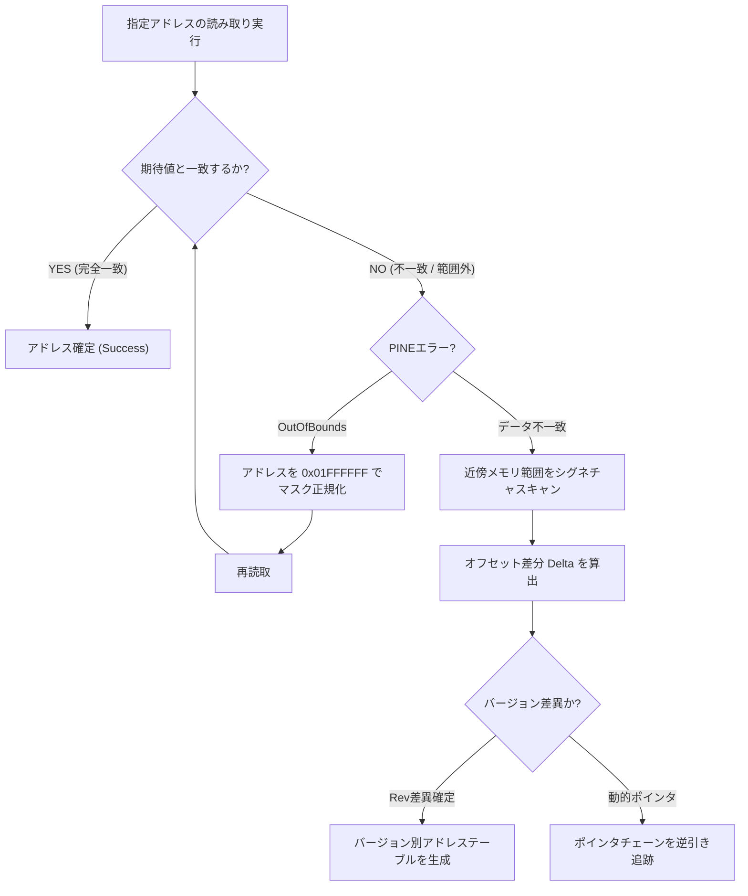

# PINEによるトルネコ3メモリアドレス対応検証計画書 (PINE_ADDRESS_VALIDATION.md)

## 概要
本計画書は、旧版「トルネコいじり」（`start.hsp`）の解析結果（`CORE_ENGINE_ANALYSIS.md`）に基づき、最新版PCSX2（v1.7 / v2.0+）に標準搭載されている公式IPCインターフェース **PINE (PCSX2 Inter-Process Network Engine / PCSX2 IPC)** を通じて、各種ゲームデータアドレスを正確に読み取れるかを検証するためのテスト計画です。

> [!IMPORTANT]
> **検証の基本姿勢**:
> 旧版コードで用いられていたPS2側のアドレスと、PINEが要求するアドレス仕様が「完全に一致する」と最初から決めつけず、メモリセグメントの違い、ビットマスク、バージョン差異（無印版 vs 廉価版）、アライメント制限などの不一致要因を想定した段階的検証を実施します。
> 現時点では実際の読み取りテストは未実施であるため、すべての項目は **「未検証」** として扱います。

---

## 1. PS2メモリ空間とホスト仮想アドレスの厳密な定義

アドレスの混同を防ぐため、本計画書ではメモリ空間を以下の4つのレイヤーに厳格に区別します。

```
+-------------------------------------------------------------------------+
| [レイヤー4] 旧PCSX2 32bit ホスト仮想アドレス                            |
|  - 旧版の var_134, var_136 など。                                       |
|  - 32bit Windows上の PCSX2 プロセス空間内アドレス (例: 0x20XXXXXX)。     |
|  - ASLRや起動毎に変動し、最新64bit PCSX2では完全に破綻。                 |
+-------------------------------------------------------------------------+
                                    ▲ (旧版は VirtualQueryEx + bsearch でマッピング)
                                    │
+-------------------------------------------------------------------------+
| [レイヤー3] PS2 キャッシュ無効仮想アドレス (KUSEG uncheck / KSEG1)      |
|  - アドレス例: 0x20180000, 0x205DBCA8, 0x20139D00                       |
|  - 最上位ビット29 (0x20000000) が立った状態。                           |
|  - PS2のEmotion Engine (MIPS R5900) でキャッシュをバイパスする仮想空間。 |
+-------------------------------------------------------------------------+
                                    ▲
                                    │ (0x20000000 のビット反転/マスク)
+-------------------------------------------------------------------------+
| [レイヤー2] PS2 キャッシュ済み仮想アドレス (KUSEG direct)               |
|  - アドレス例: 0x00180000, 0x00148EBC, 0x00199EC6                       |
|  - MIPS KUSEG (0x00000000〜0x01FFFFFF) 内の標準マッピング。             |
|  - 通常のプログラムコード (ELF) や静的データが配置される。              |
+-------------------------------------------------------------------------+
                                    │ (PS2内部では 1:1 ダイレクトマッピング)
                                    ▼
+-------------------------------------------------------------------------+
| [レイヤー1] PS2 物理アドレス (EE RAM Physical Address)                  |
|  - 物理容量: 32MB (0x00000000 〜 0x01FFFFFF)。                          |
|  - PINEの内部実装で配列インデックス `EEMainMemory[addr & 0x01FFFFFF]`   |
|    として参照される可能性が極めて高い本来のアドレス空間。                |
+-------------------------------------------------------------------------+
```

---

## 2. PINEで読み取るべきアドレス候補一覧

解析によって判明したPS2側の各データについて、PINEに渡すべき候補アドレスをカテゴリ別に整理します。

| データ項目 | 旧版コードの記述 | PS2物理アドレス候補 (0x00xxxxxx) | PS2仮想アドレス候補 (0x20xxxxxx) | データ型 / サイズ | 検証状況 |
|---|---|---|---|---|---|
| **静的ポインタテーブル** | `var_134` (基準点) | `0x00180000` | `0x20180000` | uint32_t[5] (20B) | **未検証** |
| **ダンジョンマスター先頭** | `0x00148EBC` (`var_329`) | `0x00148EBC` | `0x20148EBC` | uint16_t (2B) | **未検証** |
| **ダンジョンマスター配列** | `var_148` (間接参照) | `var_148` の読取値 | `var_148` の読取値 | uint16_t[32] (64B) | **未検証** |
| **モンスター出現テーブル (0番)** | `0x00199EC6` (`var_314`) | `0x00199EC6` | `0x20199EC6` | 構造体配列 (48B) | **未検証** |
| **モンスターステータス先頭** | `var_149` (間接参照) | `var_149` の読取値 | `var_149` の読取値 | 構造体 (24B/体) | **未検証** |
| **モンスター種族名テーブル先頭** | `538156288` (L1749) | `0x00139D00` | `0x20139D00` | 文字列 (Shift-JIS) | **未検証** |
| **固定部屋/フロアワーク先頭** | `543012008` (L1658) | `0x005DBCA8` | `0x205DBCA8` | uint16_t (2B) | **未検証** |
| **敵も罠にかかるパッチ** | `var_134 + 1371800` | `0x002CED78` | `0x202CED78` | uint32_t (4B) | **未検証** |
| **道具識別率テーブル** | `var_136 + 87592` | `"item_equipoff" + 87592` | `"item_equipoff" + 87592` | uint16_t[15][32] | **未検証** |
| **風までのターン数** | `var_136 + 89224` | `"item_equipoff" + 89224` | `"item_equipoff" + 89224` | uint16_t[32] (64B) | **未検証** |
| **テンポ改善 (Rev0/無印)** | `var_136 + 2722880`等 | `"item_equipoff" + Offset` | `"item_equipoff" + Offset` | 各 uint8_t | **未検証** |
| **テンポ改善 (Rev1/廉価)** | `550005776` 等 (L1694) | `0x00C87410` | `0x20C87410` | 各 uint8_t | **未検証** |

---

## 3. 指定5大アドレスの詳細対照分析

ユーザーから指定された重要5アドレスについて、旧版での意味、PINE候補アドレス、予想理由、読み取れなかった場合の原因候補を厳密に整理します。

---

### (1) `0x20180000` (10進数: 538443776)

#### A. 旧版の計算式での意味
- **確定事実 (L1577, L1619-1635, L1658)**:
  - 旧版がマシン語 `bsearch` で探索したシグネチャ `20 00 18 00 A0 00 18 00 ...` の配置アドレス。
  - 発見されたホストアドレスが `var_134` に格納され、コード全体で `+ var_134 - 538443776` としてベース補正に使われる基準点。
  - ここから 4バイトごとに主要データへのポインタ（`var_144`, `var_146`, `var_147`, `var_148`, `var_149`）を読み出している。

#### B. PINEに渡すべき候補アドレス
- **第1候補 (物理 / キャッシュ有効)**: `0x00180000` (最上位ビットをマスクした物理アドレス)
- **第2候補 (キャッシュ無効仮想)**: `0x20180000` (旧版の定数そのまま)

#### C. PINEで読み取れると予想する理由
- ゲームの静的データセクション（ポインタ配列テーブル）であり、ゲーム起動中常に固定位置に存在する。
- 先頭の4バイト値が `0x00180020`、次の4バイトが `0x001800A0` となるはずであり、バイト列による成否判定が容易。

#### D. 読み取れなかった場合の原因候補
1. **PINEのマスク仕様**: PINEが `0x20000000` 以上の仮想アドレスをアドレス境界外（Out of bounds）としてエラーにする場合（`0x00180000` に正規化する必要がある）。
2. **ゲームバージョン差異**: PS2トルネコ3には無印版（SLPM-65115, 初期版/Rev1版）と廉価版（PlayStation 2 the Best / SLPM-65775）が存在し、ELFのビルドバージョンによってポインタテーブルのアドレスがずれている可能性。
3. **ゲーム起動直後**: タイトル画面やローディング中で、まだ該当データセクションがメモリに展開されていない可能性。

#### E. 検証状況
- **未検証**

---

### (2) `0x00148EBC`

#### A. 旧版の計算式での意味
- **確定事実 (L7504, L7512, L3665-3667)**:
  - ダンジョンマスター定義文字列（`var_329`）の1行目「なぞの洞穴」に対応してハードコードされたオフセット文字列（`148EBC`）。
  - 各ダンジョンごとに 2バイトずつ進む（`148EBE`, `148EC0` ... 全32ダンジョン）。
  - ただし、L7512において `strf("%X", var_148 + cnt * 2)` で上書きされる処理が存在する。

#### B. PINEに渡すべき候補アドレス
- **第1候補 (直接物理アドレス)**: `0x00148EBC`
- **第2候補 (キャッシュ無効仮想)**: `0x20148EBC`
- **第3候補 (間接ポインタ参照)**: `0x0018000C`（ポインタテーブル `var_134 + 12`）から読み出した32bit値のアドレス

#### C. PINEで読み取れると予想する理由
- `0x00148EBC` はゲームプログラムの静的RODATA領域に属しており、ダンジョンごとのフロア数や設定構造体へのインデックスが格納されていると考えられる。

#### D. 読み取れなかった場合の原因候補
1. **旧版の記述揺れ (ハードコード vs ポインタ参照)**:
   L7504に書かれた `148EBC` は作者の初期解析メモに過ぎず、実行時には L7512 の `var_148 + cnt * 2`（ポインタテーブル経由）で動的に得た値が本来の真のアドレスである可能性が高い。
2. **2バイト読み取りとアライメント**:
   2バイト整数（`Read16`）として正しく読めるか、エンディアンの違いで意図しない値になる可能性。

#### E. 検証状況
- **未検証**

---

### (3) `0x00199EC6`

#### A. 旧版の計算式での意味
- **確定事実 (L7627, L4217-4238)**:
  - 全フロアモンスター出現テーブル定義（`var_314`）の0行目 `0@@@199EC6@@@48`。
  - なぞの洞穴1F（または特定フロア）に出現するモンスターテーブル（48バイト = 8体 × 6バイト）の先頭アドレス。
  - 1体あたり: 種族ID (2B) + 出現率CDF (2B) + 初期Lv (2B)。

#### B. PINEに渡すべき候補アドレス
- **第1候補 (直接物理アドレス)**: `0x00199EC6`
- **第2候補 (キャッシュ無効仮想)**: `0x20199EC6`

#### C. PINEで読み取れると予想する理由
- 全876フロア分のモンスター出現テーブルがすべて `var_314` にハードコードされており、ROMからRAMの固定領域に展開されるテーブル群であるため。

#### D. 読み取れなかった場合の原因候補
1. **非4バイトアライメント問題**:
   アドレス `0x00199EC6` は 2バイトアライメント（偶数）ですが、4バイトアライメント（4の倍数）ではありません。PINEまたはエミュレータ内部で `Read32` を実行した場合にアライメント例外や下位ビット切り捨てが発生するリスク。必ず `Read16` で検証する必要がある。
2. **テーブルサイズのオーバーラン**:
   48バイト（8体分）の範囲外を読み取ると次フロアのテーブルに侵入するため、構造境界の厳密な確認が必要。

#### E. 検証状況
- **未検証**

---

### (4) `0x205DBCA8` (10進数: 543012008)

#### A. 旧版の計算式での意味
- **確定事実 (L1658, L1658-1670, L4425-4450)**:
  - `var_172 = 543012008 - 538443776 + var_134`。
  - 基準点 `0x20180000` からの相対オフセットは `+0x0045BCA8`。
  - 固定部屋エディタ（screen 1）およびフロアパラメータ編集時に読み書きされるワーク領域のアドレス。

#### B. PINEに渡すべき候補アドレス
- **第1候補 (物理アドレス)**: `0x005DBCA8` (最上位ビットマスク: `543012008 & 0x01FFFFFF`)
- **第2候補 (仮想アドレスそのまま)**: `0x205DBCA8`

#### C. PINEで読み取れると予想する理由
- PS2のメインRAM（32MB）の 5.8MB 付近に位置し、ゲーム実行中のワークエリア（BSS領域またはヒープ領域）としてアロケートされている。

#### D. 読み取れなかった場合の原因候補
1. **動的配置（ヒープ）の可能性**:
   固定部屋やフロアデータが、ダンジョン進入時に `malloc` 等で動的に確保されている場合、固定アドレス `0x005DBCA8` には常時有効なデータが存在しない可能性がある。
2. **シーン依存**:
   タイトル画面や村の中ではゼロクリアされており、ダンジョン生成中・探索中のみデータが書き込まれる可能性がある。

#### E. 検証状況
- **未検証**

---

### (5) `0x20139D00` (10進数: 538156288)

#### A. 旧版の計算式での意味
- **確定事実 (L1749-1750, L7526-7527, L4541-4560)**:
  - `var_254 = 538156288 - 538443776 + var_134`。
  - 基準点 `0x20180000` からの相対オフセットは `-0x00046300`。
  - モンスター種族名テキスト（文字列配列）が格納されているメモリ領域の先頭（サイズ6528バイト）。
  - 例: 「リビングデッド」=`20139D07`、「ロサ」=`20139D28`、「ベリアル」=`20139D67`。

#### B. PINEに渡すべき候補アドレス
- **第1候補 (物理アドレス)**: `0x00139D00` (リビングデッドなら `0x00139D07`)
- **第2候補 (仮想アドレスそのまま)**: `0x20139D00` (リビングデッドなら `0x20139D07`)

#### C. PINEで読み取れると予想する理由
- 文字列データ（Shift-JIS）が格納されているため、数値を読むのと異なり、人間が読める日本語文字列（「リビングデッド」など）が返ってくるかどうかで、アドレスが合っているかを 100% 確実に断定できる。最も検証の成否が分かりやすいアンカー領域。

#### D. 読み取れなかった場合の原因候補
1. **文字列エンコーディングの不一致**:
   Shift-JISではなく特殊なゲーム内文字コードやUTF-8で格納されている場合（旧版コード L4551-4559 ではバイト配列をそのまま取得して表示しているため、Shift-JISの可能性が極めて高い）。
2. **バージョンによる文字列オフセットのシフト**:
   ゲームバージョンの違いにより、テキストデータ全体の開始位置が数バイト〜数十バイトずれている可能性。

#### E. 検証状況
- **未検証**

---

## 4. 段階的検証手順 (Step-by-Step Validation Procedure)

安全かつ論理的にアドレスを特定するため、以下の5段階で検証スクリプト/ツールを実行します。

```
[Phase 1] PINE通信の疎通確認 & ゲーム基本情報の取得
    │
    ▼
[Phase 2] アンカー検証: モンスター種族名文字列の照合 (0x00139D00)
    │     ★ 文字列が一致すれば、物理アドレス系 (0x00xxxxxx) が確定
    ▼
[Phase 3] ポインタテーブルの検証 (0x00180000 vs 0x20180000)
    │     ★ シグネチャ一致 & PINEのアドレスマスク仕様を確定
    ▼
[Phase 4] 多段ポインタとモンスター出現テーブルの検証 (0x00148EBC, 0x00199EC6)
    │     ★ 2バイトアライメントと間接参照の挙動を確定
    ▼
[Phase 5] インゲーム動的ワーク変数の検証 (0x005DBCA8)
          ★ シーン遷移 (タイトル → 村 → ダンジョン) に伴う値の変化を追跡
```

---

### Step 1: PINE接続確立とエミュレータ/ゲーム状態の確認
1. PCSX2を起動し、トルネコ3のディスク（またはISO）を実行。
2. PCSX2の設定でIPC（PINE）が有効になっていることを確認。
3. 検証スクリプトから PINE ソケット（または共有メモリスロット）へ接続。
4. PINEコマンドで以下を取得・記録する:
   - `Version()`: PINEのバージョン
   - `GetGameTitle()`: ゲームタイトル
   - `GetGameUUID()` / `GetGameCRC()`: ディスクCRC（SLPM-65115 初期版か廉価版かの判定）

---

### Step 2: アンカー検証 — モンスター種族名文字列 (`0x00139D00`)
最も判定が容易な文字列領域を用いて、PINEのアドレス受付仕様をテストします。

1. **物理アドレス `0x00139D07`** から 14バイトを読み取る。
   - 期待結果: Shift-JISで `"リビングデッド"`（バイト列: `83 8A 83 72 83 93 83 4F 83 66 83 62 83 68`）が返る。
2. **仮想アドレス `0x20139D07`** から 14バイトを読み取る。
   - 期待結果:
     - パターンA: 物理アドレスと同じ `"リビングデッド"` が返る（PINEが内部で `& 0x01FFFFFF` している）。
     - パターンB: エラー（OutOfBounds）が返る（PINEは物理アドレス `0x00xxxxxx` のみを受け付ける仕様）。
3. **判定**:
   - 文字列が一致したアドレス形式（`0x00xxxxxx` か `0x20xxxxxx` か）を、以降の全検証の標準アドレス形式として採用する。
   - もし文字列が一致しない場合、近傍 `±4KB` をスキャンして `"リビングデッド"` を検索し、バージョンによるオフセット差分を算出する。

---

### Step 3: 静的ポインタテーブルの検証 (`0x00180000`)
旧版の最重要基準点 `var_134` を検証します。

1. Step 2 で判明したアドレス形式に基づき、`0x00180000`（または `0x20180000`）から 16バイト（uint32_t × 4）を読み取る。
2. 期待される値:
   - `offset + 0x00`: `0x00180020`
   - `offset + 0x04`: `0x001800A0`
   - `offset + 0x08`: `0x00180120`
   - `offset + 0x0C`: `0x001810C0`
3. 判定:
   - 期待通りの値が読めた場合、`var_134` に対応するベースアドレスが完全に実証される。
   - `offset + 0x0C` の値（`var_148` 相当）を記録し、Step 4 のダンジョンテーブル検証に引き継ぐ。

---

### Step 4: ダンジョンマスター & モンスター出現テーブルの検証
1. **ダンジョンマスター (`0x00148EBC`)**:
   - `0x00148EBC` から 2バイト（`Read16`）を読み取る。
   - また、Step 3 で取得した `var_148` のポインタ先からも 2バイトを読み取る。
   - 両者を比較し、旧版のハードコード値とポインタ参照値のどちらが真であるかを確定する。
2. **モンスター出現テーブル (`0x00199EC6`)**:
   - `0x00199EC6` から 6バイト（uint16_t × 3）を `Read16` で順次読み取る。
   - 期待される構造:
     - `monster_id`: 0〜196（モンスター種族ID）
     - `cdf_rate`: 0〜999（累積出現率）
     - `init_level`: 1〜99（初期レベル）
   - 値がモンスターマスター（スモールグール等）の有効範囲に収まっているか検証。

---

### Step 5: 動的ワーク変数の検証 (`0x005DBCA8`)
1. タイトル画面で `0x005DBCA8` から 2バイトを読み取る。
2. セーブデータをロードし、村の中にいる状態で同じアドレスを読み取る。
3. ダンジョン（なぞの洞穴等）に進入した状態で同じアドレスを読み取る。
4. **判定**:
   - シーンごとに値がどのように変化するかを記録し、常駐変数なのかダンジョン限定の揮発性ワーク領域なのかを特定する。

---

## 5. アドレス不一致時のフォールバック戦略

もし検証時に指定アドレスから期待したデータが読み取れなかった場合、以下のアルゴリズムで自動補正を行います。



1. **ビットマスク補正**:
   `0x20XXXXXX` でエラーになった場合、自動的に `& 0x01FFFFFF` を適用して `0x00XXXXXX` を再試行。
2. **アンカー文字列スキャンによるオフセット差分算出**:
   `"リビングデッド"` や `"item_equipoff"` が指定位置からずれていた場合、そのズレ幅 $\Delta = \text{Actual} - \text{Expected}$ を計算し、全アドレスに一括適用して再検証。
3. **ゲームバージョン判定テーブルの自動構築**:
   無印版（SLPM-65115）と廉価版（SLPM-65775）で配置が異なることが判明した場合、CRC判定により自動でアドレスセットを切り替える構成とする。

---
**本計画書に記載された検証項目はすべて現時点で「未検証」であり、後続の検証フェーズにおいて実際の読み取り結果を記録・更新します。**
